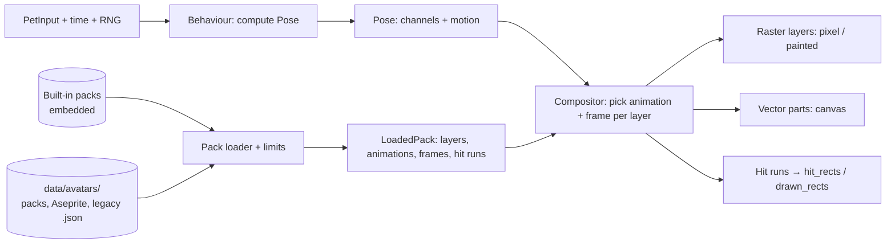

# Layered sprite and vector pets

## Goal & Context

The pet is drawn by code today: each frame, the sprite crate paints ellipse-blob bodies and hard-coded limb, eye, prop and effect cell tables into three 26×24 layers. Only the silhouette and palette can be customised, so new pets need code, and the drawing is pinned to the C# original by golden tests.

This spec replaces that drawing with **layered sprite packs**. A pet is a set of layers (body, eyes, arms, feet, props, headphones, effects, glow), each holding named animations. One behaviour layer (today's state machine) decides, every tick, what each layer shows. That keeps eye-follow, random idle acts, blinking, headphones, props and effects for every pet. Three kinds of pack share that model:

- **pixel**: pixel-art sheets, crisp at any scale;
- **painted**: smooth high-resolution PNG sheets;
- **vector**: parts drawn from path data, animated by parameters.

The procedural renderer is removed. Sprout and Hood are baked from it once into layered pixel packs, so they look and behave the same on day one. Three new pets ship with the app: a vector Pip (from the user's pocket-sprout.html design), a painted Pip rendered from the vector one, and a pixel Hamster drawn from the user's reference image. The green Hood and the Hamster each ship in both styles: as layered pixel packs (the green Hood baked like Sprout and Hood; the Hamster drawn from its reference) and as vector packs converted from the user-approved designs in `avatars/reference/`. Users make their own pets as packs, including from Aseprite exports. Old ellipse `.json` avatars keep loading.

Users and pack authors are affected (a new authoring guide), plus developers (the sprite crate's model changes).

This work starts after spec fn-1-migrate-aipet-from-net-to-rust completes. Its cutover removes the C# that generated the sprite goldens, its docs rewrite owns the same docs, and its performance and memory baselines are the budgets here.

## Architecture & Data Models



- **Behaviour** keeps today's state machine (states idle, sleep, thinking, working, attention, done, listen; idle acts; hover, wave, poke, land, run, held, blink overrides; facing; continuous motion: offset, squash, stretch, breathe, shadow) but outputs a **Pose** rather than pixels. A Pose is a set of named channels:
  - `state`: the mood, including the idle act when one is playing;
  - `eyes`: an expression (open, closed, happy, squint, wide, up) plus a look direction (one of 9, centre included) with hysteresis;
  - `arms` and `feet`: named poses;
  - `prop`: none, laptop or lens;
  - `headphones`: on or off;
  - `fx`: none, zs, dots, notes, alert, sparkles or dust;
  - `facing`: left or right;
  - the time each channel last changed;
  - `motion`.

  Randomness stays behind the injectable RNG.
- **Pack**: a manifest plus art.
  - Layers are drawn in manifest order. Each layer is bound to one Pose channel and holds animations keyed by that channel's values.
  - An animation is a list of frames, each with a duration in milliseconds, plus a loop mode: `loop`, `once` (hold the last frame) or `pingpong`.
  - A missing key walks a fallback chain declared in the manifest, ending at the layer's `default`. A layer may also be empty for a value; for example, no headphones layer means no headphones.
  - Each layer is flagged as part of the hit mask or not.
  - The pack declares its kind, the art's pixel size in logical px, its anchor (the point that sits on the ground shadow), its mirror policy (`flip` or `none`) and its accent and glow colours.
- **Compositor**: for each layer, pick the animation from the Pose channel and the frame from the time since that channel last changed. Mirror the result when facing left and the pack allows it.
- **Rendering**:
  - pixel and painted layers are images built once per frame at load and reused;
  - vector parts are drawn with iced's canvas from a cached geometry that is rebuilt only when the Pose changes.
- **Hit mask**: the alpha of the hit-flagged layers becomes row runs, worked out per frame at load (raster) or per Pose change (vector), then merged into rectangles.
- **Identity**: an avatar is still found by its name string in config.json.

## API Contracts

**Pack folder** (`<data dir>/avatars/<folder>/`, or embedded):

```json
{
  "format_version": 1,
  "name": "Hamster",
  "kind": "pixel",
  "pixel_size": 3.75,
  "anchor": [16, 31],
  "mirror": "flip",
  "accent": "#F4A340",
  "glow": "#FFE08A",
  "layers": [
    {
      "name": "body",
      "channel": "state",
      "hit": true,
      "default": "idle",
      "fallback": { "listen": "idle", "done": "idle" },
      "animations": {
        "idle": { "sheet": "body.png", "frames": [[0, 0, 32, 32, 160], [32, 0, 32, 32, 160]], "loop": "loop" }
      }
    }
  ]
}
```

A frame is `[x, y, w, h, duration_ms]` within its sheet. Painted packs may give `"sheet@2x"` beside `"sheet"`. Vector packs replace `sheet` and `frames` with `parts`: path data in SVG `d` syntax, a fill, an optional stroke, and parameter bindings (translate, scale and rotate by a Pose channel value or by `motion`). Unknown manifest keys are ignored. `format_version` greater than the build supports means the pack is skipped.

**Aseprite**: a folder holding an Aseprite `json-array` export with its PNG is a pack.
- Tags `<layer>:<key>`, such as `eyes:look-left`, become animations.
- Tag `direction` and the string `repeat` map to the loop modes.
- Frame `duration` is used as given.
- A slice named `anchor` sets the anchor through its pivot.
- An optional `pack.json` beside the export supplies the remaining manifest fields.

**Native Aseprite files** (R20): a pack may also contain the `.aseprite` file itself instead of an export. The loader reads its frames, layers, tags, durations and slices directly, by the same mapping as the export. An Aseprite layer named after a pack layer (`body`, `eyes`, `arms`, …) becomes that layer's art, and slices named after parts give their origins. `pack.json` supplies the rest. Only RGBA and indexed colour modes are accepted, the same size and frame limits apply, and linked or external files (tilesets from other files) are rejected.

**Grid sprite sheets** (R20): instead of a rectangle per frame, an animation may name a grid on its sheet and list frame indices:

```json
"idle": { "sheet": "body.png", "grid": { "frame": [32, 32], "origin": [0, 0], "gap": [0, 0], "columns": 8 },
          "frames": [0, 1, 2, 1], "ms": 160, "loop": "loop" }
```

Frame `i` is the cell at column `i % columns`, row `i / columns`. `ms` is either one duration for every frame or a list, one per frame. A sheet can mix grid animations and explicit `[x, y, w, h, ms]` frames. A cell outside the sheet, a non-positive frame size or a mismatched `ms` list skips the pack with a reason.

**Rive packs** (R21): `kind: "rive"`. The pack folder holds one `.riv` file and a manifest that names the artboard and state machine, and maps Pose channels onto that state machine's inputs:

```json
{ "format_version": 1, "name": "Ghosty", "kind": "rive", "anchor": [65, 118.5], "mirror": "flip",
  "rive": { "file": "ghosty.riv", "artboard": "Pet", "state_machine": "Main",
            "inputs": {
              "mood":     { "number": "state",  "values": { "idle": 0, "sleep": 1, "thinking": 2, "working": 3,
                                                          "attention": 4, "done": 5, "listen": 6 } },
              "lookX":    { "number": "look.x" }, "lookY": { "number": "look.y" },
              "blink":    { "trigger": "eyes", "on": "closed" },
              "happy":    { "bool": "eyes", "when": ["happy"] },
              "typing":   { "bool": "arms", "when": ["type"] },
              "laptop":   { "bool": "prop", "when": ["laptop"] },
              "music":    { "bool": "headphones", "when": ["on"] },
              "poke":     { "trigger": "poke" } } } }
```

- **Input kinds**: a `number` input takes a channel value through its `values` map, or a continuous source: `look.x` and `look.y` run from −1 to 1. A `bool` input is true while the channel is one of `when`. A `trigger` fires when the channel enters `on`, or on the event named (`poke`, `land`, `wave`, `alert`).
- **Missing inputs**: inputs the file doesn't have are reported by `--check-pack` and ignored, and channels the manifest doesn't map have no effect.
- **The Rive state machine** owns the animation, blending and timing inside the pet. The app owns behaviour, whole-body motion, mirroring (unless `mirror` is `none`), the ground shadow and click-through.
- **Rendering**: the runtime advances by the elapsed time each tick and draws into a CPU RGBA image at the pet's device size. When it reports nothing animating and no input changed, nothing is drawn or uploaded. The image's alpha gives the hit mask, as for raster frames.
- **Load safety**:
  - only embedded assets (no referenced images or fonts), no Rive scripting, no data binding or view models;
  - at most 4 MB per file;
  - a `.riv` is first parsed by `AiPet --check-pack` in a child process with a time limit, and loaded in-process only if that succeeded, so a malformed file can't crash the pet.

**Check**: `AiPet --check-pack <folder>` prints `OK <name> (<kind>, <layers> layers, <frames> frames)` and exits 0, or prints one line per problem and exits 1. It never starts the pet and never writes anything.

**Config**: `Avatar` stays the avatar's name. An unknown name shows the first avatar, and config isn't rewritten on load. A rollback to an older build behaves the same way, falling back to the first avatar.

**Part motion** (R18): how a pack says where its movable parts go and how they move. It applies to every kind; raster frames and vector shapes differ only in what a part draws.

```json
{ "name": "eyes", "channel": "eyes", "hit": true,
  "parts": [ { "id": "eye-left", "origin": [55.5, 63.5] }, { "id": "eye-right", "origin": [74.5, 63.5] } ],
  "shapes": { "open": { "d": "…", "fill": "#5CFF9C" }, "closed": { "d": "…", "fill": "#5CFF9C" } },
  "look": { "center": [0, 0], "up": [0, -2.5], "up-right": [2.5, -2] },
  "default": "open" }

{ "name": "arms", "channel": "arms", "hit": true,
  "parts": [ { "id": "hand-left", "origin": [35, 101], "shape": "hand" },
             { "id": "hand-right", "origin": [95, 101], "shape": "hand" } ],
  "shapes": { "hand": { "d": "…", "fill": "#0F4422" } },
  "poses": { "rest": { "hand-left": [35, 101], "hand-right": [95, 101] },
             "wave": { "hand-right": [116, 71.5] } },
  "transition_ms": 160,
  "animations": { "type": { "part": "hand-left", "loop": "loop",
                            "keys": [ [0, 0, 90], [-1, 1.5, 90], [0, 0, 520] ] } },
  "default": "rest" }
```

- **Parts**: a layer's movable pieces. Each has an `id` that is unique in the pack and an `origin` in art-box coordinates (logical px, the 130×120 box). A part draws around its origin: vector shapes in their own coordinates centred on (0,0), and raster frames placed by a per-frame `pivot` (the frame pixel that sits on the origin).
- **Shapes or frames per value**: the layer's channel value (an expression such as `wide`, or a pose such as `type`) selects which shape or frame each part draws, through the layer's fallback chain. Expressions are separate drawings, never scaled copies.
- **`look`**: the eyes channel's direction (one of 9) adds an offset to the origins of the eye parts. A missing table means the eyes don't follow the pointer; missing directions fall back to the nearest one given, then to `center`. Raster offsets are whole art pixels.
- **`poses`**: each value of the layer's channel gives some or all parts a target position; parts not listed keep their `origin`. On a value change, each part moves from its current position to its target over `transition_ms`, eased (0 means it jumps).
- **`animations`**: keyframes on top of the pose position. `keys` are `[dx, dy, ms]` or objects with optional `dx`, `dy`, `rotate`, `scale` and `opacity`, plus `ms`. Loop modes are those of frames. An optional `phase` (0–1, one per part) offsets a shared loop per part, so two hands can bob out of step. A vector part may also rotate about its origin, which is how the Hamster's arms swing from the shoulder.
- **Order**: final placement = pose target (interpolated) + animation offset + look offset (eyes only). Then comes whole-body motion (breathing, squash, drag offset), then mirroring. Parts therefore ride with the body.
- **Validation**: everything is checked at load, like the rest of the manifest:
  - finite numbers only;
  - positions and offsets within the art box plus its halo pad;
  - at most 64 keys per animation;
  - `transition_ms` and key durations from 0 (transition only) or 1 to 10 000 ms;
  - unknown part ids, an unknown pose value or a duplicate id skip the pack with a reason.

## Edge Cases & Constraints

- **Untrusted packs**: a pack loads completely or not at all. These limits apply:
  - manifest ≤ 256 KB, JSON depth ≤ 64;
  - each PNG ≤ 8 MB, each side ≤ 2048 px, checked from the header before decoding;
  - ≤ 64 MB decoded per pack, ≤ 16 layers, ≤ 512 frames, ≤ 256 vector parts;
  - durations from 1 ms to 60 s, coordinates finite and within ±10 000;
  - fallback chains have no cycles and at most 8 steps.

  Paths must be relative and stay inside the pack folder after canonicalising. Absolute paths, `..`, symlinks, junctions, reparse points and device names are rejected. Vector path data never loads external resources (no SVG files are parsed).
- **Art box**: all art fits today's sprite box (130×120 logical px) plus its halo pad, so the window, the surface and every shell's region code keep their sizes. A pack whose art is larger is skipped.
- **Pixel crispness**: pixel packs use nearest filtering, and their on-screen position and pixel size are snapped to whole device pixels at every scale (100 %, 125 %, 150 %, 200 %), including after a scale change mid-run. Painted packs use linear filtering, and pick `@2x` above 1.5× scale when given.
- **Hit mask**: the hit runs are merged into at most 64 rectangles, with a minimum cell of 2 logical px, coarsened further when needed. An empty mask falls back to today's hit ellipse. The drawn region stays the halo box plus the shadow, so soft edges are never clipped on Windows.
- **Timing**: a frame is chosen from elapsed time, independent of the tick rate. The tick runs at the smooth rate while an animation on screen has a frame shorter than the calm interval, and at the calm rate otherwise. It never exceeds 60 fps.
- **Reload while worn**: Reload keeps the pet on the pack's previously loaded frames when the folder is gone or now fails to load, as the Avatars page does today. A half-written export (JSON newer than its PNG) fails as a whole and is retried on the next Reload.
- **Names**: built-ins win name collisions. Packs and legacy files are taken in sorted folder or file order, and a later duplicate is skipped with its reason shown.
- **Performance**: calm CPU and RSS stay within fn-1's R18 budgets for every shipped pet, measured with fn-1's performance script. Embedded art adds ≤ 3 MB to the binary.
- **Reduced motion**: when the system asks for reduced motion, the pet shows each animation's first frame with no bob, squash or idle acts. Changes of state and expression still show. `AIPET_REDUCE_MOTION=1` forces this on for testing.

## Acceptance Criteria

- **R1:** One behaviour layer computes a Pose (the channels and motion above) from PetInput, time and the injected RNG. Every pack kind is rendered from that Pose alone, and no per-frame procedural drawing of the pet remains in the code. Errors: a Pose value a pack lacks resolves through the fallback chain to the layer's default. A layer with nothing for a value draws nothing.
- **R2:** Packs follow the manifest contract above (format version, kind, pixel size, anchor, mirror policy, colours, ordered layers bound to channels, animations with per-frame durations and loop modes, fallbacks, hit flags). Errors: a missing `idle`/default, an unknown channel, an unknown loop mode, a fallback cycle, a too-new `format_version` and an out-of-range number each skip the pack with a stated reason.
- **R3:** Sprout and Hood ship as baked layered pixel packs embedded in the binary. Composited, they reproduce the frozen golden frames for every golden case within the stated tolerance: identical except at layer-overlap outline cells, at most 2 % of a frame's pixels. They keep eye-follow, idle acts, blinking, headphones, props and effects. Errors: no error surface beyond the R1 fallbacks.
- **R4:** Packs in `<data dir>/avatars/` are discovered, loaded all-or-nothing within the limits above, contained to their folder, and resolved by name with built-ins first, then sorted order. Errors: each limit, an escaping path, a symlink or junction, a bad image, a missing file and a duplicate name skips that pack, records one reason line, and never crashes or blocks startup.
- **R5:** An Aseprite `json-array` export with its PNG (plus optional `pack.json`) loads as a pack, mapping tags, directions, `repeat` strings, durations and the `anchor` slice as specified. Errors: a `json-hash` export, untagged frames and a tag naming an unknown layer each give a stated reason. Trimmed frames keep their position through `spriteSourceSize`.
- **R6:** Legacy ellipse `.json` avatars keep loading. They are converted at load into a layered pixel pack: a body layer rasterised once from the ellipses, palette, shading and blush, plus Sprout's other layers recoloured with the file's palette. Errors: files the old loader rejected are still skipped. A converted avatar may differ from today's drawing only in the body's outline and shading.
- **R7:** Pixel and painted packs render with the filtering, snapping and `@2x` rules above, with every frame's image built once at load, so a tick that changes nothing uploads nothing. Errors: a scale change rebuilds only what depends on the scale.
- **R8:** Vector packs render their parts with parameter bindings through iced's canvas. Their geometry is rebuilt only when the Pose changes, and they never load external resources. Errors: malformed path data, a non-finite number and an unknown binding target skip the pack with a reason.
- **R9:** Click-through follows each displayed frame's hit-flagged alpha on Windows, X11, Wayland and macOS, through the merged-rectangle rules above. Errors: an empty mask falls back to the hit ellipse, and an over-fine mask is coarsened to the 64-rectangle cap.
- **R10:** The Settings → Avatars page lists every loaded pet of every kind with a still, keeps Pick, Reload and Open folder, and lists skipped packs with their reason. config.json keeps `Avatar` as a name and is written only on a real change. Errors: an unknown saved name shows the first avatar without rewriting config.
- **R11:** The app ships three new built-in pets: a vector Pip modelled on pocket-sprout.html, a painted Pip rendered from it at high resolution, and a pixel Hamster drawn from the user's reference image. Each has every state and the eye, arm, prop, headphone and effect layers. Errors: no error surface beyond R1's fallbacks.
- **R12:** `AiPet --check-pack <folder>` validates a pack with the same loader and limits, printing the result and exit code as specified. Errors: a missing folder, an unreadable file and every R2/R4/R5/R8 reason are printed one per line with exit 1.
- **R13:** When the system's reduced-motion setting is on (Windows, GNOME/KDE, macOS), or `AIPET_REDUCE_MOTION=1` is set, the pet behaves as described above. Errors: a platform whose setting can't be read counts as off.
- **R14:** Every shipped pet meets fn-1's R18 calm-CPU and RSS budgets on Windows and Linux, measured with fn-1's script, and embedded art adds ≤ 3 MB. Errors: no error surface beyond the measurement.
- **R15:** Docs describe the new model: an authoring guide (pack format, layers and channels, kinds, Aseprite, limits, the checker, legacy avatars), the architecture's pet section, the README's Avatars text and data folder, the Settings help text, the changelog, a sample pack in the repo's `avatars/`, and third-party notices for new crates. Errors: no error surface beyond accuracy.
- **R16:** Two more built-in vector pets ship: Hood (green) and Hamster, converted from the approved reference drawings `avatars/reference/hood-green.svg` and `avatars/reference/hamster.svg` (their generators and review pages beside them). The conversion keeps each drawing's parts, pivots and draw order; normalises coordinates into the pack's art box and anchor; leaves the ground shadow to the app; turns shapes into path data with explicit opacity, stroke widths, caps and joins; and maps preview-only states (the Hood's "glow off") onto real Pose values or drops them. Each has every state; parts a drawing lacks (headphones, effects, the magnifier) are added in its style. Errors: no error surface beyond R1's fallbacks and R8's load rules.
- **R17:** Hood (green) also ships as a built-in layered pixel pack, baked with Sprout and Hood from the green palette in `avatars/hood-green.json`, and so keeps every live behaviour. The legacy file itself still loads under R6. Errors: no error surface beyond R1's fallbacks.
- **R18:** Packs encode where their movable parts go and how they move, per the Part motion contract above: parts with ids and origins, shapes or frames per channel value (raster frames placed by a pivot), a `look` offset table for the eyes, `poses` with eased transitions, and keyframe `animations` (offsets, rotation, scale, opacity, with `phase` and the frame loop modes), applied in the stated order before whole-body motion and mirroring. The same encoding serves raster and vector packs, and an Aseprite export maps onto it (part slices give origins; per-frame slice keys give pose positions). Errors: a non-finite or out-of-box number, an unknown part id or pose value, a duplicate id, more than 64 keys or an out-of-range duration skip the pack with a reason. A missing `look` table or `poses` block is allowed: eyes stare ahead, and parts stay at their origins.
- **R21:** Rive packs (`kind: "rive"`) play a `.riv` file's state machine, driven by the manifest's mapping from Pose channels to inputs (numbers, booleans, triggers; `look.x`/`look.y` continuous), as in the API contracts above. They are rendered on the CPU into an RGBA image at the pet's device size, with no texture upload when nothing animates. They keep click-through from alpha, mirroring, whole-body motion and reduced motion, which holds the state machine's current frame and stops advancing. They load only after the child-process check succeeds. Errors: each of the following skips the pack with a reason, and never crashes the pet:
  - a file over 4 MB;
  - a missing or malformed `.riv`, or an unsupported Rive version;
  - an unknown artboard or state machine;
  - referenced (non-embedded) assets;
  - a check-process failure or timeout.

  An input the file lacks is reported by `--check-pack` and ignored.
- **R20:** Raster packs may contain pixel art straight from Aseprite: either the native `.aseprite` file, read directly, or its `json-array` export (R5). They may also use plain sprite sheets described as a grid (frame size, origin, gap, columns, frame indices, durations), as in the API contracts above. Both produce the same layers, animations, parts and pivots as explicit frames, so packs behave identically however their art is stored. Errors: an unsupported Aseprite colour mode, a linked or external file, a cell outside the sheet, a non-positive frame size and a mismatched duration list each skip the pack with a reason. Every size and frame limit applies to the decoded result.
- **R19:** An agent skill for making avatar packs lives in the repo, under `.claude/skills/` with a copy under `.agents/skills/` for Codex. With it, a new agent can design, build, check and review a pack without reading the Rust code. It covers:
  - the manifest and Part motion contract with complete examples;
  - the three kinds;
  - the generator workflow (`avatars/reference/*_gen.py`): parts, origins, poses, a review page with 130×120 boxes on three backgrounds, and a state sheet;
  - Aseprite export settings;
  - the limits;
  - `AiPet --check-pack`;
  - a Codex review step;
  - the owner's design conventions (cartoon style, thick outline, flat cel shading, canvas-ready shapes only).

  Errors: the skill's worked example must pass `--check-pack`; a skill whose example fails is incomplete.

## Early proof point

Task fn-2-layered-sprite-and-vector-pets.2 validates the core approach: Sprout and Hood baked into layers and composited back reproduce the frozen golden frames. If that fails, re-evaluate the layer split (for example, baking arms and feet into the body layer per pose) before continuing with fn-2-layered-sprite-and-vector-pets.3+.

Two spikes come before their implementations: task fn-2-layered-sprite-and-vector-pets.15 (Aseprite) before task 11, and task fn-2-layered-sprite-and-vector-pets.13 (Rive) before task 14. Both are throwaway code on `spike/` branches, keeping only their findings in `rust/proofs/`. The Rive spike is also a second proof point. If `rive-rs` doesn't build on all three platforms, or the CPU renderer misses fn-1's calm-CPU budget, Rive drops out of this spec (R21 is deferred with the measurements), and the other pack kinds are unaffected.

## Boundaries

- No change to the window, surface size, bubbles, menu or shells beyond the hit mask and frame pacing.
- No arbitrary SVG files, no zip packs, no pack downloads or marketplace.
- Rive: no data binding or view models, no referenced (out-of-band) assets, no Rive scripting, and no Rive GPU renderer. These are limits of the pinned runtime and the CPU renderer. No built-in Rive pets in this spec: Rive is for user packs, plus one sample. Native `.aseprite` files are allowed (R20), but no other editors' native formats.
- No user-editable effects outside packs: effects are pack layers.
- No macOS hands-on pass and no 150 % hands-on pass in this spec. Snapping is covered by tests.
- Old builds keep their own avatar handling. A rollback falls back to the first avatar.

## Decision Context

- Layered packs over whole-frame sheets: whole frames can't keep eye-follow, headphones and props without combinatorial sheets. Layers bound to Pose channels keep every live behaviour (user's choice).
- The procedural renderer is removed (user's choice). Baking it once preserves the built-ins, and the frozen goldens keep pinning the composited result.
- Packs draw their own effects (user's choice). The app draws only the ground shadow.
- Rive (R21, user's request) goes through the official `rive-rs` runtime, pinned by git revision, with our own CPU renderer (tiny-skia) behind its `Renderer` trait. Rejected: its vello backend, which is pinned to a wgpu far from iced's; vello 0.7 shared with iced's wgpu 27, which means porting a 2023 binding at high risk; and the C++ GPU renderer, which can't share iced's device. `rive-rs` is ~16 months stale and compiles C++; task 13 proves the build and the CPU cost before task 14 commits to it. Rive's free-tier exports reportedly carry a splash screen, so check how such files look before recommending the free tier to pack authors.
- Pixel art can come straight from Aseprite (native files or exports) or from plain grid sheets (R20, user's request), so artists aren't forced into one tool's export.
- Part positions and motion are data in the pack (R18), not code: new pets need no Rust changes, and the same encoding serves raster, vector and Aseprite packs.
- A pack-authoring skill (R19) records the workflow used for the green Hood and the Hamster, so new agents don't have to read the code.
- The green Hood and the Hamster ship in both pixel and vector styles (user's choice); the vector designs were iterated with the user and reviewed by Codex before planning their conversion.
- Vector pets are drawn with iced's canvas, which is already enabled: no texture upload per frame. iced's SVG widget would re-rasterise every animated frame.
- Art stays in today's sprite box, so no shell or geometry changes cascade.
- Legacy avatars are converted rather than kept on the old renderer, so the old renderer can go.

## Quick commands

```bash
cd rust && cargo test -p aipet-sprite && cargo test -p aipet-ui
cd rust && cargo run -p aipet -- --check-pack ../avatars/hamster
cd rust && cargo clippy --workspace --all-targets -- -D warnings && cargo fmt --all -- --check
```

## Requirement coverage

| Req | Description | Task(s) | Gap justification |
| --- | --- | --- | --- |
| R1 | One behaviour layer computes a Pose (the channels and motion above) from PetInput, time and the injected RNG. Every pack kind is rendered from that Pose alone, and no per-frame procedural drawing of the pet remains in the code. Errors: a Pose value a pack lacks resolves through the fallback chain to the layer's default. A layer with nothing for a value draws nothing. | fn-2-layered-sprite-and-vector-pets.1, fn-2-layered-sprite-and-vector-pets.2 | — |
| R2 | Packs follow the manifest contract above (format version, kind, pixel size, anchor, mirror policy, colours, ordered layers bound to channels, animations with per-frame durations and loop modes, fallbacks, hit flags). Errors: a missing `idle`/default, an unknown channel, an unknown loop mode, a fallback cycle, a too-new `format_version` and an out-of-range number each skip the pack with a stated reason. | fn-2-layered-sprite-and-vector-pets.1, fn-2-layered-sprite-and-vector-pets.3 | — |
| R3 | Sprout and Hood ship as baked layered pixel packs embedded in the binary. Composited, they reproduce the frozen golden frames for every golden case within the stated tolerance: identical except at layer-overlap outline cells, at most 2 % of a frame's pixels. They keep eye-follow, idle acts, blinking, headphones, props and effects. Errors: no error surface beyond the R1 fallbacks. | fn-2-layered-sprite-and-vector-pets.2, fn-2-layered-sprite-and-vector-pets.8 | — |
| R4 | Packs in `<data dir>/avatars/` are discovered, loaded all-or-nothing within the limits above, contained to their folder, and resolved by name with built-ins first, then sorted order. Errors: each limit, an escaping path, a symlink or junction, a bad image, a missing file and a duplicate name skips that pack, records one reason line, and never crashes or blocks startup. | fn-2-layered-sprite-and-vector-pets.3 | — |
| R5 | An Aseprite `json-array` export with its PNG (plus optional `pack.json`) loads as a pack, mapping tags, directions, `repeat` strings, durations and the `anchor` slice as specified. Errors: a `json-hash` export, untagged frames and a tag naming an unknown layer each give a stated reason. Trimmed frames keep their position through `spriteSourceSize`. | fn-2-layered-sprite-and-vector-pets.3 | — |
| R6 | Legacy ellipse `.json` avatars keep loading. They are converted at load into a layered pixel pack: a body layer rasterised once from the ellipses, palette, shading and blush, plus Sprout's other layers recoloured with the file's palette. Errors: files the old loader rejected are still skipped. A converted avatar may differ from today's drawing only in the body's outline and shading. | fn-2-layered-sprite-and-vector-pets.3 | — |
| R7 | Pixel and painted packs render with the filtering, snapping and `@2x` rules above, with every frame's image built once at load, so a tick that changes nothing uploads nothing. Errors: a scale change rebuilds only what depends on the scale. | fn-2-layered-sprite-and-vector-pets.4, fn-2-layered-sprite-and-vector-pets.8 | — |
| R8 | Vector packs render their parts with parameter bindings through iced's canvas. Their geometry is rebuilt only when the Pose changes, and they never load external resources. Errors: malformed path data, a non-finite number and an unknown binding target skip the pack with a reason. | fn-2-layered-sprite-and-vector-pets.5 | — |
| R9 | Click-through follows each displayed frame's hit-flagged alpha on Windows, X11, Wayland and macOS, through the merged-rectangle rules above. Errors: an empty mask falls back to the hit ellipse, and an over-fine mask is coarsened to the 64-rectangle cap. | fn-2-layered-sprite-and-vector-pets.4, fn-2-layered-sprite-and-vector-pets.8 | — |
| R10 | The Settings → Avatars page lists every loaded pet of every kind with a still, keeps Pick, Reload and Open folder, and lists skipped packs with their reason. config.json keeps `Avatar` as a name and is written only on a real change. Errors: an unknown saved name shows the first avatar without rewriting config. | fn-2-layered-sprite-and-vector-pets.4 | — |
| R11 | The app ships three new built-in pets: a vector Pip modelled on pocket-sprout.html, a painted Pip rendered from it at high resolution, and a pixel Hamster drawn from the user's reference image. Each has every state and the eye, arm, prop, headphone and effect layers. Errors: no error surface beyond R1's fallbacks. | fn-2-layered-sprite-and-vector-pets.5, fn-2-layered-sprite-and-vector-pets.6, fn-2-layered-sprite-and-vector-pets.8 | — |
| R12 | `AiPet --check-pack <folder>` validates a pack with the same loader and limits, printing the result and exit code as specified. Errors: a missing folder, an unreadable file and every R2/R4/R5/R8 reason are printed one per line with exit 1. | fn-2-layered-sprite-and-vector-pets.3 | — |
| R13 | When the system's reduced-motion setting is on (Windows, GNOME/KDE, macOS), or `AIPET_REDUCE_MOTION=1` is set, the pet behaves as described above. Errors: a platform whose setting can't be read counts as off. | fn-2-layered-sprite-and-vector-pets.7, fn-2-layered-sprite-and-vector-pets.8 | — |
| R14 | Every shipped pet meets fn-1's R18 calm-CPU and RSS budgets on Windows and Linux, measured with fn-1's script, and embedded art adds ≤ 3 MB. Errors: no error surface beyond the measurement. | fn-2-layered-sprite-and-vector-pets.8 | — |
| R15 | Docs describe the new model: an authoring guide (pack format, layers and channels, kinds, Aseprite, limits, the checker, legacy avatars), the architecture's pet section, the README's Avatars text and data folder, the Settings help text, the changelog, a sample pack in the repo's `avatars/`, and third-party notices for new crates. Errors: no error surface beyond accuracy. | fn-2-layered-sprite-and-vector-pets.9 | — |
| R16 | Two more built-in vector pets ship: Hood (green) and Hamster, converted from the approved reference drawings `avatars/reference/hood-green.svg` and `avatars/reference/hamster.svg` (their generators and review pages beside them). The conversion keeps each drawing's parts, pivots and draw order; normalises coordinates into the pack's art box and anchor; leaves the ground shadow to the app; turns shapes into path data with explicit opacity, stroke widths, caps and joins; and maps preview-only states (the Hood's "glow off") onto real Pose values or drops them. Each has every state; parts a drawing lacks (headphones, effects, the magnifier) are added in its style. Errors: no error surface beyond R1's fallbacks and R8's load rules. | fn-2-layered-sprite-and-vector-pets.10, fn-2-layered-sprite-and-vector-pets.8 | — |
| R17 | Hood (green) also ships as a built-in layered pixel pack, baked with Sprout and Hood from the green palette in `avatars/hood-green.json`, and so keeps every live behaviour. The legacy file itself still loads under R6. Errors: no error surface beyond R1's fallbacks. | fn-2-layered-sprite-and-vector-pets.2, fn-2-layered-sprite-and-vector-pets.8 | — |
| R18 | Packs encode where their movable parts go and how they move, per the Part motion contract above: parts with ids and origins, shapes or frames per channel value (raster frames placed by a pivot), a `look` offset table for the eyes, `poses` with eased transitions, and keyframe `animations` (offsets, rotation, scale, opacity, with `phase` and the frame loop modes), applied in the stated order before whole-body motion and mirroring. The same encoding serves raster and vector packs, and an Aseprite export maps onto it (part slices give origins; per-frame slice keys give pose positions). Errors: a non-finite or out-of-box number, an unknown part id or pose value, a duplicate id, more than 64 keys or an out-of-range duration skip the pack with a reason. A missing `look` table or `poses` block is allowed: eyes stare ahead, and parts stay at their origins. | fn-2-layered-sprite-and-vector-pets.1, fn-2-layered-sprite-and-vector-pets.10, fn-2-layered-sprite-and-vector-pets.3, fn-2-layered-sprite-and-vector-pets.5 | — |
| R21 | Rive packs (`kind: "rive"`) play a `.riv` file's state machine, driven by the manifest's mapping from Pose channels to inputs (numbers, booleans, triggers; `look.x`/`look.y` continuous), as in the API contracts above. They are rendered on the CPU into an RGBA image at the pet's device size, with no texture upload when nothing animates. They keep click-through from alpha, mirroring, whole-body motion and reduced motion, which holds the state machine's current frame and stops advancing. They load only after the child-process check succeeds. Errors: each of the following skips the pack with a reason, and never crashes the pet: | fn-2-layered-sprite-and-vector-pets.13, fn-2-layered-sprite-and-vector-pets.14 | — |
| R20 | Raster packs may contain pixel art straight from Aseprite: either the native `.aseprite` file, read directly, or its `json-array` export (R5). They may also use plain sprite sheets described as a grid (frame size, origin, gap, columns, frame indices, durations), as in the API contracts above. Both produce the same layers, animations, parts and pivots as explicit frames, so packs behave identically however their art is stored. Errors: an unsupported Aseprite colour mode, a linked or external file, a cell outside the sheet, a non-positive frame size and a mismatched duration list each skip the pack with a reason. Every size and frame limit applies to the decoded result. | fn-2-layered-sprite-and-vector-pets.11, fn-2-layered-sprite-and-vector-pets.15 | — |
| R19 | An agent skill for making avatar packs lives in the repo, under `.claude/skills/` with a copy under `.agents/skills/` for Codex. With it, a new agent can design, build, check and review a pack without reading the Rust code. It covers: | fn-2-layered-sprite-and-vector-pets.12 | — |
