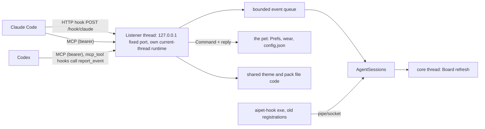

# MCP server in the pet

## Goal & Context

Agents that work beside the pet (Claude Code, Codex, any MCP client) can drive it. They can wear a pet, make and wear a theme, check and install a pack, change the pet and bubble sizes, and read or dismiss the board, all without the user opening Settings. The same server takes over status reporting. Today every hook event starts the `aipet-hook` exe, which forwards one JSON line over the per-user pipe or socket. After this spec, Claude Code posts its events straight to the pet with HTTP hooks, and Codex reports through `mcp_tool` hooks on its MCP connection to the pet. No hook process starts per event, and Codex on Windows loses the 1-4 s PowerShell start delay that forced its shorter event list.

This supersedes three fn-1 boundaries, by the owner's decision of 2026-11-09: "no changed plugin hook definitions", "no tokio in the hook or the server", and the frozen Codex command strings. It runs after fn-1 ships (milestone 2: fn-1.23 and fn-1.28), so fn-1 ships today's pipe hook unchanged and this spec changes it in a later plugin release.

## Architecture & Data Models



- **One listener**, on its own thread with a current-thread tokio runtime, separate from iced's one-worker executor. It serves the MCP endpoint `/mcp` (rmcp, Streamable HTTP) and the hook endpoint `/hook/claude`. It binds 127.0.0.1 on port **47615**, one shared constant that the listener, the hook and MCP registration generator, the doctor, the plugin check and the docs all use (the pet's tests override it with `AIPET_PORT`). The flow-next tracker's 3210 is a different port.
- **Status events** become today's envelope (v1) and go through `AgentSessions::apply`, the record log and `changed()`, exactly as the pipe server's events do. The core thread owns those three and hands the listener one ingress handle to them, so HTTP and pipe events land in the same sessions and board. The listener never touches sessions under its own lock: it hands each event to one bounded queue, applied in arrival order.
- **Tools that change settings** never write `config.json` themselves. The listener sends a command to the pet (today the iced pet's state on the UI thread; FNT-75, now after this spec, moves it to the pet thread's scene), which owns `Prefs` and the config store. The pet applies it exactly as it applies a change from Settings, saves the config, and replies with the new state. The MCP server depends only on the pet, never on Settings: Settings is a view of the pet's state that the server works without, so Settings can later move to its own process (to save memory) without touching the server (owner, 2026-11-09).
- **Runtime folders** for deleted themes (`<data>/trash/`) and pack staging (`<data>/staging/`) sit outside `<data>/avatars/`, so the pack loader never lists them, and on the same volume, so the final moves are renames.
- **Theme and pack file logic** (naming, writing, deleting, the pack check, copying) moves out of the Settings page into the pet's own code, outside Settings. The pet runs it for both the tools and the Avatars page.
- **The pipe/socket server and the `aipet-hook` exe stay for one release** as a migration bridge, so registrations made before the upgrade keep reporting. Nothing new registers the exe.
- **Token:** one per OS user, created by the pet on first start in its data folder, readable only by that user. MCP clients send it as a bearer token, read by a header-helper command that the plugin and `--install` register. The hook endpoint takes no token (owner decision): it accepts status events only and checks Host and Origin.

## API Contracts

**Hook endpoint.** `POST /hook/claude`, body = Claude's hook input JSON as-is. Optional headers `X-AiPet-Entrypoint` and `X-AiPet-Host-Session` carry `CLAUDE_CODE_ENTRYPOINT` and `CLAUDE_CODE_HOST_SESSION_ID` (through the hook's `allowedEnvVars`). The response is always `200` with body `{}`, including for malformed input, which is logged. The exceptions are a bad Host or Origin (403) and an oversized body (413), both with empty bodies.

**MCP tools** (fixed order; each returns `structuredContent` matching its `outputSchema`, plus the same JSON as a text block; business failures are `isError: true` with a reason):

| Tool | Input | Result | Annotations |
|---|---|---|---|
| `status` | - | `{version, port, hook_events: [last 30 lines], registrations_seen: {claude, codex}}` | read-only |
| `list_avatars` | - | `{worn: {name, style, theme}, avatars: [{name, styles: [{style, kind, themes}]}], skipped: [{path, reason}]}` (one entry per pet, FNT-74) | read-only |
| `wear_avatar` | `{name, style?, theme?}` (the pet; its default style and theme when left out) | `{worn, style, theme}` | idempotent |
| `get_settings` | - | `{pet_size, bubble_size, bubbles, on_top, music}` | read-only |
| `set_settings` | any subset of `get_settings`' fields | the full settings after the change | idempotent |
| `get_board` | - | `{cards: [{id, source, title, state}]}` | read-only |
| `dismiss_card` | `{id}` | `{dismissed: id}` | idempotent |
| `list_themes` | `{pet}` | `{themes: [{name, builtin, palette}]}` | read-only |
| `save_theme` | `{pet, name, palette, create: bool}` | `{pet, name, file}` | idempotent |
| `delete_theme` | `{pet, name, confirm_name}` | `{deleted, trashed_to}` | destructive |
| `check_pack` | `{path}` | `{ok, report}` (the `--check-pack` text) | read-only |
| `install_pack` | `{path, replace?: bool}` | `{installed, name, report}` | not idempotent |
| `report_event` | `{agent: "codex", event: <hook input fields>}` | `{}` | visible to the model: Codex hooks can't call a disabled tool (task 1's spike) |

## Edge Cases & Constraints

- **Pet not running.** Claude's HTTP hooks fail fast on a refused connection and carry a timeout of at most 2 s (the default is 600 s), never `onFailure: block`. An MCP client that started before the pet shows the server as failed until the user reconnects (`/mcp` in Claude). `status` and `--doctor` say so. Codex hooks are skipped until Codex connects.
- **Port taken** (another OS user's pet, or another app). The pet logs it once and runs without the listener: Settings and the old pipe path still work. One pet per machine is reachable over HTTP, which is a documented limit.
- **Shared machine.** Any local user can reach 127.0.0.1. A squatter on the port could read Claude's hook bodies or spoof bubbles. The owner accepted this for hooks. Tools stay behind the token.
- **Ordering.** Claude sends no sequence number and runs the handlers for one event in parallel. The pet uses its receive time as `at` and applies events in arrival order. The pairing window and the stale rules must still give the C# goldens' final states under jittered arrival.
- **Size.** Bodies over 4 MiB get 413. The pet trims strings server-side as the exe did (256K per string, `tool_response` dropped, `tool_input` cut to its key fields when still too large).
- **`transcript_path`** from a hook body is read for chat titles only when it lies under the Claude or Codex home.
- **Theme names** pass an allowlist (letters, digits, space, `-`, `_`, at most 40 characters, not a Windows reserved name, unique case-insensitively per pet). Paths resolve under `<data>/avatars/themes/` only. Built-in themes cannot be overwritten or deleted.
- **Pack install.** The source must be a folder inside the user's home. The pet copies it into `<data>/staging/`, follows no symlinks, and stops at 64 MiB in total or 2,000 entries, whichever comes first (the loader limits only manifests and the images they name, so the copy needs its own limits). It runs the pack check and installs only when the check passes. A replacement renames the old pack to a backup, renames the staged pack into place, restores the backup if that fails, and deletes the backup only after success. One install runs at a time. On failure the existing pack is unchanged and nothing is left in staging.
- **Budgets.** The server's own cost is at most 5 MB of RSS (R15; owner, 2026-11-09): if FNT-75 lands later the pet holds 10-40 MB, and fn-1 R18's 1.5 x C# ceiling alone would no longer bound it. With the listener on, the pet still meets fn-1 R18 (calm CPU at most the C# pet's + 0.5 points, RSS at most 1.5x the C# pet's) on Linux and Windows.
- **Both MCP eras.** 2026-07-28 stateless requests and 2025-11-25-and-older clients (initialize, `Mcp-Session-Id`, GET SSE) work on the same endpoint. After a pet restart, an old session id gets 404 so the client starts again.

## Acceptance Criteria

- **R1:** A spike records, on a real Codex and Claude Code install, whether Codex `mcp_tool` hooks can pass the hook payload's session, turn, event, tool and tool-use fields into a tool call. It also records whether Codex reconnects to an MCP server that was down at its start, whether a tool hidden from the model (`disabled_tools` or similar) still runs from a hook, whether Claude's HTTP hook reaches the pet on SessionStart, whether `allowedEnvVars` headers arrive, and whether Stop's HTTP hook returns before the turn ends. Errors: a "no" on payload fields switches Codex to the fallback in R6. A "no" on the others is recorded as a limit in the docs.
- **R2:** The pet listens on 127.0.0.1 at its fixed port, serving `/mcp` (both MCP eras) and `/hook/claude`. Errors: a present Origin that is not allowed gets 403. A Host other than loopback gets 403. A body over 4 MiB gets 413. More than 16 concurrent requests wait. If the port is in use, the pet logs once and runs without the listener. A panic in a handler never stops the pet.
- **R3:** `/mcp` requires the per-user bearer token, which the pet creates on first start, readable only by the user, and never logs or puts in a URL. Errors: a missing or wrong token gets 401 with an empty body, logged at most once a minute. An unreadable or corrupt token file is replaced and the replacement is logged.
- **R4:** Claude Code reports every event it reported through the exe by posting to `/hook/claude`. The pet answers 200 `{}` at once and applies the event through the same sessions code, with the entrypoint and host-session headers mapped into the envelope's `env`. Errors: malformed JSON or an unknown event is logged and answered 200 `{}`. A full queue drops the event with a log line.
- **R5:** Under parallel posts in any order, the sessions and board reach the same final states as the C# goldens when replayed with arrival jitter up to 500 ms. PreToolUse and PermissionRequest still pair, and a late event of a finished turn never overwrites its "done". Errors: no error surface beyond R4.
- **R6:** Codex reports through `mcp_tool` hooks that call `report_event` on its `aipet` MCP connection, with the full event list on Windows and Linux. If R1 finds the payload fields cannot be passed, Codex instead keeps the exe's command hooks for one more release and the spec records it. Errors: a pet that is down or a Codex that is not connected blocks nothing. A `report_event` call with an invalid event is `isError` and applies nothing.
- **R7:** `list_avatars`, `wear_avatar`, `get_settings` and `set_settings` act through the pet exactly as a change from Settings does, without Settings being open or present. The change shows at once, an open Settings window shows the new values, and `config.json` stays readable by the .NET pet. Errors: an unknown pet, style or theme is `isError`, naming the valid ones. A size outside pet 75-200 or bubbles 80-120 is `isError` with the range, and nothing changes. A UI that does not answer in 5 s gives `isError`.
- **R8:** `get_board` lists the board's cards and `dismiss_card` dismisses one, as clicking its close button does. Errors: an unknown card id is `isError`.
- **R9:** `list_themes`, `save_theme` and `delete_theme` use the same files and code as Settings → Avatars, and the Avatars page shows the result after Reload or at once if open. Errors: a name failing the allowlist, a built-in theme, a create over an existing name, or an edit of a missing one is `isError`. `delete_theme` without `confirm_name` equal to the name is `isError`. A deleted theme moves to `<data>/trash/`. Deleting the worn theme makes the pet wear its default theme.
- **R10:** `check_pack` returns the same text and verdict as `AiPet --check-pack`. `install_pack` makes the pet copy, check and install a pack from a folder path, then reload so the pet appears in `list_avatars`. Errors: a path outside the user's home, not a folder, or not found is `isError`. A symlink inside, or more than 64 MiB or 2,000 entries, is `isError`. A failed check is `isError` with the check's report. A pack whose pet and style, or whose name, already exists without `replace: true` is `isError`; with `replace: true`, an existing user style is replaced in its own folder (wherever it loaded from, whatever it is named), and replacing a built-in style is `isError`. In every error case `<data>/avatars/` is as it was before the call, including an existing pack that a failed replacement targeted.
- **R11:** Every tool has an `outputSchema`, returns `structuredContent` plus the JSON as text, and carries read-only, idempotent or destructive annotations. Tools are listed in a fixed order. A table-driven conformance test over every tool checks all of this. Errors: unknown tools and malformed requests are JSON-RPC errors. Every other failure is `isError`.
- **R12:** `AiPet --install claude|codex` registers the HTTP hooks and the MCP server (Claude), or `[mcp_servers.aipet]` plus the Codex hooks that R1's verdict chose (the `mcp_tool` hooks, or on the fallback the exe's command hooks), and removes the exe registrations it replaces. `--uninstall` removes both kinds. `--doctor` checks the listener, the token, the registrations and untrusted Codex hooks. The `aipet` plugin, keeping its name, ships the same hooks and an MCP entry, and `scripts/check-plugin.sh` checks them against the generator. Errors: a settings or config file that is not valid JSON or TOML is left untouched with a message. A Codex that has not trusted the hooks is a doctor warning, never an error.
- **R13:** With the listener on and an agent connected, the pet meets fn-1 R18's calm-CPU and RSS budgets on Linux and Windows, with the numbers recorded. Errors: a miss blocks the release.
- **R14:** The README, `docs/ARCHITECTURE.md` (§1, §2, §6, §7, §8.4, §9, §10), `docs/HANDOFF.md` decisions, `docs/MAKING-A-PET.md`, both copies of the `aipet-avatar-pack` skill, the plugin README and manifests, `CHANGELOG.md` and `THIRD-PARTY-NOTICES.md` describe the server, the tools, the new hooks, the migration and, on R1's success verdict, Codex's one-time re-trust (on the fallback, that Codex keeps the exe). Errors: no error surface beyond review.
- **R15:** The server costs at most 5 MB of resident memory: with an agent connected and idle, the pet's RSS is at most 5 MB above the same build's with the listener off, measured paired in one run on Linux and Windows; after a hook body at the size cap, RSS settles back within that 5 MB within 60 s. Errors: a miss blocks the release; the first remedies are a lower hook-body cap and returning freed memory after large requests.

## Early proof point

Task fnt-71-mcp-server-in-the-pet.1 validates the core approach: Codex `mcp_tool` hooks can carry status, and Claude's HTTP hooks can replace the exe. If it fails for Codex, keep the exe's command hooks for Codex (R6's fallback) before continuing with fnt-71-mcp-server-in-the-pet.4. Task .2 is the second proof point: the listener must fit R18's budgets before tools are built on it.

## Boundaries

- No pack downloads, zips or marketplace (fn-2's boundary stands). `install_pack` copies a local folder only.
- No tools for credentials, Jira or GitHub settings, hook installation, the data path, updates or autostart.
- No auto-start of the pet from a hook or an MCP client.
- No token rotation command. A corrupt token file is replaced (R3), and nothing else rotates it.
- Removing the pipe/socket server and the `aipet-hook` exe is a follow-up after the bridge release.
- No per-user ports or discovery files. One pet per machine is reachable over HTTP.
- The `aipet` plugin and marketplace names never change.

## Decision Context

The owner chose `mcp_tool` hooks for Codex over keeping the exe, to drop the per-event process on both agents. That means a one-time re-trust and missed events while the pet is down, and it is gated on the R1 spike with the exe as the fallback. Hooks carry no token because Claude's HTTP hooks can only expand environment variables, and setting a per-user variable before every agent starts was judged worse than the shared-machine risk. Tools keep the token, delivered by header helpers that read the file. The listener gets its own current-thread runtime so the iced executor's single worker (fn-1.29) stays as measured. The spec runs after fn-1 ships so milestone 2 keeps its frozen contracts. Rejected: per-user derived ports, which the plugin's static hook URL cannot express without an environment variable.

Maintainability (plan review): duplication - task 8 makes identical edits to both copies of the aipet-avatar-pack skill (.claude/skills and .agents/skills); structure - none identified

The Windows half of task 8 (the hands-on pass and R13 and R15 on Windows) moved to FNT-76 task 4 (its R5) on the owner's word, 2026-11-13, so this spec closes on its Linux half and merges: Linux met R13 and R15 and passed the hands-on checklist (`rust/proofs/mcp-server.md`, `rust/proofs/memory.md`).

## Resolved via Research

Written by plan, 2026-11-09, from docs-scout, practice-scout and docs-gap-scout.

### docs-scout
- rmcp 3.9.0 serves protocol revisions 2024-11-05 through 2026-07-28. `legacy_session_mode` defaults to true. `allowed_origins` defaults to empty, which skips the Origin check, so it must be set. rmcp has no auth, so the bearer check is axum middleware. Source: https://docs.rs/rmcp/3.9.0/rmcp/transport/streamable_http_server/tower/struct.StreamableHttpServerConfig.html
- rmcp needs tokio `sync`, `macros`, `rt`, `time`, `io-util`, and the listener needs `net`. axum adds hyper 1 and hyper-util. Source: https://docs.rs/crate/rmcp/3.9.0/features
- Claude `http` hook fields: `url`, `headers`, `allowedEnvVars`, `timeout` (default 600 s), `onFailure`. `mcp_tool` hooks are skipped on SessionStart at launch. A missing `${VAR}` in `.mcp.json` stays literal. Plugin `.mcp.json` supports `headersHelper`. A failed server is marked failed after 3 retries. Source: https://code.claude.com/docs/en/hooks, https://code.claude.com/docs/en/mcp
- Codex hooks are `command` and `mcp_tool` only. `mcp_tool` takes `server`, `tool`, `input`, `timeout`, `statusMessage`, never starts a server, and does not block on errors. Trust is tied to the hook's hash. `[mcp_servers.x]` takes `url`, `bearer_token_env_var`, `http_headers`, `env_http_headers`, `http_headers_helper`, `enabled_tools`, `disabled_tools`. Whether `input` templates the hook payload is unconfirmed (R1). Source: https://learn.chatgpt.com/docs/hooks, https://learn.chatgpt.com/docs/extend/mcp
- MCP 2026-07-28: a present, invalid Origin MUST get 403. Servers SHOULD bind 127.0.0.1. A legacy client against a modern-only server fails, so legacy mode stays on. Source: https://modelcontextprotocol.io/specification/2026-07-28/basic/transports/streamable-http

### practice-scout
- Answer hooks at once and process from a bounded queue with `try_send`. Give every HTTP hook a short explicit timeout. Source: https://code.claude.com/docs/en/hooks
- Claude hook bodies carry no sequence number or timestamp, and handlers for one event run in parallel. Source: https://code.claude.com/docs/en/hooks
- Destructive tools need a server-side guard: Claude Code prompts the same for every MCP tool whatever its annotations. Source: https://blog.modelcontextprotocol.io/posts/2026-03-16-tool-annotations/
- DNS-rebinding advisories hit rmcp before 1.4 and other SDKs. Our own `/hook` route needs its own Host and Origin checks. Source: https://rustsec.org/advisories/RUSTSEC-2026-0189

### docs-gap-scout
- Docs to change are listed in R14. The `aipet-avatar-pack` skill exists twice (`.claude/skills` and `.agents/skills`), identical, and both change. Source: repo
- THIRD-PARTY-NOTICES needs rows for rmcp, axum, hyper and tower, with versions from `rust/Cargo.lock`. Source: THIRD-PARTY-NOTICES.md

## Quick commands

```bash
cd rust && cargo test -p aipet-core --test server && cargo test -p aipet
curl -s -X POST -H 'Content-Type: application/json' -d '{"hook_event_name":"Notification","session_id":"t"}' http://127.0.0.1:<port>/hook/claude
rust/target/release/AiPet --doctor claude
```

## Requirement coverage

| Req | Description | Task(s) | Gap justification |
| --- | --- | --- | --- |
| R1 | A spike records, on a real Codex and Claude Code install, whether Codex `mcp_tool` hooks can pass the hook payload's session, turn, event, tool and tool-use fields into a tool call. It also records whether Codex reconnects to an MCP server that was down at its start, whether a tool hidden from the model (`disabled_tools` or similar) still runs from a hook, whether Claude's HTTP hook reaches the pet on SessionStart, whether `allowedEnvVars` headers arrive, and whether Stop's HTTP hook returns before the turn ends. Errors: a "no" on payload fields switches Codex to the fallback in R6. A "no" on the others is recorded as a limit in the docs. | fnt-71-mcp-server-in-the-pet.1 | — |
| R2 | The pet listens on 127.0.0.1 at its fixed port, serving `/mcp` (both MCP eras) and `/hook/claude`. Errors: a present Origin that is not allowed gets 403. A Host other than loopback gets 403. A body over 4 MiB gets 413. More than 16 concurrent requests wait. If the port is in use, the pet logs once and runs without the listener. A panic in a handler never stops the pet. | fnt-71-mcp-server-in-the-pet.2 | — |
| R3 | `/mcp` requires the per-user bearer token, which the pet creates on first start, readable only by the user, and never logs or puts in a URL. Errors: a missing or wrong token gets 401 with an empty body, logged at most once a minute. An unreadable or corrupt token file is replaced and the replacement is logged. | fnt-71-mcp-server-in-the-pet.2 | — |
| R4 | Claude Code reports every event it reported through the exe by posting to `/hook/claude`. The pet answers 200 `{}` at once and applies the event through the same sessions code, with the entrypoint and host-session headers mapped into the envelope's `env`. Errors: malformed JSON or an unknown event is logged and answered 200 `{}`. A full queue drops the event with a log line. | fnt-71-mcp-server-in-the-pet.3 | — |
| R5 | Under parallel posts in any order, the sessions and board reach the same final states as the C# goldens when replayed with arrival jitter up to 500 ms. PreToolUse and PermissionRequest still pair, and a late event of a finished turn never overwrites its "done". Errors: no error surface beyond R4. | fnt-71-mcp-server-in-the-pet.3 | — |
| R6 | Codex reports through `mcp_tool` hooks that call `report_event` on its `aipet` MCP connection, with the full event list on Windows and Linux. If R1 finds the payload fields cannot be passed, Codex instead keeps the exe's command hooks for one more release and the spec records it. Errors: a pet that is down or a Codex that is not connected blocks nothing. A `report_event` call with an invalid event is `isError` and applies nothing. | fnt-71-mcp-server-in-the-pet.4 | — |
| R7 | `list_avatars`, `wear_avatar`, `get_settings` and `set_settings` act through the pet exactly as a change from Settings does, without Settings being open or present. The change shows at once, an open Settings window shows the new values, and `config.json` stays readable by the .NET pet. Errors: an unknown pet, style or theme is `isError`, naming the valid ones. A size outside pet 75-200 or bubbles 80-120 is `isError` with the range, and nothing changes. A UI that does not answer in 5 s gives `isError`. | fnt-71-mcp-server-in-the-pet.5 | — |
| R8 | `get_board` lists the board's cards and `dismiss_card` dismisses one, as clicking its close button does. Errors: an unknown card id is `isError`. | fnt-71-mcp-server-in-the-pet.5 | — |
| R9 | `list_themes`, `save_theme` and `delete_theme` use the same files and code as Settings → Avatars, and the Avatars page shows the result after Reload or at once if open. Errors: a name failing the allowlist, a built-in theme, a create over an existing name, or an edit of a missing one is `isError`. `delete_theme` without `confirm_name` equal to the name is `isError`. A deleted theme moves to `<data>/trash/`. Deleting the worn theme makes the pet wear its default theme. | fnt-71-mcp-server-in-the-pet.6 | — |
| R10 | `check_pack` returns the same text and verdict as `AiPet --check-pack`. `install_pack` makes the pet copy, check and install a pack from a folder path, then reload so the pet appears in `list_avatars`. Errors: a path outside the user's home, not a folder, or not found is `isError`. A symlink inside, or more than 64 MiB or 2,000 entries, is `isError`. A failed check is `isError` with the check's report. A pack whose pet and style, or whose name, already exists without `replace: true` is `isError`; with `replace: true`, an existing user style is replaced in its own folder (wherever it loaded from, whatever it is named), and replacing a built-in style is `isError`. In every error case `<data>/avatars/` is as it was before the call, including an existing pack that a failed replacement targeted. | fnt-71-mcp-server-in-the-pet.6 | — |
| R11 | Every tool has an `outputSchema`, returns `structuredContent` plus the JSON as text, and carries read-only, idempotent or destructive annotations. Tools are listed in a fixed order. A table-driven conformance test over every tool checks all of this. Errors: unknown tools and malformed requests are JSON-RPC errors. Every other failure is `isError`. | fnt-71-mcp-server-in-the-pet.2, fnt-71-mcp-server-in-the-pet.5, fnt-71-mcp-server-in-the-pet.6 | — |
| R12 | `AiPet --install claude\|codex` registers the HTTP hooks and the MCP server (Claude), or `[mcp_servers.aipet]` plus the Codex hooks that R1's verdict chose (the `mcp_tool` hooks, or on the fallback the exe's command hooks), and removes the exe registrations it replaces. `--uninstall` removes both kinds. `--doctor` checks the listener, the token, the registrations and untrusted Codex hooks. The `aipet` plugin, keeping its name, ships the same hooks and an MCP entry, and `scripts/check-plugin.sh` checks them against the generator. Errors: a settings or config file that is not valid JSON or TOML is left untouched with a message. A Codex that has not trusted the hooks is a doctor warning, never an error. | fnt-71-mcp-server-in-the-pet.7 | — |
| R13 | With the listener on and an agent connected, the pet meets fn-1 R18's calm-CPU and RSS budgets on Linux and Windows, with the numbers recorded. Errors: a miss blocks the release. | fnt-71-mcp-server-in-the-pet.2, fnt-71-mcp-server-in-the-pet.8, fnt-76-windows-checks-with-the-owner.4 | Windows half moved to FNT-76 R5 (owner, 2026-11-13) |
| R14 | The README, `docs/ARCHITECTURE.md` (§1, §2, §6, §7, §8.4, §9, §10), `docs/HANDOFF.md` decisions, `docs/MAKING-A-PET.md`, both copies of the `aipet-avatar-pack` skill, the plugin README and manifests, `CHANGELOG.md` and `THIRD-PARTY-NOTICES.md` describe the server, the tools, the new hooks, the migration and, on R1's success verdict, Codex's one-time re-trust (on the fallback, that Codex keeps the exe). Errors: no error surface beyond review. | fnt-71-mcp-server-in-the-pet.8 | — |
| R15 | The server costs at most 5 MB of resident memory: with an agent connected and idle, the pet's RSS is at most 5 MB above the same build's with the listener off, measured paired in one run on Linux and Windows; after a hook body at the size cap, RSS settles back within that 5 MB within 60 s. Errors: a miss blocks the release; the first remedies are a lower hook-body cap and returning freed memory after large requests. | fnt-71-mcp-server-in-the-pet.2, fnt-71-mcp-server-in-the-pet.8, fnt-76-windows-checks-with-the-owner.4 | Windows half moved to FNT-76 R5 (owner, 2026-11-13) |
