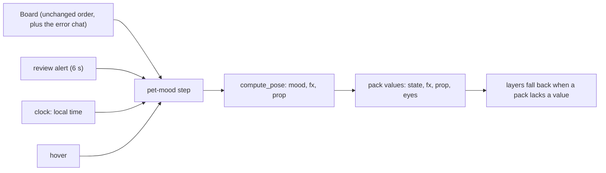

# New pet states and the Hamster's accessories

## Goal & Context

The pet says more about what the agents are doing. A failed turn makes it sad, a new review arrives as an envelope, every finished turn starts with a golden aura, and late at night or after a long chat it yawns. Every built-in pet draws these: Hood, Hood (green), Hamster (vector and pixel), Sprout (pixel and vector) and Pip (vector and painted). The Hamster also gets its own accessories (round glasses for reading, a heart when poked, speed lines when running, a blush when happy) and new shading. A spike decides whether the Hamster can do a 3D-style turnaround.

The state ideas, accessories, timing and shading approach come from JLandbo's hamster-pet (https://github.com/JLandbo/hamster-pet), which has no licence. Our Hamster was drawn from that character, and its author has told the owner he doesn't mind it shipping (owner, 2026-11-09). We copy ideas only and draw everything in our own style, and the docs credit his repository as the Hamster's origin.

## Architecture & Data Models



- **The board keeps its order and states**, apart from one deliberate change (R1). A Claude chat that ends in StopFailure becomes the chat state `error` ("Failed", red), which already ranks with done in the bubble order. Everything else that chooses the pet's mood happens in a new pet-mood step after the board. The step takes the board's front chat, the review alert, the local time, the front chat's age, and hover.
- **New behaviour is switched on by one production-only input** (default off) that the app sets and the C# golden replays never do. With it off, the pet emits exactly today's values (sparkles on done and poke, attention on an alert), so `tests/golden.rs` keeps its pixels and `tests/board.rs` its order. The one exception is R1's error chat, which the board test lists as a known deviation.
- **The review alert** in production starts news only. The old forced-attention alert input stays for the golden replay alone.
- **The mood step** lives in a module of its own, called once per tick, so the per-frame UI code only reads its result.
- **New pack values**, all free strings that the format already accepts:
  - `state`: `sad`, `tired` and `news`.
  - `fx`: `tears`, `aura` and `heart`.
  - `prop`: `envelope`.
  - `eyes`: `sleepy`.

  The aura is drawn art. The name `glow` stays reserved for the pack's glow colour and the layer halo.
- **Fixed colours:**
  - fixed: tear blue, aura gold and blush pink. They carry meaning, so themes never change them.
  - themed: the envelope takes the pack's accent for its seal.

## Edge Cases & Constraints

- **Priority** (pet mood, owner 2026-11-09): attention > news > working/thinking > sad > done (opening with the aura) > tired > idle > sleep. Reactions (run, dangle, poke, landing, hover wave) always win, as they do today.
- **Transient states** start only on a new edge. A second review inside news's 6 s window doesn't restart it. The aura plays once per done.
- **Reviews at startup.** Reviews that already exist when the pet starts never fire news.
- **Clock.** `tired` reads local time through one injected clock, so tests and fn-2.8's measurements can fix the time of day. Daylight-saving changes only move the window.
- **Reduced motion.** Each new state's first frame or first key carries its cue: the tear on the cheek, the yawn open, the aura fully built, the envelope in the hands.
- **Packs without the new values** fall back through the behaviour layer, never to a plain idle:
  - news -> the attention look with its "!"
  - sad -> the attention look
  - tired -> idle
  - aura -> sparkles
  - heart -> sparkles
  - envelope -> no prop
- **Blink.** The random blink (every 2.5-5.5 s) stays for every pet. The Hamster's drawn holds use JLandbo's long-hold rhythm only inside tired and sad.
- **fn-2.21.** New effects respect fn-2 task 21's rule that effects never cover the bubbles.

## Acceptance Criteria

- **R1:** A Claude turn that ends in StopFailure sets its chat to `error`. The bubble is red and reads "Failed", ranks with done in the bubble order, and lasts until that chat's next event or 3600 s. While that chat is the front chat, the pet is `sad`: eyes closed or down, with a tear falling. The board golden test names this as the one deviation from the C# board. Errors: Codex reports no failures, so Codex chats never become `error` (stated in the docs). A StopFailure for an unknown session creates the chat as other events do.
- **R2:** A review alert for a review new since the pet started shows `news` for 6 s: the pet holds the envelope, and the "!" is gone. A chat that needs attention wins over it. Errors: an alert while a news window is open neither restarts nor extends it, so the window ends at its first deadline. Reviews present at startup never fire it.
- **R3:** Every done opens with the `aura` effect, played once (about 1.8 s) over the hop and wave, then sparkles as today, in the look the owner approved from R12's prototype. Done's mood, timings and the C# frame goldens are unchanged. Errors: no error surface beyond R6's fallback.
- **R4:** Between 23:00 and 05:00 local time, or once the front chat is more than 2 hours old (counted from when the pet first saw it, for hook chats and Codex-watcher chats alike, so a chat already open when the pet starts counts from the start), an idle pet is `tired`: sleepy eyes and a big open-mouth yawn. A sleeping pet stays asleep, but at night it shows `tired` while hovered. Errors: the clock is injected, and tests cover both window edges and a chat at exactly 2 hours.
- **R5:** The pet's mood follows the priority in Edge Cases, and reactions win over every mood, both checked by a matrix test over every pair. Errors: no error surface beyond R1-R4.
- **R6:** A pack that lacks a new value falls back as Edge Cases lists, and every new value has a fallback in the behaviour layer. A poke shows `heart` (falling back to sparkles), so a pack can tell poke from done. Errors: no error surface beyond the fallback table.
- **R7:** Under reduced motion every new state still shows its cue in its first frame or key. Errors: no error surface beyond R8's art.
- **R8:** Every built-in pet draws `sad`, `tired`, `news`, `tears`, `aura`, `heart`, `envelope` and `sleepy` eyes. The R22 coverage test gains a state channel, checks the baked pixel packs too, and requires at least one layer per pack to resolve each new value to drawn art (an explicit `null` fallback alone does not count). Errors: a pack missing one fails the test, naming the pack and the value.
- **R9:** The Hamster (vector and pixel), drawn in our own style, has round glasses for web search and reading as its `lens` value (no magnifier; its arms read rather than hold; the eye scan stays), the envelope, tears, yawn, aura, a heart when poked, speed lines in its dust, and a pink blush only on done, the aura and the heart. Its shading is darker orange on the right side and bottom right, with the paws as small nubs on the belly, replacing the earlier "back in the head's yellow" decision. Props follow its off-centre head. Errors: no error surface beyond the R22 test and the owner's review of the pages.
- **R10:** A spike records whether the Hamster can do a 24-frame turnaround (front, side, back, curl) as pixel frames and as vector parts, which state uses it, how a cycle finishes before a mood change except for dangle, run and poke, what each pack kind costs, and the follow-up tasks it proposes. Errors: no error surface (findings only).
- **R11:** The README, `avatars/README.md` and `THIRD-PARTY-NOTICES.md` credit https://github.com/JLandbo/hamster-pet as the Hamster's origin, noting its author's permission; `docs/MAKING-A-PET.md`, `docs/ARCHITECTURE.md` (§3.2, §3.3, §5.3), both copies of the `aipet-avatar-pack` skill, the Dewdrop sample, `docs/HANDOFF.md`'s Hamster decision and `CHANGELOG.md` describe the new states, values and fallbacks. Errors: no error surface beyond review.
- **R12:** Before any pet draws the aura in place of done's opening sparkles, a prototype page shows the aura beside today's sparkles, animated and as its first frame, on light, dark and the desktop backgrounds, for the Hood and the Hamster, and the owner approves it (owner request, 2026-11-09). Errors: if the owner rejects it, the aura is redrawn and shown again; no pet draws it before approval.

## Early proof point

Task fnt-72-new-pet-states-and-the-hamsters.1 validates the core approach: a pet-mood step after the board drives the new states while the C# golden replays still pass. If it cannot, re-evaluate making the new states inputs the replays never set before continuing with task .2 and later.

## Boundaries

- Codex failure states stay out (Codex reports none).
- The board's bubble order changes only for R1.
- The turnaround itself stays out: only the spike, whose follow-ups are proposed, not planned.
- No new pack-format keys. Every new value is a string the format already takes.
- JLandbo's pixels are never copied. Ideas only.
- No plan-usage "tired" trigger, which their pet uses. Ours is the clock and chat age.

## Decision Context

**2026-11-10 (owner):** the Hamster is no longer a built-in pet: it lives only as the owner's local avatar pack, made from JLandbo's own sprites, outside this repository. Its packs, generators, reference art and credits were removed, and so was R10's spike record (`rust/proofs/hamster-turnaround.md` and its two drawings); the record can still be read at commit 0f9fa5a. R10 and task 5 stay done as history; nothing more is planned for the Hamster here.

The owner chose a red "Failed" bubble for failed turns over keeping "!", accepting one deliberate deviation from the C# board, so a failure reads differently from a question. Everything else stays outside the board, so fn-1's R9 parity and the frame goldens keep their meaning. The aura is an effect over done, not a mood: a new mood would change the golden frames' `anim_state`, and the owner's "glow replaces the first seconds of every done" fits an effect exactly. With that, glow's slot in the priority list has no separate effect. The owner chose `tired` to leave sleep alone, with hover as the window into it at night. The blink stays random for every pet. Rejected: baking JLandbo's blink rhythm into packs, which would fight the behaviour layer's blink. The owner asked to approve a prototype of the aura before it replaces done's opening sparkles (R12, task 7).

Maintainability (plan review): duplication - the same channel, fallback and review guidance is edited in both copies of the aipet-avatar-pack skill; structure - the mood step stays out of `PetUi::tick`'s hot path, in its own module (task 1)

## Resolved via Research

Written by plan, 2026-11-09, from docs-scout, practice-scout and docs-gap-scout.

### docs-scout
- JLandbo/hamster-pet has no licence (GitHub API `license: null`, no LICENSE file). Its moods: run > dangle > giggle > alert > research > spin > happy > sad > listen > news > glow > dance > tired > curious > awake > sleep. Its news is an unread answer, glow is feed news, tired is plan usage of 90% or more; ours map them differently (owner). Timings: sad [400,300,300,300], tired [900,250,900,250,1100,250] with the yawn on frame 5, news 4 x 300, glow 12 frames (1790 ms), spin 24 x 100 ms as a forward somersault and turn that finishes its cycle except for dangle, run and giggle. Source: https://github.com/JLandbo/hamster-pet
- Claude's StopFailure fires instead of Stop when a turn ends on an API error, with `error` (rate_limit, overloaded, ... unknown). PostToolUseFailure is too noisy to mean "the agent failed". Source: https://code.claude.com/docs/en/hooks

### practice-scout
- Give transient states a hold time and a completion signal; interrupts fire at once; restart a transient only on a new edge. Source: https://github.com/tonybaloney/vscode-pets/blob/main/src/panel/states.ts
- A turnaround on a cut-out rig needs drawn views (3/4, side, back); squashing parts cannot make the back view, and an asymmetric head needs separate 3/4-left and 3/4-right drawings. Source: https://esotericsoftware.com/forum/d/13069
- Under reduced motion, replace a loop with a still frame that carries the cue. Source: https://blog.openreplay.com/prefers-reduced-motion-accessible-animation/

### docs-gap-scout
- The docs that change are R11's list; the skill exists twice (`.claude/skills`, `.agents/skills`), identical. No file credits the Hamster's origin today. Source: repo

## Quick commands

```bash
cd rust && cargo test -p aipet-sprite && cargo test -p aipet-core --test board && cargo test -p aipet-ui
python avatars/reference/hamster_gen.py --pack
```

## Requirement coverage

| Req | Description | Task(s) | Gap justification |
| --- | --- | --- | --- |
| R1 | A Claude turn that ends in StopFailure sets its chat to `error`. The bubble is red and reads "Failed", ranks with done in the bubble order, and lasts until that chat's next event or 3600 s. While that chat is the front chat, the pet is `sad`: eyes closed or down, with a tear falling. The board golden test names this as the one deviation from the C# board. Errors: Codex reports no failures, so Codex chats never become `error` (stated in the docs). A StopFailure for an unknown session creates the chat as other events do. | fnt-72-new-pet-states-and-the-hamsters.1 | — |
| R2 | A review alert for a review new since the pet started shows `news` for 6 s: the pet holds the envelope, and the "!" is gone. A chat that needs attention wins over it. Errors: an alert while a news window is open neither restarts nor extends it, so the window ends at its first deadline. Reviews present at startup never fire it. | fnt-72-new-pet-states-and-the-hamsters.1 | — |
| R3 | Every done opens with the `aura` effect, played once (about 1.8 s) over the hop and wave, then sparkles as today, in the look the owner approved from R12's prototype. Done's mood, timings and the C# frame goldens are unchanged. Errors: no error surface beyond R6's fallback. | fnt-72-new-pet-states-and-the-hamsters.1 | — |
| R4 | Between 23:00 and 05:00 local time, or once the front chat is more than 2 hours old (counted from when the pet first saw it, for hook chats and Codex-watcher chats alike, so a chat already open when the pet starts counts from the start), an idle pet is `tired`: sleepy eyes and a big open-mouth yawn. A sleeping pet stays asleep, but at night it shows `tired` while hovered. Errors: the clock is injected, and tests cover both window edges and a chat at exactly 2 hours. | fnt-72-new-pet-states-and-the-hamsters.1 | — |
| R5 | The pet's mood follows the priority in Edge Cases, and reactions win over every mood, both checked by a matrix test over every pair. Errors: no error surface beyond R1-R4. | fnt-72-new-pet-states-and-the-hamsters.1 | — |
| R6 | A pack that lacks a new value falls back as Edge Cases lists, and every new value has a fallback in the behaviour layer. A poke shows `heart` (falling back to sparkles), so a pack can tell poke from done. Errors: no error surface beyond the fallback table. | fnt-72-new-pet-states-and-the-hamsters.1 | — |
| R7 | Under reduced motion every new state still shows its cue in its first frame or key. Errors: no error surface beyond R8's art. | fnt-72-new-pet-states-and-the-hamsters.2, fnt-72-new-pet-states-and-the-hamsters.4 | — |
| R8 | Every built-in pet draws `sad`, `tired`, `news`, `tears`, `aura`, `heart`, `envelope` and `sleepy` eyes. The R22 coverage test gains a state channel, checks the baked pixel packs too, and requires at least one layer per pack to resolve each new value to drawn art (an explicit `null` fallback alone does not count). Errors: a pack missing one fails the test, naming the pack and the value. | fnt-72-new-pet-states-and-the-hamsters.2, fnt-72-new-pet-states-and-the-hamsters.3, fnt-72-new-pet-states-and-the-hamsters.4 | — |
| R9 | The Hamster (vector and pixel), drawn in our own style, has round glasses for web search and reading as its `lens` value (no magnifier; its arms read rather than hold; the eye scan stays), the envelope, tears, yawn, aura, a heart when poked, speed lines in its dust, and a pink blush only on done, the aura and the heart. Its shading is darker orange on the right side and bottom right, with the paws as small nubs on the belly, replacing the earlier "back in the head's yellow" decision. Props follow its off-centre head. Errors: no error surface beyond the R22 test and the owner's review of the pages. | fnt-72-new-pet-states-and-the-hamsters.3 | — |
| R10 | A spike records whether the Hamster can do a 24-frame turnaround (front, side, back, curl) as pixel frames and as vector parts, which state uses it, how a cycle finishes before a mood change except for dangle, run and poke, what each pack kind costs, and the follow-up tasks it proposes. Errors: no error surface (findings only). | fnt-72-new-pet-states-and-the-hamsters.5 | — |
| R11 | The README, `avatars/README.md` and `THIRD-PARTY-NOTICES.md` credit https://github.com/JLandbo/hamster-pet as the Hamster's origin, noting its author's permission; `docs/MAKING-A-PET.md`, `docs/ARCHITECTURE.md` (§3.2, §3.3, §5.3), both copies of the `aipet-avatar-pack` skill, the Dewdrop sample, `docs/HANDOFF.md`'s Hamster decision and `CHANGELOG.md` describe the new states, values and fallbacks. Errors: no error surface beyond review. | fnt-72-new-pet-states-and-the-hamsters.6 | — |
| R12 | Before any pet draws the aura in place of done's opening sparkles, a prototype page shows the aura beside today's sparkles, animated and as its first frame, on light, dark and the desktop backgrounds, for the Hood and the Hamster, and the owner approves it (owner request, 2026-11-09). Errors: if the owner rejects it, the aura is redrawn and shown again; no pet draws it before approval. | fnt-72-new-pet-states-and-the-hamsters.7 | — |
