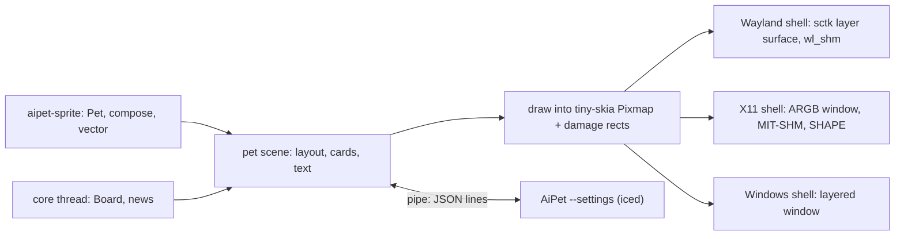

# The pet window without the GPU

## Goal & Context

The pet window draws through iced and wgpu, which maps the GL driver into the pet process: about 157 MB resident for a pet whose art is a few hundred kilobytes, and a risk of landing on a discrete GPU. FNT-73's spike measured three stacks against it (`rust/proofs/ui-framework.md`). A pet drawn on the CPU with tiny-skia and shown through each platform's own window held 9 MB at about the same calm CPU as iced (4.13 % against 4.40 %), while redrawing its whole window every frame.

This spec moves the pet window to that stack: tiny-skia for every pixel, presented by smithay-client-toolkit on Wayland, by an ARGB window on X11 and by a layered window on Windows. Settings stays in iced but leaves the pet process: it runs as `AiPet --settings`, a child the pet starts on demand, so the pet process never loads a GPU library (the owner's decision, 2026-11-09). The first task is a gate: the CPU stack must beat the iced pet's calm CPU at the real window's worst case, or the spec stops there.

It runs after fn-1 ships and before FNT-71 (owner, 2026-11-09), so FNT-71's UI-thread commands are built once, on the new pet loop.

## Architecture & Data Models



- **The pet scene** is today's `PetUi` without iced: the same state, ticks, messages, effects, frame pacing, hit and drawn rects, cards and drag logic, with its own geometry types (point, size, rect, vector) in place of iced's. It draws into a premultiplied RGBA pixmap and returns the rects that changed since the last frame. Everything it draws is already CPU work or becomes it: sprite frames (nearest for pixel packs, at whole device pixels per art pixel), painted frames, vector packs through the existing tiny-skia renderer, halos and the ground shadow, card shadows, the reviews header, the music player, the tooltip and the inline menu.
- **Text** is cosmic-text, one long-lived font system and glyph cache in the scene. Glyph masks are blitted into the pixmap; measuring and wrapping (bubble fitting, tooltip size) move from iced's paragraph to the same font system.
- **A shell** per platform owns the window, presentation, input, scale and the frame clock. It converts the pixmap's changed rects to its buffer format (an R/B swap: every target is premultiplied BGRA) and presents only those. It feeds pointer, drag, scale and output events to the scene as messages, as the iced shells do today. The Wayland shell keeps the layer namespace `aipet`, both drag modes and the xdg popup menu with its inline fallback. The X11 shell also serves Wayland desktops without layer-shell, through XWayland.
- **Settings** runs in its own process, `AiPet --settings`, started by the pet and connected to it by the child's standard input and output: one JSON object per line each way. The pet sends the state Settings shows; Settings sends the changes the user makes. Settings owns its forms and its connection tests; the pet keeps the watchers, the board and the config store, and applies each change as Settings does in-process today.
- **The iced pet shell** stays one release behind `AIPET_BACKEND=iced`, for rollback; the default never loads it. macOS keeps compiling with the iced desktop shell.

## API Contracts

**The Settings pipe.** The pet starts the child with piped stdin and stdout; each line is one JSON object with a `type`. Pet to Settings:

```json
{"type": "state", "prefs": {...}, "avatars": [...], "worn": {"name": "Hood", "style": "Pixel", "theme": "Blue"}, "watchers": {"jira": {"enabled": true, "error": null}, "github": {"enabled": false, "error": null}}}
{"type": "raise"}
```

Settings to the pet:

```json
{"type": "set", "prefs": {...}}
{"type": "wear", "name": "Hood", "style": "Vector", "theme": null}
{"type": "themes_changed", "pet": "Hood"}
{"type": "services_changed"}
{"type": "mood", "state": "news"}
```

`prefs` is today's `Prefs` in its config.json field names. The pet sends `state` when the child starts and after every change, whatever made it (Settings, the menu, a drag, later FNT-71's tools). `raise` asks an open Settings window to come to the front. Unknown types are logged and ignored on both sides.

## Edge Cases & Constraints

- **Budgets** (fn-1 R18, measured by its paired method): calm CPU at most the C# pet's + 0.5 points; RSS at most 1.5 × the C# pet's. This spec adds: calm CPU below the iced pet's, and RSS at most 50 MB with Settings closed.
- **Presentation:** a wl_buffer is the compositor's from commit to release; a busy buffer is never drawn into. Damage is per buffer, so with two buffers the scene repaints the union of the last two frames' changes. Calm frames request no frame callback and commit nothing. Windows' `UpdateLayeredWindow` always sends the whole window, so the Windows window is sized to its content, not to 380×600.
- **Scale:** integer and fractional (viewporter, buffer `round(logical × scale)`); pixel packs stay crisp at whole device pixels per art pixel; caches are rebuilt per scale.
- **X11:** an ARGB visual needs a compositing manager; without one the pet logs it once and runs, drawn on black. MIT-SHM missing falls back to plain `PutImage`.
- **Fallback order** on Linux: layer-shell (Wayland), else X11 (native or XWayland); `AIPET_BACKEND` overrides. A shell that fails to start logs why and the pet tries the next.
- **Settings child:** one at a time; opening it again sends `raise`. If it exits or crashes, the pet notices, logs it, and the menu opens a new one. If the pet exits, the child sees its stdin close and exits. The Settings window's title stays "AiPet · Settings" and the pet's WM_CLASS and layer namespace stay the same, so the Hyprland rules keep matching.
- **Threads:** no tokio in the pet's core or shells (fn-1's boundary); each shell runs its own event loop on the main thread.

## Acceptance Criteria

- **R1:** Before any other task, a gate shows that the CPU stack beats the iced pet's calm CPU at the real window's worst case: 380×600 at scale 2 and at scale 1.5, three bubbles with long text, the pet idle and working, worn as Sprout and as Dewdrop, measured paired with the iced pet by fn-1's method. It passes only if its CPU median is below the iced pet's in every case and its RSS is at most 50 MB. Errors: a failed case stops the spec, and the result and the reason are recorded in `rust/proofs/ui-framework.md`; a machine that can't reach the method's load limit is recorded with the limit used, and the gate is re-run when it can.
- **R2:** The pet window draws everything it draws today, without iced, into a CPU buffer: every pack kind, theme and style, the new moods, halos, the ground shadow, mirroring, the bubbles with their shadows and actions, the reviews header, the music player, the tooltip and the inline menu, with bubble sizes and line breaks as today's. Errors: a font that fails to load falls back to the system default; a scale change rebuilds the caches before the next frame.
- **R3:** Only what changed is redrawn and presented, and a calm pet with nothing changing does no drawing work at all. Errors: no error surface beyond R1's budget.
- **R4:** On Wayland the pet is an sctk layer surface (namespace `aipet`) with today's placement, input region, both drag modes, popup menu with its inline fallback, cursor shapes, output loss and fractional scale. Errors: a compositor without layer-shell gets the X11 shell; one without viewporter gets integer scale only; a lost surface mid-drag ends the drag as today.
- **R5:** On X11, and on Wayland desktops without layer-shell through XWayland, the pet is a 32-bit ARGB window, drawn through MIT-SHM, with a SHAPE input region, kept above, with today's WM_CLASS. Errors: no compositing manager → logged once, drawn on black; no MIT-SHM → plain PutImage.
- **R6:** On Windows the pet is a topmost, non-activating layered window sized to its content, with per-pixel click-through, drag and per-monitor DPI. Errors: a failed `UpdateLayeredWindow` is logged and retried on the next change; a DPI change during a drag waits until the drag ends, as today.
- **R7:** Settings runs as `AiPet --settings`, a child of the pet speaking the Settings pipe, and the pet process maps no GPU or GL library while running, with or without Settings open. Every Settings page works as today, live: a change in Settings shows on the pet at once, and a change from anywhere else shows in an open Settings. Errors: a second open raises the first; a crashed child is logged and can be reopened; a pet that exits takes the child with it; a malformed line is logged and skipped.
- **R8:** The pet meets fn-1 R18 and R1's budgets on Linux and Windows, measured by fn-1's method and recorded. Errors: no error surface beyond R1.
- **R9:** `AIPET_BACKEND=iced` runs today's iced pet shell for one release, and macOS keeps compiling. Errors: an unknown `AIPET_BACKEND` value logs the choices and uses the default.
- **R10:** What tests pin today stays pinned: frame pacing, hit and drawn rects, layout, cards, drag, the shells' behaviour (popup, region rate, output loss, mid-drag loss, reset) and the golden replays, ported to the new types. Errors: no error surface beyond the tests.
- **R11:** README, ARCHITECTURE, HANDOFF, CHANGELOG, THIRD-PARTY-NOTICES and the proofs describe the new window, Settings as a child process, and the new crates. Errors: no error surface beyond review.

## Boundaries

- No macOS port: it keeps the iced shell, compile-only.
- No new pet features or looks: the window shows what it shows today.
- No change to the hook socket's protocol: the Settings pipe is separate.
- Settings keeps its pages and its look; it is moved, not redesigned.
- No GPU path for the pet window (so no Rive GPU route; fnt-67's CPU route remains).

## Decision Context

FNT-73 compared the minimal stack, Slint and gpui with iced. gpui keeps the GPU stack and used more CPU than iced; Slint used the least CPU but adds little on the pet window, can't draw crisp pixel images and brings a licence with an attribution duty; the minimal stack has small, mature MIT crates and reuses the pet's existing tiny-skia and platform code. softbuffer can't present transparency on X11 or Windows, so the three presenters are written by hand. Settings in-process would keep the GPU libraries mapped once opened; the owner chose to keep them out, so Settings becomes a child process with its own pipe (the hook socket is frozen v1, shared with the C# pet, and FNT-71 plans to retire it). Using iced's own tiny-skia renderer for Settings is tried in R7's task: if it works, Settings needs no GPU either.

## Early proof point

Task fnt-75-the-pet-window-without-the-gpu.1 validates the core approach (the CPU stack beats iced's calm CPU at the worst case). If it fails, re-evaluate the move (keep iced, or damage-tracked Slint) before continuing with fnt-75-the-pet-window-without-the-gpu.2+.

## Resolved via Research

*Provenance: plan, 2026-11-09; docs-scout, practice-scout, docs-gap-scout.*

### docs-scout
- smithay-client-toolkit 0.21.1 (MIT): `delegate_*!` macros replaced by `delegate_dispatch2!`; `LayerShell`, `SlotPool`, `compositor::Region`, cursor-shape v2; no fractional-scale helper (bind wp_fractional_scale_v1 and wp_viewporter). Source: https://docs.rs/smithay-client-toolkit/0.21.1
- tiny-skia 0.12.0 (BSD-3-Clause): only `RadialGradient::new` breaks from 0.11; premultiplied RGBA only. Source: https://docs.rs/tiny-skia/0.12.0
- cosmic-text 0.19.0 (MIT/Apache-2.0): lazy Buffer setters; `Renderer` trait since 0.16; iced pins 0.15. Source: https://docs.rs/cosmic-text/0.19.0
- x11rb 0.14.0 (MIT/Apache-2.0): `shm` and `shape` features; ARGB needs a depth-32 visual and colormap. Source: https://docs.rs/x11rb/0.14.0
- windows-sys 0.61.2 (MIT/Apache-2.0): `UpdateLayeredWindow`, `CreateDIBSection` under `Win32_UI_WindowsAndMessaging` and `Win32_Graphics_Gdi`. Source: https://docs.rs/windows-sys/0.61.2
- softbuffer 0.4.8 has no transparency (unreleased master: Wayland only), so it can't present the pet. Source: https://github.com/rust-windowing/softbuffer/issues/17

### practice-scout
- Use `damage_buffer`; track damage per buffer; never draw into an unreleased wl_buffer. Source: https://wayland.app/protocols/wayland
- Pace from frame callbacks with a timer fallback (hidden surfaces get none); commit nothing when calm. Source: https://wayland.app/protocols/wayland
- Fractional scale: `buffer_scale` 1, buffer `round(logical x scale/120)`, viewport destination the logical size. Source: https://wayland.app/protocols/fractional-scale-v1
- `UpdateLayeredWindow` always updates the whole window; alpha 0 pixels already pass clicks. Source: https://learn.microsoft.com/en-us/windows/win32/api/winuser/nf-winuser-updatelayeredwindow
- cosmic-text `Buffer::draw` is per pixel; blit glyph masks instead; `SwashCache` is unbounded. Source: https://docs.iced.rs/src/iced_tiny_skia/text.rs.html
- Layer-shell is absent on GNOME and Weston. Source: https://wayland.app/protocols/wlr-layer-shell-unstable-v1

### docs-gap-scout
- ARCHITECTURE §3.6 (renderers on an iced canvas), HANDOFF's native-Wayland item and decisions, README's XWayland and Hyprland text, CHANGELOG, THIRD-PARTY-NOTICES' Rust crate table, memory/performance/windows proofs, `rust/SPIKE.md` and `rust/notes/*`, and `rust/Cargo.toml` comments change. Source: repo docs
- ARCHITECTURE §4, §8.6 and §10 describe the .NET pet; they change only when the Rust window is documented there. Source: docs/ARCHITECTURE.md

## Quick commands

```bash
cd rust && cargo test -p aipet-ui -p aipet-wayland -p aipet-desktop
cd rust && cargo test -p aipet-sprite --test golden
scripts/perf/pet-calm.sh new Sprout -- rust/target/release/AiPet
grep -cE 'libGL|libEGL|libvulkan|nvidia|dri' /proc/$(pgrep -n AiPet)/maps
```

## Requirement coverage

| Req | Description | Task(s) | Gap justification |
| --- | --- | --- | --- |
| R1 | Before any other task, a gate shows that the CPU stack beats the iced pet's calm CPU at the real window's worst case: 380×600 at scale 2 and at scale 1.5, three bubbles with long text, the pet idle and working, worn as Sprout and as Dewdrop, measured paired with the iced pet by fn-1's method. It passes only if its CPU median is below the iced pet's in every case and its RSS is at most 50 MB. Errors: a failed case stops the spec, and the result and the reason are recorded in `rust/proofs/ui-framework.md`; a machine that can't reach the method's load limit is recorded with the limit used, and the gate is re-run when it can. | fnt-75-the-pet-window-without-the-gpu.1 | — |
| R2 | The pet window draws everything it draws today, without iced, into a CPU buffer: every pack kind, theme and style, the new moods, halos, the ground shadow, mirroring, the bubbles with their shadows and actions, the reviews header, the music player, the tooltip and the inline menu, with bubble sizes and line breaks as today's. Errors: a font that fails to load falls back to the system default; a scale change rebuilds the caches before the next frame. | fnt-75-the-pet-window-without-the-gpu.2, fnt-75-the-pet-window-without-the-gpu.3 | — |
| R3 | Only what changed is redrawn and presented, and a calm pet with nothing changing does no drawing work at all. Errors: no error surface beyond R1's budget. | fnt-75-the-pet-window-without-the-gpu.2, fnt-75-the-pet-window-without-the-gpu.3, fnt-75-the-pet-window-without-the-gpu.5, fnt-75-the-pet-window-without-the-gpu.6 | — |
| R4 | On Wayland the pet is an sctk layer surface (namespace `aipet`) with today's placement, input region, both drag modes, popup menu with its inline fallback, cursor shapes, output loss and fractional scale. Errors: a compositor without layer-shell gets the X11 shell; one without viewporter gets integer scale only; a lost surface mid-drag ends the drag as today. | fnt-75-the-pet-window-without-the-gpu.5 | — |
| R5 | On X11, and on Wayland desktops without layer-shell through XWayland, the pet is a 32-bit ARGB window, drawn through MIT-SHM, with a SHAPE input region, kept above, with today's WM_CLASS. Errors: no compositing manager → logged once, drawn on black; no MIT-SHM → plain PutImage. | fnt-75-the-pet-window-without-the-gpu.6 | — |
| R6 | On Windows the pet is a topmost, non-activating layered window sized to its content, with per-pixel click-through, drag and per-monitor DPI. Errors: a failed `UpdateLayeredWindow` is logged and retried on the next change; a DPI change during a drag waits until the drag ends, as today. | fnt-75-the-pet-window-without-the-gpu.7 | — |
| R7 | Settings runs as `AiPet --settings`, a child of the pet speaking the Settings pipe, and the pet process maps no GPU or GL library while running, with or without Settings open. Every Settings page works as today, live: a change in Settings shows on the pet at once, and a change from anywhere else shows in an open Settings. Errors: a second open raises the first; a crashed child is logged and can be reopened; a pet that exits takes the child with it; a malformed line is logged and skipped. | fnt-75-the-pet-window-without-the-gpu.4 | — |
| R8 | The pet meets fn-1 R18 and R1's budgets on Linux and Windows, measured by fn-1's method and recorded. Errors: no error surface beyond R1. | fnt-75-the-pet-window-without-the-gpu.8 | — |
| R9 | `AIPET_BACKEND=iced` runs today's iced pet shell for one release, and macOS keeps compiling. Errors: an unknown `AIPET_BACKEND` value logs the choices and uses the default. | fnt-75-the-pet-window-without-the-gpu.5 | — |
| R10 | What tests pin today stays pinned: frame pacing, hit and drawn rects, layout, cards, drag, the shells' behaviour (popup, region rate, output loss, mid-drag loss, reset) and the golden replays, ported to the new types. Errors: no error surface beyond the tests. | fnt-75-the-pet-window-without-the-gpu.2, fnt-75-the-pet-window-without-the-gpu.3, fnt-75-the-pet-window-without-the-gpu.5, fnt-75-the-pet-window-without-the-gpu.6, fnt-75-the-pet-window-without-the-gpu.7, fnt-75-the-pet-window-without-the-gpu.8 | — |
| R11 | README, ARCHITECTURE, HANDOFF, CHANGELOG, THIRD-PARTY-NOTICES and the proofs describe the new window, Settings as a child process, and the new crates. Errors: no error surface beyond review. | fnt-75-the-pet-window-without-the-gpu.8 | — |

