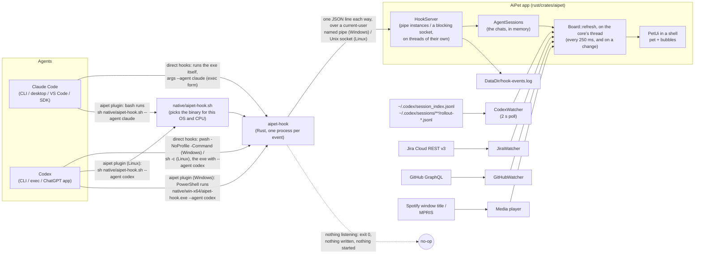
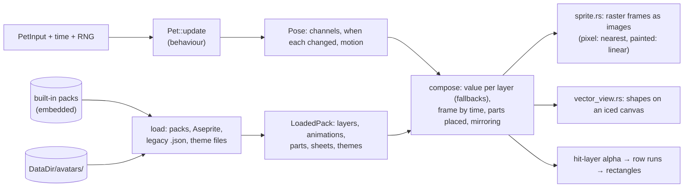
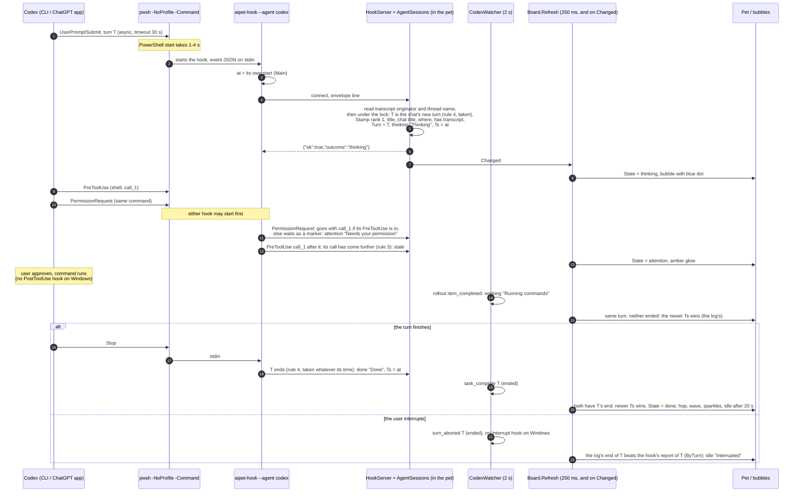

# AiPet architecture

This document describes how AiPet works as the code stands now. It covers everything from the pixels of the pet to the hook process the coding agents run. AiPet is written in Rust: the workspace is [rust/](../rust/), one crate per part (§2). Links are relative to this `docs/` folder. A citation in the text names a module (`board.rs`), which each section's "Files" line places in its crate, and often a function or constant in it. The pet and the hook were ported from a .NET app, which the cutover to Rust removed (it is at commit `bf3696ea4a`); where a rule kept the name the C# gave it (`ByTurn`, `ClaudeStale`, `Stamp`), the Rust module's documentation names it too, or has it as a snake_case function (`by_turn`).

---

## 1. Overview

AiPet is a floating desktop pet that mirrors the state of coding-agent chats: Claude Code (CLI, desktop app, VS Code, Agent SDK) and Codex (CLI, `codex exec`, and the ChatGPT desktop app). It also shows the Jira issues a search finds (by default your own open issues) and the GitHub pull requests waiting on your review, and optionally the track playing in Spotify or another MPRIS player.



**Key design choices.**
- The agent-facing part is a separate tiny process. `aipet-hook` is a native Rust program ([rust/crates/aipet-hook/](../rust/crates/aipet-hook/)), so a process spawned on every event starts quickly. Releases build it with cargo for Windows and Linux (§7.9). It is a port of the .NET hook, and behaves as it did, byte for byte where the agents or the pet can see it.
- The hook only observes. On the hook path it never writes to stdout, never fails, and always exits 0 (`main.rs`), so it cannot inject text into a chat or disturb the agent.
- The hook is a thin forwarder. Each run connects to the running pet over a local socket that only the current user can open, sends the event as one JSON line and waits for one line back ([aipet-ipc](../rust/crates/aipet-ipc/)). All state logic lives in the pet (aipet-core's `sessions/`), so the chats exist only while it runs. When it isn't running, a hook does nothing at all: it writes nothing anywhere and starts nothing. Only the user, an installer, or the Windows updater after an update starts the pet. Both ends share the endpoint, limits and field names through the `aipet-ipc` crate, with the data paths (`paths.rs`).
- Claude reaches the hook in one of two ways: hooks registered directly in its settings (exec form, no shell), or the `aipet` plugin, whose hooks run `sh` on a launcher script with `"shell": "bash"`. Codex likewise has direct hooks (through PowerShell on Windows, `sh -c` elsewhere) or the same plugin. §6 and §7 cover both.
- Everything fails soft:
  - A hook that finds nothing listening exits 0 at once. One that gets no event on stdin within 2 s sends nothing. One whose reply doesn't come within 2 s gives up and exits 0.
  - The pet drops garbage, oversized or silent connections without a reply, and never crashes on them.
  - Watcher errors become a bubble or a log line.
  - Platform features that are missing (for example X11 shapes) simply turn off.

---

## 2. Repository layout

| Path | What it is |
|---|---|
| [rust/](../rust/) | The Rust workspace ([Cargo.toml](../rust/Cargo.toml), one version and toolchain for every crate). Its crates are below; the exes' `build.rs` give them their Windows icon, manifest and version resource. |
| [rust/crates/aipet/](../rust/crates/aipet/) | The pet's binary, `AiPet` (`AiPet.exe`): Velopack's startup, the single instance, the core's thread, `config.json` and the window's place, the updates, and the choice of shell (§4.1). |
| [rust/crates/aipet-core/](../rust/crates/aipet-core/) | The pet without a UI: the hook server (`server/`), the chats' state (`sessions/`), the Codex, Jira and GitHub watchers, the Board, presets, `config.json` and the watchers' settings files, secrets, `aipet.log`, the uninstaller's hook cleanup and the update texts (§5, §6, §8). |
| [rust/crates/aipet-sprite/](../rust/crates/aipet-sprite/) | The pet's behaviour, the Pose, packs and the compositor, the built-in packs (`packs/`) and their bake (§3). |
| [rust/crates/aipet-ui/](../rust/crates/aipet-ui/) | The front end both shells share, `PetUi`: the sprite, the bubbles, the menu, Settings, and the geometry the view and the input region come from (§4). |
| [rust/crates/aipet-wayland/](../rust/crates/aipet-wayland/), [rust/crates/aipet-desktop/](../rust/crates/aipet-desktop/) | The shells: a layer-shell surface on Wayland, and an ordinary window on winit (Windows, X11, macOS) with its native calls. aipet-desktop also has the operating system's services both shells use (`platform/`, §8.6). |
| [rust/crates/aipet-hook/](../rust/crates/aipet-hook/) | `aipet-hook`, which the agents run on every event, with `--install`, `--uninstall`, `--doctor` and `--print-plugin-hooks` (§6, §7). |
| [rust/crates/aipet-ipc/](../rust/crates/aipet-ipc/) | What the hook and the pet share: the protocol, the endpoint, connecting, and the data paths (§6.5, §9). |
| [rust/crates/aipet-testkit/](../rust/crates/aipet-testkit/) | The sandbox the tests that run programs and scripts use: fresh folders, an `AIPET_PIPE` no pet listens on, stand-in tools. Not built into anything. |
| [rust/PARITY.md](../rust/PARITY.md) | The parity ledger: every test of the removed C# and the Rust tests that hold it. The .NET app (its projects, tests, solution and the icon generator) is at commit `bf3696ea4a`. |
| `rust/crates/*/tests/golden/` | What the C# wrote and rendered, frozen at the cutover: the Rust replays it (the pet's frames, the hook's registrations, the doctor, the Board). Their README says at which commit. |
| [rust/SPIKE.md](../rust/SPIKE.md), [rust/notes/](../rust/notes/), [rust/proofs/](../rust/proofs/) | The research records behind the migration and later work (Appendix A). |
| [build/](../build/) | `default.win32manifest`, the manifest aipet-hook's `build.rs` embeds (the one the .NET hook had). |
| [assets/icon/](../assets/icon/) | The app icon (`aipet.ico` and PNGs), and the plugin's and the Linux hicolor icons. They were drawn with the .NET pet's renderer by a generator that went with the C#; builds only use the committed files. |
| [plugins/aipet/](../plugins/aipet/) | One plugin folder for both agents: `.claude-plugin/plugin.json` and `hooks/hooks.json` (Claude Code), `.codex-plugin/plugin.json` and `hooks/codex.json` (Codex), the launcher `native/aipet-hook.sh`, assets, README and LICENSE. The hook binaries (`native/<rid>/`) are gitignored: the release workflow adds them in the plugin repository. |
| [.claude-plugin/marketplace.json](../.claude-plugin/marketplace.json), [.agents/plugins/marketplace.json](../.agents/plugins/marketplace.json) | The marketplaces `aipet` for Claude Code and for Codex. Both point at `plugins/aipet` in the separate repository `xMarcinator/ai-pet-plugin`, pinned to a tag and a commit. |
| [packaging/linux/](../packaging/linux/) | The Linux package's `install.sh` (install, update, `--uninstall`), the menu entry template `aipet.desktop.in`, the hicolor icons, and `hyprland/` with the Hyprland window rules (`aipet.lua`, `aipet.conf`). |
| [packaging/windows/](../packaging/windows/) | A README on the Windows packages the release workflow builds. Nothing in it runs. |
| [install.ps1](../install.ps1), [install.sh](../install.sh) | The end-user one-line installers: the latest release's app, then the plugin for each agent on `PATH`. |
| [build.ps1](../build.ps1), [build.sh](../build.sh) | Build the pet and the hook with cargo per RID into `artifacts/`, bundle the hook into the plugin and make a local marketplace to try it (§7.7). |
| [scripts/](../scripts/) | `install-from-source.sh` and `install-from-source.ps1` (install a build from a clone, with direct hooks); the checks CI runs: `check-plugin.sh` (the plugin and marketplace files are consistent, and the hook files match the code), `check-parity.sh` (the parity ledger), `check-removed-paths.sh` (nothing names what the cutover removed), `check-notices.sh` (THIRD-PARTY-NOTICES.md is what cargo-about makes) and `check-skill-copies.sh`; and `perf/`, the CPU and memory benchmarks. |
| [.github/](../.github/) | `workflows/ci.yml` (the hook and the plugin check on Windows and Linux, the Rust workspace, the notices, the scripts), `workflows/release.yml` (check, win, linux, plugin, publish), `workflows/velopack-proof.yml` (an installed pet updating itself on Windows, run by hand) and `dependabot.yml` (updates for the pinned actions). |
| [avatars/](../avatars/) | A legacy sample avatar (`hood-green.json`), the built-in pets' reference drawings and generators (`reference/`), and sample packs and a sample theme file (`samples/`). The app does not read this folder (see §3.7). |
| [docs/](../docs/), [THIRD-PARTY-NOTICES.md](../THIRD-PARTY-NOTICES.md), [CHANGELOG.md](../CHANGELOG.md) | This document, [MAKING-A-PET.md](MAKING-A-PET.md) (making packs and themes) and the work-in-progress handoff; the notices for every crate the release builds compile in, generated by cargo-about from `rust/about.toml` and `rust/about.hbs` (`scripts/check-notices.sh --write`); the changes per release. |
| `web/` | An earlier prototype. Not built or installed, and not covered here. |

---

## 3. The pet: behaviour, packs and drawing

Files: [pet.rs](../rust/crates/aipet-sprite/src/pet.rs) (behaviour), [pose.rs](../rust/crates/aipet-sprite/src/pose.rs) (the Pose), [pack.rs](../rust/crates/aipet-sprite/src/pack.rs) (the pack model and its checks), [manifest.rs](../rust/crates/aipet-sprite/src/manifest.rs) (reading `pack.json`), [load.rs](../rust/crates/aipet-sprite/src/load.rs) (finding and loading pets, the limits, Aseprite, theme files, `--check-pack`), [compose.rs](../rust/crates/aipet-sprite/src/compose.rs) (the compositor), [vector.rs](../rust/crates/aipet-sprite/src/vector.rs) (path data and the tiny-skia rasteriser), [builtin.rs](../rust/crates/aipet-sprite/src/builtin.rs) (the embedded pets), and in the UI crate [sprite.rs](../rust/crates/aipet-ui/src/sprite.rs), [vector_view.rs](../rust/crates/aipet-ui/src/vector_view.rs) and [settings/avatars.rs](../rust/crates/aipet-ui/src/settings/avatars.rs).

This section describes the Rust pet. The behaviour in `pet.rs` is a port of the .NET pet's that keeps its numbers bit for bit, with its states. The moods added since (`sad`, `tired`, `news`, the aura and the heart, fnt-72) are the Rust pet's own: they are on in the app and off in the golden replays (`PetInput.moods`, `Board.moods`), so the replays still match the C# frame for frame. What the pet looks like comes from a **pack**. The authoring side (the manifest, every key, the limits and the checker) is in [MAKING-A-PET.md](MAKING-A-PET.md).

### 3.1 Pipeline: Pose → compositor → renderers

The behaviour never draws. Each frame it computes a **Pose**, a renderer-neutral description of what each part of the pet shows. The compositor turns the Pose and the worn pack into what each layer draws, and the UI draws it.



- **Frame loop.** The shell ticks the UI, and the UI the pet, at the smooth rate (60 fps) while the pointer is on the pet's surface, during a drag, for a second after anything moved fast, and while an animation on screen has frames shorter than the calm interval; at the calm rate (30 fps) otherwise (`PetUi::frame_interval`). `Pet::update(input, t)` clamps `dt` to 0.001-0.05 s, computes the pose, and returns the frame's motion. The art is redrawn at 24 fps (`(int)(t*24)` changes) and motion every call, as in the C#: smooth movement, stepped animation frames.
- **`PetInput`** is what the UI tells the pet: `state` (`sleep`, `idle`, `thinking`, `working`, `attention` or `done`), `state_since`, `prop` (`laptop` or `lens`), `hover`, `mouse`, `dragging`, `moved`, `last_move`, `facing` (±1), the one-shot deadlines `poke_until`, `land_until`, `wave_until` and `alert_until`, and `music`.
- **The Pose** ([pose.rs](../rust/crates/aipet-sprite/src/pose.rs)) is a set of channels, each with the time its value last changed, plus `motion` (offset, squash and stretch about the anchor, shadow scale and opacity) and `still` (reduced motion):

  | Channel | Values |
  |---|---|
  | `state` | `idle`, `idle-look`, `idle-hop`, `idle-stretch`, `idle-wiggle`, `idle-tap`, `sleep`, `thinking`, `working`, `attention`, `done`, `listen` |
  | `eyes` | `open`, `closed`, `blink`, `happy`, `squint`, `wide`, `up`, `down`, plus a look direction (`Look`: `dx` −2..2, `dy` −1..1, with hysteresis on the pointer) |
  | `arms` | `rest`, `raised`, `wave-a`, `wave-b`, `run-a`, `run-b`, `hold` (at the laptop), `lens` |
  | `feet` | `stand`, `tap`, `dangle-a`, `dangle-b`, `run-a`, `run-b` |
  | `prop` | `none`, `laptop`, `lens` |
  | `headphones` | `on`, `off` |
  | `fx` | `none`, `zs`, `dots`, `notes`, `alert`, `sparkles`, `dust`, and `<effect>+sparkles` when sparkles come on top |
  | `facing` | `left`, `right` |

- **Randomness** (idle acts, glances, blink times) goes through the injectable `PetRng`, so the tests pin it down.

### 3.2 Where the state comes from

The UI copies the board's state into `input.state` and resets `state_since` only when it changes; §5 explains how the board's state is derived. Inside `Pet::compute_pose`:

- The mood is `attention` while `t < alert_until`. In the golden replays a new Jira or GitHub review sets `alert_until = t + 6`, as in the C#.
- In the app, the UI's mood step ([mood.rs](../rust/crates/aipet-ui/src/mood.rs)) picks the state instead, highest first: `attention`; `news` for 6 s after a new review (`NEWS_S`; one arriving while it shows doesn't stretch it); `working` or `thinking`; `sad` for the board's `error` (a failed turn, §5.3); `done`; `tired` instead of `idle` from 23:00 to 04:59 local, or once the front chat has gone on for 2 hours (`TIRED_AFTER_S`); then `idle` and `sleep`. Asleep stays asleep, but at night the pointer over a sleeping pet shows it tired.
- A pack that draws neither a newer state nor its sign (`tears`, the `envelope`, `sleepy` eyes) shows `sad` and `news` as `attention` and `tired` as `idle` (`Pet::drawable`), so a pack made before them never shows plain idle for news.
- While music is playing, `idle` or `sleep` of any age, or `done` older than 4 s, becomes the synthetic mood `listen`. `headphones` is `on` whenever music plays.
- The idle act is cleared on a mood change.
- The prop is used only while working: `lens` when the input says so, else `laptop`. It is hidden while poked or landing. With a prop and resting arms, the arms channel is `hold` (laptop) or `lens`.
- The random glance is re-rolled from {−1, 0, 0, 1} every 2.5-6 s.

### 3.3 States and poses

Y is in DIPs (negative is up) and `P = 5`. `Wave(rate)` alternates `wave-a` and `wave-b` every `1/rate` s.

| Mood | Motion | Eyes | Arms / feet | `fx` |
|---|---|---|---|---|
| `idle` | Bob `Y=(0.5+0.5 sin 2.2t)*0.6P`. After the next idle time (first at 6 s, then every 5-11 s), when not hovered or dragged, plays an idle act, which is also the `state` value: `look` (the look sweeps −2..2 at 4 steps/s), `hop` (0.9 s, up to 3.2P), `stretch` (`raised`, happy eyes, Y=−P), `wiggle` (X=sin(16t)*0.8P) or `tap` (feet `tap` at 5 Hz, looking right). Other acts last 1.6-2.6 s. | `open`, glancing | `rest` / `stand` | `none` |
| `sleep` | `Y=(0.5+0.5 sin 1.2t)*0.5P` | `closed` | `rest` / `stand` | `zs` (not while hovered) |
| `thinking` | Floats up, `Y=-(0.5+0.5 sin 2.4t)*0.7P` | `up`, looking right | `rest` / `stand` | `dots` |
| `working` | Quick bounce, `Y=-abs(sin 6.3t)*0.6P` | Lens: `open`, scanning [−1, 0, 1, 0] at 1.5 steps/s. Laptop: `down`, looking right. | `lens` or `hold` | `none` |
| `attention` | 1.2 s cycle with a 0.6 s hop to 3P | `open` | `Wave(3)` | `alert` |
| `done` | One 0.7 s hop to 3P | `happy` | `Wave(3)` for the first 4 s | `aura` for the first 1.8 s (`AURA_S`) where the pack draws one, then `sparkles` |
| `sad` | Slow droop, `Y=(0.5+0.5 sin 1.4t)*0.4P` | `down` | `rest` / `stand` | `tears` |
| `tired` | Slow bob, `Y=(0.5+0.5 sin t)*0.6P` | `sleepy`, still following the pointer | `rest` / `stand` | `none` |
| `news` | Little bounce, `Y=-(0.5+0.5 sin 3t)*0.6P`, holding the `envelope` | `open` | `hold` / `stand` | `none` |
| `listen` | Beat 60/112 s; nod `Y=-abs(sin(πt/beat))*1.2P`; sway `X=sin(πt/(2·beat))*0.6P` | `happy` for 6 of every 8 beats | `rest` / `stand`, headphones `on` | `notes` |

**Overrides.** These apply after the base pose, in this fixed order:

1. **Hover tracking** (pointer over the sprite, not dragging, not working): the eyes look towards the pointer, up when it is above them. A sleeping pet stops bobbing and opens its eyes.
2. **Wave** (`t < wave_until`, only in idle, sleep or done): `Wave(5)` with happy eyes. On pointer enter, `wave_until = t + 1.4` unless the last wave ended less than 3 s ago.
3. **Poke** (a click without a drag, `poke_until = t + 1.2`): squint, then happy eyes; a hop of `Y=-sin(pp·π)*3P`; a `heart` where the pack draws one, else sparkles on top of the effect.
4. **Landing** (after a drag, `land_until = t + 0.45`): a hop of `2.5P` with happy eyes.
5. **Running** (dragging, and the last move was under 0.25 s ago): `run-a`/`run-b` arms and feet at 10 Hz, a lean of `X=facing*P`, looking far towards `facing`, no prop, `fx` `dust`. Otherwise **held** (the drag has passed its threshold but the last move was 0.25 s or more ago): feet `dangle-a`/`dangle-b` at 3 Hz, arms `raised`, `wide` eyes, no prop, no effect.
6. **Blink**: when the eyes are open, up or down and `t > blink_at`, they `blink` for 0.13 s. The next blink comes 2.5-5.5 s later; the first is at t=3.

`facing` is the drag's direction. Whether that mirrors anything is up to the pack (§3.6).

### 3.4 Squash, stretch, breathing, shadow

These run on every call and become the Pose's `motion`:

- `v = (pose.Y - prevY)/dt`.
- **Landing** (`prevY < -2 && pose.Y >= -0.4 && v > 0`): `squash = 0.13`, decaying as `squash *= exp(-11 dt)`.
- `stretch = clamp(-v/2600, 0, 0.06)`, applied only while rising.
- `breathe = 0.012*sin(1.2t)` when sleeping or `sin(2.2t)` when idle, and 0 while the pet is pressed or dragged. It keys off the raw input state, so a listening pet still breathes.
- `scale_x = 1+squash-0.5 stretch-0.5 breathe` and `scale_y = 1-squash+stretch+breathe`, which roughly preserves volume.
- Shadow: `lift = clamp(1+Y/45, 0.5, 1)`; the shadow's scale and opacity are 0.55 and 0.35 while held, else `lift`.
- **Reduced motion** (the system's setting, or `AIPET_REDUCE_MOTION=1`): no offset, squash or idle acts, and `Pose::still`, so every animation holds its first frame. Values still change, so expressions and states still show.

The squash is about the pack's anchor, which the UI puts at the sprite's ground point (50 %, 91.7 % of the 130×120 box), so the feet stay planted. The ground shadow is the app's, drawn under every pet; it follows X only, never Y.

### 3.5 Packs

A pack ([pack.rs](../rust/crates/aipet-sprite/src/pack.rs)) is a manifest plus art: a kind (`pixel`, `painted` or `vector`), a pixel size in logical px, an anchor (the art pixel on the ground shadow), a mirror policy (`flip` or `none`), accent and glow colours, a palette with themes, and 1-16 **layers** drawn in order. Each layer is bound to one Pose channel and has:

- animations per value: raster frames `[x, y, w, h, ms]` on a sheet with a loop mode (`loop`, `once`, `pingpong`), a clock (from the channel's change, or the pet clock) and pivots; or keyframe part animations;
- for vector layers, shapes per value or by name (path data, fill, stroke, width, caps, joins, opacity);
- part motion: `parts` with ids and origins, a `look` offset table (eyes only), `poses` with an eased `transition_ms`;
- a `default` and a `fallback` chain. `Layer::resolve` walks the chain (at most 8 steps, no cycles), then for a combined value such as `zs+sparkles` its last part, then the default; a `null` fallback draws nothing;
- `hit` (part of the hit mask), `glow` (drawn into the glow), its own `mirror`, and `themed` (a pixel theme recolours it).

`Pack::validate` and `manifest::read` check everything at load: the defaults exist, the chains end, durations and numbers are in range, part ids are known and unique, a vector pack has at most 256 parts and a raster layer at most one, positions stay in the art box and its 10 px halo pad, and art fits the box. A pack that fails is skipped with one reason line.

**Where pets come from** (`load::all`, on startup and on Reload):

1. The built-in pets, embedded in the binary ([builtin.rs](../rust/crates/aipet-sprite/src/builtin.rs), the files in [packs/](../rust/crates/aipet-sprite/packs/)), in this order: Sprout and Hood (pixel packs baked once from the pixel pets by `bake.rs`; the Hood in Blue with a Green theme), Pip (vector, written by `avatars/reference/pip_gen.py`) and Pip (painted) (painted from it by `painted.rs`), Hood (vector), Hamster and Sprout (vector) (written by the reference generators through `vector_pack.py`), and Hamster (pixel) (`hamster_pixel_gen.py`). `tests/bake.rs` and `tests/vector_packs.rs` check the committed files are what the bake and the generators make, and the golden tests replay the C#'s frames against the baked Sprout and Hood.
2. Every entry of `DataDir/avatars/` in sorted order: a folder with a `pack.json`, an Aseprite `json-array` export with its PNG, or a native `.aseprite` file (with an optional `pack.json` for the rest) is a pack; a `.json` file is a legacy ellipse avatar, baked into a pixel pack when it loads (`load_legacy`). The `themes/` folder is skipped here.
3. The theme files in `DataDir/avatars/themes/`, each put on its pet by name (§3.7).

Built-ins win a name; a later pet with a name already taken is skipped. Every pack loads completely or not at all, within the limits (manifest 256 KB and 64 deep, each PNG 8 MB and 2048 px a side checked from its header before decoding, 64 MB decoded per pack, 512 frames, an `.aseprite` file 8 MB with every cel's size checked before it is inflated). Files must stay inside the pack's folder: absolute paths, `..`, links, junctions and device names are rejected. Vector path data loads nothing from outside the manifest.

**Aseprite.** Both sources go through `build_aseprite`. Tags `<layer>:<value>` become animations; the tag's direction and repeat count give the loop mode (a repeat plays the frames n times, then holds the last); frames keep their durations; a slice named `anchor` gives the anchor and a slice named after a part gives its origin and, on each tag's first frame, its pose position. An export's trimmed frames keep their place through `spriteSourceSize`. The native reader ([aseprite_file.rs](../rust/crates/aipet-sprite/src/aseprite_file.rs), our own rather than a crate; see `rust/proofs/aseprite.md`) reads frames, normal and group layers, raw, linked and zlib cels in RGBA, greyscale or indexed colour, tags and slices, crops each tagged layer's frames to what is drawn, and lays them out on one sheet. It rejects tilemaps, tilesets, external files and non-square pixels.

**`AiPet --check-pack <folder or theme file>`** runs the same loader (`load::check`) and prints `OK <name> (<kind>, <layers> layers, <frames> frames[, themes …])` with exit 0, or the reason with exit 1. It never starts the pet or writes anything.

Rive packs aren't supported (the spike's measurements are in `rust/proofs/rive.md`).

### 3.6 The compositor and the renderers

`compose::pick` gives, for each layer in order, the value it shows (through `resolve`), the frame of that value's animation at the time since its channel changed (or on the pet clock), and whether it is mirrored: when the Pose faces left and the layer's mirror policy, else the pack's, is `flip`. A layer's `<value>@left` frames, where it has them, are used unmirrored instead. `compose::Parts` places the movable parts: each part's pose target, eased from where it was when the value changed, plus its keyframe (with its `phase`), plus the look offset for the eyes; then the body's motion, then the mirroring, so parts ride with the body.

- **Raster packs** ([sprite.rs](../rust/crates/aipet-ui/src/sprite.rs)): every frame of the pack, its mirror image, and for a glowing layer its blurred halo in the glow colour, becomes an iced image once, when the pet puts the pack on. Each redraw only picks which images show where, so a tick that changes nothing uploads nothing. The art is placed with its anchor on the sprite's ground point, each frame at the art box's origin less its pivot, moved by its layer's offset from `Parts::raster_offsets`. A raster layer moves as one piece: with a part, by the part's place less its origin (the eased pose, the key's `dx` and `dy`, the look offset), and without one by the eyes' look table; rotation, scale and opacity are for vector parts. That is why a raster layer has at most one part. A pixel pack's offset is whole art pixels; a painted pack's is logical px, snapped with the rest of the sprite. `Pet::composite` (the golden test and the grid packs' stills) and `compose::flatten` (stills) move the frames by the same offsets, and `Sprite::fast_ms` asks for smooth frames while a part is between poses or a part animation steps. Pixel packs use nearest filtering and snap their position and pixel size to whole device pixels at every scale; painted packs use linear filtering.
- **Vector packs** ([vector_view.rs](../rust/crates/aipet-ui/src/vector_view.rs)): the parts' shapes are drawn on an iced canvas, with the geometry cached until what is drawn changes (a value, a part's place) or the sprite's snapped rectangle changes size by a device pixel. The body's breathing and squash stretch the canvas's rectangle rather than rebuilding the geometry. A glowing layer gets halo strokes along its shapes.
- **Layers' targets.** A layer bound to `fx` is drawn with the effects on top; a `glow` layer into the glow; every other layer with the body.
- **Hit mask.** The hit layers' solid pixels become row runs: worked out per frame at load for raster packs, and rasterised with tiny-skia at art resolution when the drawing changes for vector packs. `geometry::sprite_rects` adds them to the hit ellipse's box (86x88, always there), joins rows, and past 64 rectangles merges them into coarser bands. The result goes to each shell's input region (§4.3).
- **Stills.** The Avatars page's tiles and the theme editor's preview are drawn from the same Pose at rest (`sprite::still`): raster packs flattened from their frames (`compose::flatten`), vector packs rasterised with tiny-skia.

### 3.7 Avatars, themes and the Avatars page

**Identity.** A pet is one or more drawings, its **styles** (FNT-74): packs that share a pet (`pet`, else the pack's name), a pet folder's subfolders, grouped by `load::groups` in load order, each pet's default style the drawing named as the pet. `config.json` keeps `Avatar` (the pet's name), `AvatarStyle` (left out when it is the pet's default) and `AvatarTheme` (left out when it is the style's default). An unknown pet shows the first pet, an unknown style the pet's default, and an unknown theme the style's default, without rewriting config. Older names still work: a drawing's name, such as "Hood (vector)", wears that pet in that style, and "<pet> (<theme>)", such as "Hood (green)", that pet in that theme (`choose`, [lib.rs](../rust/crates/aipet-ui/src/lib.rs)). The .NET pet reads only `Avatar` and drops `AvatarStyle` when it writes the file. Config is written only on a real change.

**Themes** ([pack.rs](../rust/crates/aipet-sprite/src/pack.rs) `Palette`, `Theme`; [load.rs](../rust/crates/aipet-sprite/src/load.rs) `LoadedPack::in_theme`). A pack's `palette` names colours, which are its default theme (named by `theme`, else "Default"); `themes` are the others. A colour theme changes some named colours: a vector pack's shapes, accent and glow name them as `$name`, and `Pack::recolour` swaps them; a pixel pack's names are exact colours in its sheets, and `LoadedPack::recoloured` swaps those pixels, keeping their alpha, in every themed layer (all but the effects, unless a layer says). A sheet theme draws some of a raster pack's sheets from other files of the same size; the painted Pip's Lilac theme is one, since a painted pack's blended colours can't be swapped. A theme changes colours or sheets, never both; a pet has at most 64.

**Theme files.** The user's own themes are `DataDir/avatars/themes/*.json`, each `{"pet", "theme", "palette"}`: a pet by name (a built-in one or the user's), a new theme name, and some of its named colours. `load::all` puts each on its pet after the pets load, in file order; one that doesn't fit (no such pet, a painted pet, a colour the pet doesn't name, a name it already has) is skipped with its reason, as `themes/<file>`.

**The Avatars page** ([settings/avatars.rs](../rust/crates/aipet-ui/src/settings/avatars.rs)):
- One tile per pet, each a still (in the style worn, for the worn pet) with its accent's dot. A click wears it: the pet takes it on, the accent colours Settings and the menu, and the config is saved.
- For a pet with more than one style, a **Style** row of pills; a style keeps the worn theme where it has one by that name.
- Under the tiles, the worn pet's themes as pills. **New theme** (for a pet with named colours) opens an editor with a preview, the name and each named colour, and **Save** writes a theme file with the colours that differ from the pet's default, named `<pet>-<theme>.json`. **Edit** and **Delete** appear for the user's own themes only. Sheet themes can't be edited.
- "Your own avatars": **Reload** reruns `load::all`; **Open folder** opens `DataDir/avatars`, making it first if it is missing. Every pack, legacy file or theme file that didn't load is listed with its reason. When the worn drawing has gone or now fails to load, Reload puts on the pet's default style, else the first pet.

**Sizes.** Settings → General has Pet size (75-200 %) and Bubble size (80-120 %), saved as `PetSize` and `BubbleSize`. The bubbles stay as far above the pet's head at every pet size. A pack's art box is the same at every size, so packs need nothing for it.

The repository's [avatars/](../avatars/) folder is not read by the app: it holds the legacy sample `hood-green.json`, the reference drawings and generators in `reference/`, and sample packs and a sample theme file in `samples/` ([avatars/README.md](../avatars/README.md)).

---

## 4. The window and bubbles

Files: the app, [aipet/src/](../rust/crates/aipet/src/) (`main.rs`, `single.rs`, `placement.rs`, `config.rs`, `core_thread.rs`); the front end both shells share, [aipet-ui/src/](../rust/crates/aipet-ui/src/) (`lib.rs` for `PetUi`, `geometry.rs`, `view.rs`, `cards.rs`, `menu.rs`, `mood.rs`, `settings/`); and the two shells, [aipet-wayland/src/](../rust/crates/aipet-wayland/src/) (`shell.rs`, `drag.rs`, `probe.rs`) and [aipet-desktop/src/](../rust/crates/aipet-desktop/src/) (`shell.rs`, and `native/` for the window calls iced has no API for).

### 4.1 Process start and the shells

**Start** (`main`, [main.rs](../rust/crates/aipet/src/main.rs)), in this order:
- **Velopack first.** `updates::startup()` runs before anything else. The Windows installer, updater and uninstaller start the app with arguments of their own, which it handles before it exits; any other start goes on at once (§8.5). `AiPet --check-pack <folder>` comes next, and never starts the pet (§3.5).
- **Single instance** ([single.rs](../rust/crates/aipet/src/single.rs)). One pet per user, whether the other is the Rust pet or a .NET pet of an earlier release. On Windows, the named mutex `Local\AiPetApp`: another pet holds it when it was there already, or when this pet may not open it (a pet started elevated made it). On Linux, an exclusive, non-blocking `flock` on the lock file next to the hooks' socket (the socket's path with `.lock` in place of `.sock`, or `<AIPET_PIPE>.lock` with that override), opened 0600 without following a link and held until the pet ends; then, as the .NET pet did, a pet that answers on the socket, or is there but too busy to answer, is another pet too. Losing quits quietly. A lock that can't be taken for another reason (a link at its path, a folder that can't be written) stops the pet with a line in the log, rather than risk two.
- **The GPU and the shell's environment,** while no other thread reads it. The pet renders through wgpu on the low-power GPU (`WGPU_POWER_PREF=low` unless set), through GL on Linux and Vulkan on Windows (`WGPU_BACKEND` unless set; never DX12, whose window iced 0.14 can't make transparent). On Linux, where an Intel or AMD GPU drives the screen and no NVIDIA one does, only Mesa's EGL driver is loaded ([mesa.rs](../rust/crates/aipet/src/mesa.rs)), and glibc gets at most two malloc arenas.
- **Updates.** `updates::start()` runs once the pet knows it is the only one. It returns false, and the pet exits, when an update downloaded earlier is installed first; Velopack's `Update.exe` then starts the pet again (§8.5).
- **The core** ([core_thread.rs](../rust/crates/aipet/src/core_thread.rs)): `config.json` is read, the platform's services made, and the core's thread started (§4.7).
- **The shell,** until the pet quits; then the core stops (and with it the hook server and the watchers), and the single instance is let go.

**Which shell.** `AIPET_BACKEND=wayland|desktop` chooses. Otherwise the Wayland shell runs when the session is Wayland (`WAYLAND_DISPLAY` set and not empty) and its compositor has layer-shell, which [probe.rs](../rust/crates/aipet-wayland/src/probe.rs) asks without panicking; the desktop shell runs everywhere else. Before the desktop shell starts on Linux, `main` empties `WAYLAND_DISPLAY` and removes `WAYLAND_SOCKET`, so winit takes X11 (through XWayland in a Wayland session) and libwayland can't connect: winit's own Wayland windows can neither place themselves nor stay on top. `AIPET_DEBUG=1` says which shell runs and why, and logs pointer events and input-region updates to stderr.

| | Wayland shell ([aipet-wayland](../rust/crates/aipet-wayland/src/shell.rs)) | Desktop shell ([aipet-desktop](../rust/crates/aipet-desktop/src/shell.rs)) |
|---|---|---|
| Where | Wayland compositors with layer-shell: Hyprland, Sway, KDE, COSMIC | Windows, X11, GNOME and other Wayland sessions without layer-shell (through XWayland), macOS (not supported) |
| Built on | an iced_exwlshell daemon | an iced daemon on winit |
| The pet's surface | a layer surface, namespace `aipet`, on the Top layer (Bottom when "Always on top" is off), anchored to its output's bottom-right corner, never taking the keyboard | a transparent, undecorated window, title and class `AiPet`, kept above other windows and out of the taskbar and window switchers |
| What takes the mouse | the surface's input region, exactly `PetUi::hit_rects` | X11: the SHAPE extension's input shape, and its bounding shape for what is drawn. Windows: a window region (`SetWindowRgn`) of what is drawn, which ignores the mouse outside the input region. macOS: the window ignores the mouse while the pointer is outside it, checked about 30 times a second (`native/`) |
| Dragging | by the surface's margins, or over an output-sized surface (`AIPET_DRAG=margin` or `overlay`, overlay by default; [drag.rs](../rust/crates/aipet-wayland/src/drag.rs)) | the window follows the pointer, read from the desktop every frame, so a lost release is noticed |
| The menu | an xdg popup above the pet, which the compositor dismisses on a click elsewhere; drawn in the pet's surface when a popup doesn't appear within 500 ms | drawn in the window, above the pet |
| Settings | an xdg window, 800×640, title `AiPet · Settings` | an ordinary window, the same size and title |

Both shells run the same front end, `PetUi` ([aipet-ui](../rust/crates/aipet-ui/src/lib.rs)): the shell turns the core's news into messages, calls `PetUi::tick` every `PetUi::frame_interval` (§3.1), draws `PetUi::pet_view` on the 380×600 surface (`SURFACE`), and makes `PetUi::hit_rects` the surface's input region whenever it changes (`PetUi::drawn_rects` is what is drawn on, shadows included). Only the pet's surface is drawn on a tick, not at the display's rate. `AIPET_OPEN_SETTINGS=1` (or a page's name, such as `avatars`) opens Settings at start in either shell.

### 4.2 The surface and placement

**The surface** ([geometry.rs](../rust/crates/aipet-ui/src/geometry.rs), [view.rs](../rust/crates/aipet-ui/src/view.rs)) is 380×600 logical px, the size of the .NET pet's window. Every layer is pinned where `geometry` puts it, and the input region is built from the same numbers, so what takes the mouse is what is drawn. Bottom to top: the reviews header, the bubbles (back to front, each with its buttons and dismiss button while the pointer is on it), the ground shadow, the sprite's body, the glow's halo, the glow and effects, the menu when it is drawn in the surface, and a tooltip while one shows. The sprite's 130×120 box sits at the bottom centre; the stacks sit above it.

**Placement** ([placement.rs](../rust/crates/aipet/src/placement.rs)). A place is the whole surface's top-left corner in desktop pixels, which both shells save: `Left` and `Top` in `config.json`, with `WindowHeight`, the height it was saved with, so a place a .NET pet saved (whose window was 420 high, or had a toolbar row) still puts the pet where it was. With no place, the pet starts in the bottom-right corner of its screen, 24 px in from the right edge and flush with the bottom.
- The desktop shell opens its window hidden on the primary monitor, so the native setup (utility window, keep above, out of the taskbar) is in place before the window manager sees it, then moves it where the pet was left and shows it. It looks at the screens every second, and brings the pet back to its corner (and saves that) when it shows on none of them.
- The Wayland shell turns a place into a home on an output: the output it is on, and the surface's right and bottom margins there ([drag.rs](../rust/crates/aipet-wayland/src/drag.rs) `arrange`). The surface is made at the first retry, a second after the start, by which time the compositor has said where all its outputs are; a place on none of them goes home on the output the compositor picks. The surface may hang over its output's edges, as long as the sprite stays on it. It is made again when its output goes away.
- A drop saves the new place at once. Settings' Reset position puts the pet back in its corner and saves that. The quit writes what is still unwritten. Starting and quitting without a change write nothing.

**Always on top.** The Wayland shell moves the surface between the Top and Bottom layers. The desktop shell asks the window manager to keep the window above, and says so again every 2 s while it is on (on Windows, `HWND_TOPMOST`).

### 4.3 Click-through

Only the pet and its bubbles take the mouse. `PetUi::hit_rects` gives, in logical px: the sprite's rectangles (its hit mask, §3.6), each visible bubble's rounded body (its buttons are inside it) and its dismiss button while that shows, the reviews header, and the menu while it is drawn in the surface. Shadows, glows and tooltips click through. Each shell scales the rectangles to physical pixels.
- **When the region is sent.** What is drawn goes as soon as it changes, and the input region with it; a change to the input region alone waits until 100 ms after the last one, as the .NET pet's did.
- **Wayland.** `wl_surface.set_input_region` with exactly those rectangles, so everything else, on every compositor with layer-shell, clicks through. During an overlay drag the output-sized surface takes the whole output's input until the drop.
- **X11 and XWayland** ([native/x11.rs](../rust/crates/aipet-desktop/src/native/x11.rs)). The input shape is the hit rectangles and the bounding shape is what is drawn, sent over a connection of the pet's own to the display winit uses (X window ids are server-wide). Compositors that honour the input shape let the rest click through. Hyprland's XWayland ignores input shapes, which is why the Wayland shell runs there.
- **Windows** ([native/win32.rs](../rust/crates/aipet-desktop/src/native/win32.rs)). A window region clips hit-testing and drawing alike, so the region is what is drawn (shadows and glow included). Where the region takes the mouse and the input region doesn't, the window ignores the mouse (`WS_EX_TRANSPARENT | WS_EX_LAYERED`) from the hit test of the move that takes the pointer there, before a click can follow, until a timer about 30 times a second sees the pointer back. `WS_EX_TOOLWINDOW` keeps the pet out of Alt+Tab and is kept through winit's style rewrites.
- **macOS.** AppKit has no input region: the window ignores the mouse while the pointer is outside the hit rectangles, checked about 30 times a second. Nothing clips drawing.

### 4.4 Bubbles

Files: [cards.rs](../rust/crates/aipet-ui/src/cards.rs) (the stacks, their layout and animation), `PetUi::sync_cards` and `PetUi::fill` in [lib.rs](../rust/crates/aipet-ui/src/lib.rs) (which bubbles are shown, and their text and buttons).

Each bubble is a card keyed by its session's id: a title, a detail line, a status dot with a pulse, the round buttons it has, and a dismiss button on its top-left corner. The body is 50 px high and 25 px round (`CARD_H`, `CARD_RADIUS`).

**Three stacks.** Each bubble belongs to one of three stacks, by its kind (`section_of`, [board.rs](../rust/crates/aipet-core/src/board.rs)). From the pet up:
- `music`: the one music bubble, right above the pet, so no chat ever hides it;
- `chats`: the agents' chats;
- `reviews`: Jira and GitHub bubbles and their error bubbles, under the reviews header.

The Board caps each stack (4 chats, 4 reviews, 1 music) and counts the rest; in the reviews stack a watcher's error bubble always shows, first (§5).

**What is shown** (`sync_cards`, `fill`):
- With bubbles off ("Show bubbles" in the menu), none, so every bubble animates away.
- The Board's cards, in its order. A chat's detail starts with its app's label (`Codex CLI · Running command`) when chats of more than one app are showing, or when the app is anything but the Claude app or Claude Code. The thinking dots cycle three times a second.
- The last bubble of a stack ends with `  ·  +N more` when its stack has more than it shows.
- **Ghost:** when nothing at all is shown, bubbles are on, and the pointer is on the pet (not dragging it), a ghost bubble appears in the chats stack: "Claude Code / Napping" while the pet sleeps, else "All caught up". It isn't the Board's: a click on it brings Claude forward.
- **The reviews header** shows while the reviews stack holds a bubble. It reads "{n} waiting on you", where n counts the Jira and GitHub bubbles shown plus those beyond the cap, or "Jira and GitHub" when the stack holds only error bubbles. It doesn't say "reviews", because Jira's search may find your own issues rather than reviews.

**Coming and going.** A new bubble slides up 14 px and fades in; one that went (dismissed, idle, over the cap, or bubbles hidden) fades out and drops 10 px over 0.25 s. If its id comes back while it is still fading, it comes back as a new bubble.

**Layout.**

| | Y offset | Scale | Opacity | Shows | Takes the mouse |
|---|---|---|---|---|---|
| Folded (a deck of cards) | `-i*9` | `1-0.06i` | 1, 0.78, 0.56, then hidden | the front bubble only | the front bubble only |
| Spread | `-i*58` (50 px + 8 px gap) | 1 | 1 | all | all |

- **One stack spread at a time.** A click on a folded stack of more than one bubble spreads it and folds the others: two spread stacks would be taller than the room above the pet. A stack folds again when it drops to one bubble, or when the pointer has been off the pet's surface for more than 2.5 s.
- Each stack's height eases to its target, so the stacks sit on each other; positions, scales and heights ease as `1 - exp(-13·dt)`, opacity as `1 - exp(-16·dt)`.
- **Style.** The dot has the state's colour (§5.3); a GitHub bubble's is GitHub's purple, `#A371F7`. Working, attention, thinking and music bubbles pulse. A chat's border is its app's colour (§5.4); an attention bubble gets an amber tint and a glow that breathes about every 1.8 s, so it keeps its app's border while "needs you" shows.
- **Sizes.** Settings → General's Bubble size (80-120 %) scales the bubbles; the stacks stay as far above the pet's head at every pet size.

### 4.5 Bubble actions

A bubble the pointer is on, while it is the front one or its stack is spread, shows its buttons and its dismiss button.

| Control | Shown | Action |
|---|---|---|
| Body click | always | A folded stack of more than one bubble spreads (§4.4). Otherwise `open_item`: an error bubble opens Settings on its Jira or GitHub page; the music bubble brings the player forward; a review opens its page; a chat opens its deep link (§5.4), else brings its agent's app forward (`Platform::focus_agent`). |
| ✕ Dismiss | on hover | The core dismisses it (§5.5). |
| Open | a working or thinking chat in its agent's desktop app | Opens the chat as a click on the bubble does. It stands where the .NET pet's Stop button was: the Rust pet has no Stop, and never sends another app simulated keys. |
| Open in Jira | a Jira issue, or a pull request that names one | Opens the issue. |
| Open pull request | a bubble with a pull request | Opens it. |
| ⏮ ⏯ ⏭ | the music bubble | The player's previous, play/pause and next. |

**`focus_agent`** ([aipet-desktop/src/platform/](../rust/crates/aipet-desktop/src/platform/)) brings the agent's desktop app forward, and opens at most one URL when no window of it is found: the chat's link when given, else on Windows `claude://` for Claude, and nothing for Codex. It never runs the agent's CLI.

### 4.6 Drag, menu and config

- **Drag.** A left press on the sprite captures the pointer. More than 4 px of movement makes it a drag, and the shell moves the surface (§4.1's table); it tells the pet with `DragStarted`, `DragMoved` and `DragEnded`, or `DragCancelled` when the drag is lost without a release (the surface went away). A horizontal step sets the facing; the pet runs while the pointer moves and dangles while it rests (§3.3). A release after a drag lands the pet and saves its place; a release without one is a poke.
- **The Wayland drag** ([drag.rs](../rust/crates/aipet-wayland/src/drag.rs)), a state machine with no Wayland in it, so the tests replay event sequences. `overlay` (the default) grows the surface to the whole output for the drag and draws the pet at the pointer, then shrinks it back at the drop; `margin` moves the surface by its margins as the pointer moves. Hyprland 0.56 slides each change of a layer surface's position over its `layers` animation, which the shipped layer rule turns off (§7.8); Hyprland 0.57 squeezes the old frame into a new size, so the pet isn't drawn while the surface shrinks back (`Drag::shows_pet`).
- **Menu** ([menu.rs](../rust/crates/aipet-ui/src/menu.rs)). A right press on the sprite opens it above the pet: the toggles "Show bubbles" and "Always on top" (each saved at once), "Avatars…" (Settings on the Avatars page), "Settings…", and "Quit". Quit tells the app, which installs a downloaded update once the pet has exited (§8.5), and ends the pet. A press on the pet closes the menu and does nothing else.
- **`config.json`** (aipet-core's [config.rs](../rust/crates/aipet-core/src/config.rs), kept by aipet's [config.rs](../rust/crates/aipet/src/config.rs)). The fields the .NET pet wrote, with the same names and JSON rules, so a Rust pet and a .NET pet read each other's file:
  - `Left`, `Top`: the whole surface's place in desktop pixels; `WindowHeight`: its height when the place was saved;
  - `Pills` (show bubbles), `OnTop`, `Music` (default true), `Avatar` (the pet's name), `AvatarStyle` and `AvatarTheme` (§3.7), `PetSize` and `BubbleSize`;
  - `Toolbar`: read only, from files written while the .NET pet had a toolbar under the pet.

  The settings are written as soon as they change; the place after a drop, a reset and at the quit. Only a real change is ever written, so a missing or corrupt file stays as it is until the user changes something.

### 4.7 Threads

The pet's threads, and what each may wait on:
- **The main thread** runs the shell's event loop: iced's update, view and drawing, the native window calls, and Settings. It waits on nothing but the event loop.
- **One async worker** ([executor.rs](../rust/crates/aipet-ui/src/executor.rs)): iced's tokio runtime with one worker thread instead of one per core. It runs the frame timer, the shells' event listeners and the Wayland shell's broadcasts, each a future that waits.
- **The core's thread** ([core_thread.rs](../rust/crates/aipet/src/core_thread.rs)): refreshes the Board every 250 ms and whenever a hook changed a chat or a watcher polled, and hands it to the pet (`News::Board`) when what it shows changed; new reviews go as `News::Alert`. The hook server's `changed`, the watchers' events and the pet's requests (dismiss a bubble, music on or off) only post to it, so nothing there waits for the pet.
- **The hook server** (§6.5): 8 listener threads, a thread per connection (at most 64), and on Windows a thread that cuts off connections that wait too long.
- **The watchers:** Codex's log watcher, Jira's and GitHub's pollers, each on a thread of its own (aipet-core's `Poller`), and GitHub's key lookups; the music player's poll, once a second while the user listens along, since a poll may run a program.
- **Short-lived threads:** the update checks (Windows install only), Settings' Test buttons and file pickers, the Linux tools' output readers, and the uninstaller's hook cleanup.

Like the C# it replaced, the core never runs on a thread pool or an async runtime: blocking work has threads of its own.

### 4.8 Settings

Settings ([settings/](../rust/crates/aipet-ui/src/settings/)) is a window of its own, 800×640, titled `AiPet · Settings`: a sidebar of pages and the page with its title and hint. It paints its own background. One opens at a time; opening it again brings it forward on the page asked for.

**Pages:**
- **General** ([general.rs](../rust/crates/aipet-ui/src/settings/general.rs)):
  - The pet: switches for "Show chat bubbles" and "Always on top", and "Listen along with {player}" when the platform has a media player.
  - Pet size (75-200 %) and Bubble size (80-120 %), saved as `PetSize` and `BubbleSize`.
  - More: Position (Reset), the data folder with Open, and Team defaults with "Import defaults…".
  - About ([updates.rs](../rust/crates/aipet-ui/src/settings/updates.rs)): "AiPet {version}" (the version the release sets from its tag), a line on where the app's update stands, and one button: "Check for updates", or "Restart to update" once an update is downloaded, which installs it and quits the pet, and the updater starts it again. A copy that doesn't update itself (anything but the Windows install) shows no button and says so. §8.5 covers the updates.
- **Avatars:** the pets, styles and themes (§3.7).
- **Jira** ([jira.rs](../rust/crates/aipet-ui/src/settings/jira.rs)): enabled, site, email, token and JQL. The token box is write-only: it holds only what is typed, Save empties it, an empty box on Save keeps the saved token, and it never shows the saved one. Also Test search, Create a token and Remove saved token. An empty JQL box means the default search, your own open issues.
- **GitHub** ([github.rs](../rust/crates/aipet-ui/src/settings/github.rs)): enabled, host, token and organisations (comma-separated). Test connection runs `viewer{login}` plus a review count and saves nothing. The token box is write-only, as Jira's.

The other fields are filled from the watcher's saved settings, and again whenever those change outside the page (Import defaults…). Tests run on threads of their own, so the pet keeps moving.

**Import defaults…** sets the Jira and GitHub settings from a preset file a team shares (aipet-core's [presets.rs](../rust/crates/aipet-core/src/presets.rs)), saved as the pages' Save does.
- The file is picked with the desktop's file picker (rfd: the XDG portal on Linux), on a thread of its own. An error from the picker shows as a message rather than taking the pet down.
- The format is `{"version":1,"jira":{site,jql,enabled},"github":{host,orgs[],jiraProjects[],enabled}}`. Every section and field is optional, and a file of another version is refused with a message. A preset never carries credentials: tokens and the Jira email are never read from it, even when the file has them.
- When a preset points Jira at another site, or GitHub at another host, while a token is saved, that token is removed before Save restarts the watcher (`Preset::moves_jira`, `moves_github`). A shared file therefore can't send your token to an address you never typed. The result line asks you to paste the token again if you trust the new address.

---

## 5. From sources to bubbles: the Board

Files, in [aipet-core](../rust/crates/aipet-core/src/): [board.rs](../rust/crates/aipet-core/src/board.rs), [sessions/](../rust/crates/aipet-core/src/sessions/) (AgentSessions: `mod.rs`, `claude.rs`, `codex.rs`, `turns.rs`, `titles.rs`, `describe.rs`), [codex_watcher.rs](../rust/crates/aipet-core/src/codex_watcher.rs); the core's thread is [core_thread.rs](../rust/crates/aipet/src/core_thread.rs).

`Board` lives on the core's thread ([core_thread.rs](../rust/crates/aipet/src/core_thread.rs)). It is rebuilt from scratch every 250 ms and whenever a watcher, the media player or the hook server reports a change, and goes to the pet (`News::Board`) only when what it shows changed. Each rebuild takes a `snapshot` of the `AgentSessions` store: copies of its entries, taken under the store's lock, so neither the core nor the pet waits on a file or a hook (`sessions/mod.rs`).

### 5.1 The hooks' chats (`AgentSessions.Entry`)

The store is keyed `claude:<sid>` or `codex:<sid>` and kept in the order the chats first appeared (Board breaks exact ties by it). It lives only in the running pet: nothing is saved, and a pet that starts knows no chats until their next events (§10). How events are placed is in §6.

| Field | Set for | Read by Board | Meaning |
|---|---|---|---|
| `State` | both agents | yes (default `idle`) | `idle`, `thinking`, `working`, `attention` or `done` |
| `Detail` | both | yes | Second line, e.g. "Running command", "Needs your permission" |
| `Prop` | both | yes | `laptop`, `lens` or null |
| `Title` | both | yes (name rank 1) | First prompt line, `Short(…, 38)`, skipped for `/commands` and, for Codex, for a sub-agent's prompt |
| `ChatTitle` | both | yes (name rank 2) | The agent's own name for the chat, `Short(…, 44)` |
| `Agent` | both | yes (default `claude`) | `claude` or `codex` |
| `Cwd` | both | yes (name rank 0 fallback) | Working folder (Codex strips `\\?\`) |
| `Where` | both | yes | See §6.6 |
| `Ts` | both | yes | `at` of the event behind the last *visible* change (Unix seconds) |
| `HostId` | Claude | yes | `CLAUDE_CODE_HOST_SESSION_ID`, kept only in the exact `local_<uuid>` form, used for the deep link |
| `HasTranscript` | Codex | yes: Codex entries without it are dropped | Set when `transcript_path` was given |
| `Turn`, `TurnEnded` | Codex | yes (`by_turn`, §5.2) | The chat's own current turn id, and whether its end is in; copied out of `Threads` |
| `Dispatched`, `DispatchedRank` | both | no | The chat's latest event, for ordering (§6.4) |
| `Threads` (internal) | Codex | no | How far each of the chat's threads has come (§6.4) |
| `Asks` (internal) | Claude | no | The last 16 PreToolUse and PermissionRequest halves, for pairing (§6.4) |
| `Ended` | both (SessionEnd) | yes: the entry is skipped | Tombstone `{Ended, Ts}`, pruned 24 h after its `Ts` |

`Threads` and `Asks` are shared by a snapshot's copies, but only `Apply` touches them, under the lock (`sessions/mod.rs`).

`recorded` (`board.rs`) turns the snapshot into sessions. It skips tombstones and Codex entries without a transcript. The name is `ChatTitle`, then `Title`, then the last folder of `Cwd`, then `AgentLabel(agent)` ("Claude" or "ChatGPT").

### 5.2 Sources and merging

`Board::refresh` (`board.rs`) proceeds in order:

1. **The hooks' chats** (`recorded`, above).
2. **Merge into one `Session` per id** (`offer`):
   - For a Codex chat reported by both the hook and the log, the turn ids decide first (`by_turn`, below).
   - Otherwise the larger `Ts` wins; on a tie, a `hook` report beats a `log` report. The winner keeps its own `Ts`.
   - The winner inherits `Where` and `Cwd` from the loser if it lacks them, and `Link` too; with no link on either side, one is worked out from the (possibly inherited) `Where`.
   - The name comes from the report with the higher name rank; a tie goes to the report offered later.
   - `CodexWatcher` sessions are offered after the hook entries: rank 2 if Codex's index named the chat, else rank 0 with the folder name or "Codex".
3. **Timeouts** (`effective`), applied to the merged chats only.
4. **Review, music and error bubbles** (below).
5. **Sort** by `Priority` descending, then `Ts` descending, into `All`.
6. **Dismiss pruning** (§5.5), then **cards**: `live = Eff != "idle" && !dismissed`. `MaxCards` gives each stack a cap: 4 for `chats`, 4 for `reviews`, 1 for `music` (`board.rs`). A section's `jira-error` and `github-error` bubbles are always taken, first, so an error is the front card of the reviews stack. The remaining room goes to the other bubbles in `All` order, and `Extra` counts only those left out. The reviews header's count (`PetUi::fill`, [aipet-ui](../rust/crates/aipet-ui/src/lib.rs)) is therefore the number of reviews, errors excluded.
7. **Mood** (§5.3).

A session's `Kind` is `chat`, `jira`, `github`, `music`, `jira-error` or `github-error`. `section_of` (`board.rs`) gives three stacks: the Jira and GitHub kinds, errors included, go to `reviews`; `music` to `music`; chats to `chats`.

**The hook against CodexWatcher** (`by_turn`, `board.rs`). Their times don't compare. The hook's `Ts` is when its hook started, which on Windows is 1-4 s late (PowerShell). The log's is when Codex wrote the line. By time alone, an interrupt or an error, which only the log reports, would lose to a hook event Codex sent just before it. So when one report is the hook's and the other the log's, and both name a turn:
- The log's end of a turn beats the hook's report of that turn, unless the hook has that turn's end too.
- The log's end of a turn beats the hook's report of an older turn.
- The hook's report of a later turn beats the log.
- Anything else goes by time: the same turn with both or neither ended, a newer log turn that hasn't ended, ids that aren't UUIDv7s and differ, or a report without a turn.

Turns order as in §6.4 (`v7_before`, `turns.rs`). The hook's `Turn` is the chat's own thread's current turn, and `TurnEnded` says whether its Stop, Interrupt or manual PostCompact is in (`sessions/codex.rs`). The watcher's come from the latest `task_started`, `task_complete` or `turn_aborted` (§5.6).

**Review, music and error bubbles** (§8 has the watchers):
- A Jira issue becomes `jira:<KEY>`, named `{KEY} · {summary}`. Its detail is the issue's status, plus `PR repo#N` when GitHub found a PR for it (`PrLabel`), joined by ` · `. It doesn't say "review", because the default search finds your own open issues.
- A GitHub review request whose keys match no watched Jira issue becomes `gh:<url>`, named `repo#N · title`, with the detail "PR review requested[ · KEY]".
- The music bubble (`music` or `paused`) shows while playing, or up to 600 s after pausing.
- An enabled watcher with a `LastError` adds `gh:_error` ("GitHub reviews") or `jira:_error` ("Jira") with the detail `{error}. Click to fix` and `Ts = now`. A closed error bubble stays closed until the error's text changes (§5.5).

### 5.3 Timeouts and priorities

| State | Priority | Decays to `idle` after | Dot colour |
|---|---|---|---|
| `attention` | 5 | 3600 s | `#FFCF3F` amber |
| `review` | 4 | — | `#4C9AFF` |
| `working` | 3 | 900 s | `#E27A52` |
| `thinking` | 3 | 900 s | `#7AA7FF` |
| `done` | 2 | 20 s | `#5FD38D` |
| `error` | 2 | as the attention it replaces | `#E5484D` |
| `idle` / `sleep` | 1 (also unknown states) | — | `#8A8A90` |
| `music` / `paused` | 0 | — | `#1DB954` / `#5E8F6E` |

The store bumps `Ts` only on a visible change, so the 900 s timeout counts from the last state or detail change. A single long tool call with no further events turns idle after 15 min.

**Pet mood** (`board.rs`).
- `State` is the `Eff` of the first chat in `All`: highest priority, then newest. This list includes idle and dismissed chats.
- With no chats the mood is `sleep`. `idle` becomes `sleep` when the newest chat `Ts` is more than 300 s old.
- `Prop` is the top chat's prop.
- **A failed turn** (fnt-72, with `Board.moods` on, as in the app): a chat whose turn ended on an API error (Claude's `StopFailure`, the entry's `failed`) and is `attention` becomes `error`, its own red bubble with the detail `Failed: …`. It lapses as the attention would, and the next event of that chat clears it. The pet shows it as `sad` (§3.2). The C# board, and the golden replays, keep it as `attention`.

### 5.4 App colours and deep links

`app_of` (`board.rs`) switches on `(s.Agent, s.Where)` in order, and the first match wins (the non-codex rows match any agent other than codex):

| Agent | `where` | Label | Border |
|---|---|---|---|
| any | `terminal` | Codex CLI / Claude Code CLI | `#A3A3AD` |
| codex | `exec` | codex exec | `#A3A3AD` |
| codex | `desktop` | ChatGPT app | `#10A37F` |
| codex | contains `vscode` | Codex in VS Code | `#3794FF` |
| codex | other | Codex | `#10A37F` |
| claude | `desktop` | Claude app | `#D97757` |
| claude | `claude-vscode` | Claude in VS Code | `#3794FF` |
| claude | starts with `sdk` | Claude Agent SDK | `#B48CFF` |
| claude | other / null | Claude | `#D97757` |

`link_for` gives:
- `claude://claude.ai/epitaxy/<host_id>` for a Claude chat with `where=="desktop"` and a `host_id` of exactly the form `local_<uuid>` (`is_host_id`);
- `codex://threads/<sid>` for a Codex chat with `where=="desktop"` and a sid that is a 36-character dashed GUID (braced or undashed forms get no link);
- otherwise null, and a click calls `focus_agent` (§4.5).

Both ids come from the agents' events, so anything but exactly those shapes gets no link. `host_id` comes only from the Claude hook's environment. A `CodexWatcher` session gets a Codex link from its own `where`.

### 5.5 Dismiss

`dismiss(id)` records `(Ts, Eff, Detail)` (`board.rs`). A later `Refresh` removes the record, and the bubble comes back, when any of these holds:
- the session is gone;
- for an error bubble (`jira-error`, `github-error`), its `Detail` changed: another error. Error bubbles are made anew with `Ts = now` on every refresh, so time can't tell;
- otherwise, its `Ts` is more than 2 s newer (the slack covers the hook and the log reporting the same event moments apart);
- for chats only, its `Eff` or `Detail` changed.

Consequences:
- A dismissed error stays hidden until the watcher reports another error, or the error clears and comes back.
- A review returns when its issue or PR is updated, and the music bubble with the next track.
- A dismissed `attention` chat still drives the pet's mood (§5.3) for up to an hour, while its bubble stays hidden.

### 5.6 CodexWatcher

`CodexWatcher` is a read-only fallback for Codex chats, or parts of a turn, that the hooks don't report (`codex_watcher.rs`):
- hooks that aren't trusted yet, which Codex skips silently;
- a desktop app that doesn't run them;
- an interrupted turn where no Interrupt hook is registered: on Windows, and with the plugin everywhere (§6.1);
- a turn that ends in an error, after which Codex runs no Stop hook.

The core starts it once (`core_thread.rs`), and it polls every 2 s on a thread of its own. Each poll's sessions replace a snapshot the Board copies under a lock (`codex_watcher.rs`), so the Board never changes the watcher's own.

**Which files it reads.**
- **Index:** `$CODEX_HOME/session_index.jsonl` (`Paths.CodexHome`), re-read only when its size or mtime changes. It reads the last 512 KB and takes `{id, thread_name}` from each line.
- **Rollout files:** `sessions/YYYY/MM/DD/rollout-*.jsonl`. The id is the last 36 characters of the file name. The first scan covers every day folder; later scans (every 30 s) cover the 21 newest. A file whose chat isn't in the index yet is followed only if it was written within 3 h.
- **What it skips:** a file with unchanged size and mtime is never opened. A never-read file older than 3 h is re-checked only every 30 s. A file it couldn't open is tried again at the next poll. A chat is emitted only if its `Ts` is within 3 h and it is not skipped.

**How a rollout file is read.**
- The first line (up to 4 MB) is `session_meta`, giving `cwd` (without `\\?\`) and `originator`. The originator maps to `where` as the hook's does (§6.6): `Codex Desktop`/`codex_work_desktop` → desktop, `codex-tui`/`codex_cli_rs` → terminal, `codex_exec` → exec, anything else lower-cased.
- Sub-agents (`source` is an object) and threads whose `thread_source` is `guardian_review` or starts with `memory` are skipped.
- After the meta line, the reader jumps to the last 512 KB. It then reads appended bytes up to the last newline and parses only lines containing `event_msg`.

**Event mapping**. `Ts` comes from the line's ISO `timestamp`. The turn is the payload's `turn_id`, or null when the line has none.

| `payload.type` | Result | Turn |
|---|---|---|
| `task_started` | thinking, "Thinking" | this turn, not ended |
| `item_completed` (only while thinking or working) | `CommandExecution` → working "Running commands" laptop. `FileChange` → "Editing files" laptop. `WebSearch` → "Browsing the web" lens. `McpToolCall` → "Using a tool" laptop. Anything else → thinking "Thinking". | unchanged |
| `task_complete` | done, "Done" | this turn, ended |
| `turn_aborted` | idle, "Interrupted" | this turn, ended |

This mapping is best effort against the Codex 0.155/0.156 file formats.

---

## 6. The hooks at runtime

Files: the hook, [aipet-hook](../rust/crates/aipet-hook/src/) (`main.rs`, `event.rs` for the event path, `trace.rs` for its log), [aipet-ipc](../rust/crates/aipet-ipc/src/) (`protocol.rs`, `endpoint.rs`, `connect.rs`, `paths.rs`), which the hook and the pet share, the plugin's launcher [aipet-hook.sh](../plugins/aipet/native/aipet-hook.sh), and in the pet [aipet-core/src/server/](../rust/crates/aipet-core/src/server/) (`mod.rs`, `unix.rs`, `windows.rs`, `answer.rs`, `record.rs`) and `sessions/`. Registration: aipet-hook's `install.rs`, `claude.rs`, `codex.rs`, [plugins/aipet/hooks/](../plugins/aipet/hooks/).

### 6.1 How each agent runs it

Each agent runs the hook either through a direct registration (`--install`, §7) or through the `aipet` plugin. Don't use both: every event would reach the pet twice.

| | Claude, direct | Claude, plugin | Codex, direct | Codex, plugin |
|---|---|---|---|---|
| Command | `<exe>` with `args: ["--agent","claude"]` (exec form, no shell; `claude.rs`) | `sh "${CLAUDE_PLUGIN_ROOT}/native/aipet-hook.sh" --agent claude` with `"shell": "bash"` | `<exe> --agent codex` through a new shell per event: `pwsh`/`powershell -NoProfile -Command` on Windows (cmd.exe in a rare fallback), `sh -c` style elsewhere (`codex.rs`) | `sh "$PLUGIN_ROOT/native/aipet-hook.sh" --agent codex`; on Windows `commandWindows`, `& (Join-Path $env:PLUGIN_ROOT 'native\win-x64\aipet-hook.exe') --agent codex`, through PowerShell |
| Process tree | Claude → hook | Claude → bash → sh (the launcher) → hook | Codex → shell → hook | Codex → shell → sh (the launcher) → hook; Windows: Codex → PowerShell → hook |
| Events | 17, all async except `Stop` (`claude.rs`) | the same 17 ([hooks.json](../plugins/aipet/hooks/hooks.json)) | Windows 9; elsewhere 12, adding PostToolUse, Interrupt and SessionEnd (`codex.rs`) | the Windows 9 everywhere ([codex.json](../plugins/aipet/hooks/codex.json), `CODEX_EVENTS`) |
| Timeouts | 5 s | 5 s | 30 s async; Interrupt and SessionEnd sync with 3 s | 30 s async |
| Missing `session_id` | recorded as `claude:default` | the same | ignored | ignored |

The dispatch time `at` is the same for all four: `Launched::now()`, taken as `main` starts, before stdin is read ([main.rs](../rust/crates/aipet-hook/src/main.rs)). Registered directly, that is about when Claude started the hook. Through the plugin it comes after bash, sh and the launcher: a few ms later on Linux, maybe tens of ms on Git Bash. For Codex it comes after the shell, which PowerShell makes 1-4 s late at random, so the pet orders Codex events by Codex's own ids first (§6.4). The hook looks at no process, its own or any other. Anything but `--agent codex` is sent as a Claude event.

**The launcher** ([aipet-hook.sh](../plugins/aipet/native/aipet-hook.sh):7-25) runs the plugin's copy of the hook for this OS and CPU, from `native/<rid>/` next to it, with the same arguments and stdin. It forks as little as it can, because its time delays `at` and each fork is slow on Git Bash:
- Its folder comes from `$0`, with no `dirname`.
- `$OS = Windows_NT` means `win-x64/aipet-hook.exe` with no `uname`. Otherwise one `uname -sm` decides: MINGW, MSYS or Cygwin → `win-x64`; Linux x86_64/amd64 → `linux-x64`, only when `/lib64/ld-linux-x86-64.so.2` exists; Linux aarch64/arm64 → `linux-arm64`, only when `/lib/ld-linux-aarch64.so.1` exists. Only glibc builds are shipped, so musl or a 32-bit userland is skipped.
- An unknown platform, a missing binary, or one that stays non-executable after a `chmod +x` exits 0.
- The hook runs as `"$bin" "$@" 2>/dev/null; exit 0`, not with `exec`. A binary that still can't load (a glibc older than the one it was built against, or an .exe that antivirus blocks) therefore ends in a quiet 0 too.

### 6.2 Contract

- **Input:** the event JSON on stdin, read within 2 s (`STDIN`, [protocol.rs](../rust/crates/aipet-ipc/src/protocol.rs)). When nothing complete came in time, the hook returns at once and sends nothing. Empty input becomes `{}`. Before parsing, each escaped lone surrogate (half an emoji, which Node's `JSON.stringify` writes for text cut in the middle of one) becomes `�`, as the .NET hook did: its JSON reader parsed one but then couldn't read or write the string, which would lose the event (`mended`, `event.rs`). Input that isn't a JSON object becomes `{}`; with the pet running, the error goes to the hook's trace log (§6.9) and the pet logs the event as ignored (`event.rs`).
- **Fields the pet reads:** `hook_event_name`, `session_id`, `cwd`, `transcript_path`, `prompt`, `tool_name`, `tool_input` (its `file_path`, `notebook_path`, `skill` and `command`, `TOOL_INPUT_KEYS`; the whole input only to tell calls apart when it has none of those, §6.4), `notification_type`, `message`, `trigger`, `agent_type`, `error_type`, and for Codex `agent_id`, `turn_id` and `tool_use_id`. Claude's hook also passes the environment variables `CLAUDE_CODE_ENTRYPOINT` and `CLAUDE_CODE_HOST_SESSION_ID` (`CLAUDE_ENV`, §6.6). Everything else in the payload is ignored.
- **Output:** nothing, ever, on the hook path: not on stdout, and not on stderr. This matters because Codex parses stdout: text on SessionStart or UserPromptSubmit becomes model context, and output on Stop fails the hook (`event.rs`).
- **Exit code:** always 0. The envelope and the request line are built before the pet is reached, so a failure there never takes an instance for nothing. Once the hook has reached the pet, every error is traced; before that it writes nothing (`event.rs`). A panic anywhere, on any thread, is caught by `main` (`silently`) and prints nothing.
- **Time budget** (`protocol.rs`). Claude gives a hook 5 s. The hook's own budget is 4.5 s from `main` (`HOOK_BUDGET`): stdin up to 2 s (`STDIN`), then a free instance for what the budget has left once the reply's 2 s (`TIMEOUT`) is set aside, at most 2.5 s (`CONNECT`) and about 500 ms when stdin took its full 2 s, then the reply. That leaves about 500 ms of Claude's 5 s for starting the hook (bash, sh and the launcher for the plugin, then the runtime). A hook that was slow to get its stdin waits for an instance that much less (`busy_wait`, `event.rs`).
- **Build:** the hook that ships is the Rust crate [aipet-hook](../rust/crates/aipet-hook/), a native program built with cargo (`cargo build -p aipet-hook --release --locked`). It takes the endpoint, the limits and the field names from [aipet-ipc](../rust/crates/aipet-ipc/), which the pet uses too. It must be built with `panic = "unwind"`, since the event path catches every panic and still exits 0 (a `compile_error!` in [main.rs](../rust/crates/aipet-hook/src/main.rs) holds it). Nothing on the hook path starts a process. Releases build it for Windows with the C runtime linked in, and for Linux with cargo-zigbuild for glibc 2.27 (§7.9). From source, `build.sh`, `build.ps1` and `scripts/install-from-source.sh` build it with cargo too (§7.7).

**One run:**

```
main: launched = now  (this is `at`)
 -> read_payload (<= 2 s): nothing in time -> exit 0, nothing sent or written
      escaped lone surrogates -> �; not a JSON object -> {} (traced once the pet is reached)
 -> envelope: v, type, agent, at, pid, env (Claude),
      payload = the event without tool_response, every string cut to 256 Ki chars
 -> request: one JSON line (non-ASCII kept as UTF-8); over 4 MiB - 32 bytes -> tool_input keeps only the keys the pet reads
 -> connect, waiting at most min(2.5 s, 4.5 s - 2 s - time so far) for a free instance
      nothing listening (or on Windows, not the pet's pipe) -> exit 0, having written nothing anywhere and started nothing
      the pet's pipe or socket is there but took no connection in time -> one "stayed busy" trace line, exit 0
 -> Pet::ask: write the line with sent = now, read the reply line (2 s for both)
      no reply, "ok":false, or an error -> one trace line
 -> exit 0

The pet, on a thread of its own (server/mod.rs, handle):
 -> read_line (<= 4 MiB; cut off after 2 s), then answer.rs
      not a JSON object (or nested deeper than 128) -> no reply; another v -> "unsupported version"; another type -> "unknown request"
 -> ping -> {"ok":true,"app":"AiPet","pid":..,"recent":[..]}
 -> event -> AgentSessions::apply:
      Codex without a session_id, or an unknown agent -> "ignored"
      read the chat title / Codex originator and thread name when needed (files, before the lock)
      under the lock:
        prune entries with now - Ts > 86400 (an event found ignored or stale prunes too)
        SessionEnd? -> "stale" if older than the entry, else tombstone {Ended: at, Ts: at}  ("removed")
        event not accepted? -> "ignored"
        ClaudeStale / CodexStale? -> "stale" (a late Codex prompt still names the chat first)
        new or tombstoned -> fresh {State: idle, Detail: Ready, Title: ""}
        Stamp (Dispatched, DispatchedRank)
        common fields (Agent, Cwd, Where, HostId / HasTranscript, ChatTitle; Codex: Turn, TurnEnded)
        per-event Set(state, detail, prop)
        Ts = at only if new, (State, Detail) changed, or stored Ts > now + 5
 -> Record: one line in hook-events.log and the recent list
 -> changed (not for ignored, stale or an error) -> the core's thread refreshes the Board
 -> reply {"ok":true,"outcome":"<state>|ignored|stale|removed"}, or {"ok":false,"error":"error:<Type>"}
```

### 6.3 Event → state

All of this runs in the pet, in `AgentSessions`; the hook only forwards the event.

**Claude** (`sessions/claude.rs`). 16 events are accepted, plus the `SessionEnd` tombstone. Direct registration and the plugin register all 17.

| Event | State / detail |
|---|---|
| `SessionStart` | idle "Ready", only if the chat is new or idle/done (it also fires after a mid-turn compaction). |
| `UserPromptSubmit` | `title = Short(first line, 38)` unless empty or starting with `/`; thinking "Thinking". |
| `PreToolUse` | `Describe(tool_name, tool_input)` (below) |
| `PostToolUse`, `PostToolUseFailure` | thinking "Thinking" |
| `PermissionRequest` | attention "Needs your permission" |
| `PermissionDenied` | thinking "A tool call was denied" |
| `Notification` | By `notification_type`: `idle_prompt` → idle "Waiting for you" (never over done); `permission_prompt` → attention "Needs your permission"; `agent_needs_input`/`elicitation_dialog`/`elicitation_url_dialog` → attention "Needs your input"; `agent_completed` → done "Done"; `auth_success`, `elicitation_complete`/`elicitation_response`, `quota_auto_resume_*` → no change. With no type (older Claude), the text of `message` decides. |
| `Elicitation` | attention "Needs your input" |
| `ElicitationResult`, `SubagentStop` | thinking "Thinking" |
| `PreCompact` | thinking "Compacting the conversation" |
| `PostCompact` | `trigger=="manual"` → done "Compacted" (no Stop follows a `/compact`); otherwise thinking |
| `SubagentStart` | working "Delegating to a helper[ (type)]", laptop |
| `Stop` | done "Done" |
| `StopFailure` | attention with `StopError(error_type)`: "Hit a rate limit", "The service is overloaded", "Hit a server error", "Needs you to sign in again", "Has a billing problem", "Hit the output limit", "Its model isn't available", "Hit a request error", "Has a cloud credentials problem", otherwise "Hit an error" (`sessions/claude.rs`) |
| `SessionEnd` | tombstone |

**Codex** (`sessions/codex.rs`). 11 events are accepted, plus the `SessionEnd` tombstone.

| Event | State / detail | In the Windows and plugin set? |
|---|---|---|
| `SessionStart` | idle "Ready" only if the chat is new or idle/done (also fires on resume, compact, fork). | yes |
| `UserPromptSubmit` | Sets `title` only when `agent_id` is empty. thinking, "Delegating to a helper" if `agent_id` is set, else "Thinking". A late one only names the chat (§6.4). | yes |
| `PreToolUse` | `CodexDescribe`: `apply_patch` parses `*** Update/Add/Delete File:` into "Editing X" or "Editing N files"; `spawn_agent` → "Delegating to a helper"; `view_image` → "Looking at an image" lens; otherwise `Describe` | yes |
| `PermissionRequest` | attention "Needs your permission" | yes |
| `PostToolUse` | thinking "Thinking" | **no** |
| `Stop` | done "Done" | yes |
| `Interrupt` | idle "Interrupted" | **no** |
| `PreCompact` | thinking "Compacting the conversation" | yes |
| `PostCompact` | a manual one on the chat's own thread → done "Compacted" (a `/compact` is a turn of its own with no Stop); otherwise thinking "Thinking" | yes |
| `SubagentStop` | thinking "Thinking" | yes |
| `SubagentStart` | working "Delegating to a helper[ (type)]", laptop | yes |
| `SessionEnd` | tombstone | **no** |

**Tool description** (`Describe`, `sessions/describe.rs`). The hook passes every string cut to 256 Ki characters, so `apply_patch`'s file count and the untyped Notification's message check only see that much.

| Tool | Result |
|---|---|
| `Bash`, `PowerShell`, `shell`, `local_shell`, `exec_command` | working "Running command", laptop |
| `Edit`, `MultiEdit`, `Write`, `NotebookEdit` | "Editing {file}", laptop |
| `apply_patch` | "Editing files", laptop |
| `Read` | "Reading {file}", lens |
| `Grep`, `Glob`, `ToolSearch` | "Searching the code", lens |
| `WebFetch`, `WebSearch`, `web_search` | "Browsing the web", lens |
| `Agent`, `Task`, `Workflow` | "Delegating to a helper", laptop |
| `TodoWrite`, `EnterPlanMode`, `update_plan` | thinking "Planning" |
| `AskUserQuestion` | attention "Has a question for you" |
| `ExitPlanMode` | attention "Plan ready for review" |
| `Skill` | "Using skill {name}", laptop |
| `mcp__<server>__*` | server contains `Browser`/`chrome` → "Using the browser", lens. Server name over 20 characters → "Using a connector". Otherwise "Using {server}". |
| anything else | "Using {tool}", laptop |

### 6.4 Ordering

Events run in the background and can finish out of order. The pet places each one against what the chat already has (`sessions/claude.rs`): Claude's by `at`, apart from a call's PreToolUse and PermissionRequest, and Codex's by its own ids first. `Apply` runs under the store's lock, so events from concurrent hooks are placed one at a time. A chat's first event is always taken.

**Shared rules.**
- **Rank**: `SessionStart`=0, `UserPromptSubmit`=1, `PreToolUse`/`PreCompact`/`SubagentStart`=2, `PostToolUse(Failure)`/`PostCompact`/`SubagentStop`=3, everything else=4. Ranks break ties only within the same millisecond (`at` has ms precision). A wider tie would make a quick next PreToolUse stale after a PostToolUse.
- **`Stale`**:
  - On a tombstone, the event is stale if `Ended <= now+5 && at <= Ended + 0.5 ms`.
  - Otherwise, if the recorded `Dispatched > now+5`, the clock was set back and the event is accepted.
  - Otherwise the event is stale if `at < Dispatched - 0.5 ms`, or if it is within 0.5 ms and `Rank(ev) < DispatchedRank`.
- **`Stamp`** records `Dispatched = at` and `DispatchedRank`. An event taken although it started before the latest (a paired PermissionRequest, or one in the same millisecond) doesn't move the latest back: only `DispatchedRank` rises, so what started between the two stays stale. After the clock was set back it stamps as usual.
- **`Ts`** moves only on a visible change, so a repeated event doesn't reopen a closed bubble or make a done chat look newly done.

**Claude** (`ClaudeStale`, `ClaudePair`). Claude dispatches a call's PreToolUse and then its PermissionRequest a few ms apart at most, and the plugin's shells start each hook a few ms late at random. So `at` can put the two either way round. PermissionRequest has no `tool_use_id`, so the pet pairs the two by `CallKey` (tool name plus `command`, `file_path` or `notebook_path`, else the whole input), the closest unpaired half within 1 s (`PairWindow`):
- A PreToolUse whose PermissionRequest is in already is stale.
- A PermissionRequest is taken when its own PreToolUse is the chat's latest event (`Dispatched`, rank 2).
- Anything else goes by `Stale`.

Each half pairs once, so the same command run again soon after isn't taken for the earlier call. The last 16 halves are kept in `Entry.Asks`, and a half is recorded even when its time then finds it stale. Claude's `Stop` is its only synchronous hook, directly and in the plugin, so "done" normally comes after the turn's other events.

**Codex** (`CodexStale`, `CodexOrder`, `Turns`). On Windows Codex runs each hook through PowerShell, which starts it 1-4 s late at random. So neither when an event arrives nor `at` says which came first. Codex's own ids do, as far as they go. Turns are followed per thread (`ThreadOf`): `""` for the chat itself, `agent:<id>` for a sub-agent, and `transcript:<path>` for any other thread reporting under the chat's session. What the ids say of a thread is recorded even when the event's time then finds it stale.

1. **Old turns.** An event of a turn before its thread's current one is stale. Turn ids are UUIDv7s, which begin with the turn's start time, so they sort even when all of a turn's events come late (`V7Before`). Ids of another shape only tell a turn seen before (the last 16 are kept) from a new one. So does a v7 id while the current one's time is well past now, after the clock was set back. A turn's `UserPromptSubmit` is its first event, so once another event of the turn is in, even its end, a late prompt only names the chat: it sets `Title` and `ChatTitle`, and is reported "stale" without being stamped.
2. **Ended turns.** Nothing of a turn is taken after its end: `Stop`; `SubagentStop` for a sub-agent; `Interrupt`; the `PostCompact` of a `/compact` (`ManualCompact`). Once the chat's own turn has ended, its other threads' events are stale too, until its next turn.
3. **Tool calls** (`Turns.Call`). Within a turn, a PreToolUse whose call has come further already (its PermissionRequest or PostToolUse is in) is stale. Calls are told apart by `tool_use_id`. A PermissionRequest has none, so it goes with the latest call of the same `CallKey` that is still at its PreToolUse and started within 5 s (`HookSpread`): an identical call after the one that asked can only start once the ask is answered. The request may still be for a rerun whose PreToolUse hasn't come (Codex reruns a command that failed in the sandbox, with approval, a second or two later). So it also leaves a marker that such a PreToolUse takes, within the same 5 s, and is then stale. The asking call's PostToolUse drops the marker. A PermissionRequest whose call's PreToolUse is the chat's latest event is taken whatever its time.
4. **The chat's own turn starting or ending** is taken whatever its time. It comes after everything else of the chat, so it sets the latest (`Dispatched`) itself, even backwards.
5. **Anything else** goes by `at` and Rank as for Claude (`Stale`): SessionStart, which has no turn; one tool call against another; a sub-agent against the chat; an automatic compaction; any event without a `turn_id`.

Left wrong:
- The same command run again within 5 s of an approved request, and before that call's PostToolUse (none on Windows or with the plugin), shows the chat asking until its next event.
- When another tool's Stop hook makes Codex go on, or a sub-agent works on past its chat's turn, the chat shows done until its next turn.

### 6.5 The socket

Both ends share [aipet-ipc](../rust/crates/aipet-ipc/src/): the endpoint, the limits, the envelope's field names, and the client calls `connect`, `Pet::ask` and `read_line` (`connect.rs`). The hook opens the named pipe on Windows and connects a Unix domain socket elsewhere; it has no async runtime and starts no process. The pet's end is aipet-core's `server/`. The contract is frozen: the .NET hooks and pets of earlier releases speak it too.

- **Endpoint** (`endpoint`, `endpoint.rs`):
  - Windows: the named pipe `\\.\pipe\AiPet-<user SID>-<session id>` (`AiPet-<user name>` if either can't be read). The session id comes from `ProcessIdToSessionId`, not from `Process.SessionId`, which lists every process on the machine. Pipe names are machine-wide, so the user and the session keep pets apart (`endpoint.rs`).
  - Linux: `/run/user/<effective uid>/aipet.sock` when that folder exists, else `$XDG_RUNTIME_DIR/aipet.sock`, else `DataDir/aipet.sock`; the path must be under 104 bytes. The effective uid is read from `/proc/self/status`, which starts no process (`endpoint.rs`). The uid's folder comes first because the pet and every hook must reach the same path whatever their environments say: a hook run from a snap (VS Code's, say) gets `XDG_RUNTIME_DIR=/run/user/<uid>/snap.<name>`, and one from an SSH login may get none.
  - `AIPET_PIPE` overrides it (a pipe name on Windows, a socket path elsewhere), for tests next to a running pet.
- **Who can connect:**
  - Windows: the pipe's ACL allows only the user and denies network clients, and the pet sets the user as the owner (`OnlyMe`, `server/windows.rs`). It doesn't grant the token's owner, which is Administrators in an elevated process, so an elevated pet and a normal hook, or the other way round, can still talk. The hook checks the owner itself (`OwnedByMe`, `connect.rs`). The first instance is created with `FILE_FLAG_FIRST_PIPE_INSTANCE`, so a squatter on the name makes the pet log that it can't listen.
  - Linux: the socket file is set to 0600 before the pet listens. The pet checks each peer's uid against its own `geteuid()`, with `SO_PEERCRED` (getpeereid on other Unixes), and refuses a peer it can't tell; the mode keeps other users out, but not root (`SameUser`, `server/unix.rs`). The hook checks the pet's uid in turn (`connect.rs`).
- **Server** (`HookServer::start`, `server/mod.rs`). Listening and answering run on threads of their own and only ever block: nothing waits for the pet's UI or an async runtime, so a busy pet (its watchers, a burst of hooks reading transcripts) still answers in time, and on Windows a hook never finds every instance taken and drops its event as if the pet were closed. (The C# pet learnt this from .NET's thread pool; [rust/PARITY.md](../rust/PARITY.md)'s StarvedPoolTests rows hold it.)
  - Windows: 8 synchronous pipe instances, whose waits, reads and writes happen in the kernel, each with a thread (`Listen`). Each listener makes the next instance before handing its connection off, so a hook never finds no instance at all and takes the pet for not running. Buffers are 64 KiB.
  - Linux: one socket, bound and set to 0600 before it listens (socket2), and only ever used blocking (`server/unix.rs`). `refuse_live_server` connects first: a live pet refuses the start; a socket file a crash left behind refuses the connect and is replaced. 8 threads wait in `accept(2)` on the one socket, and the kernel queues connects meanwhile. An accept error (out of file descriptors, say) is logged, and the thread tries again 100 ms later. If only some threads start, the pet still listens and logs how many.
  - `serve` hands each connection to a thread of its own. Past 64 at once (`MAX_CONNECTIONS`), or when no thread can be started, the connection is dropped at once, so a flood can't take a thread each for 2 s until none can be started. Such drops are logged at most once every 10 s (`warn`).
  - Dropping the server (when the pet quits) wakes each listener with a connection of its own. On Linux it then closes the socket and removes the file it bound.
- **Framing:** one request per connection. The client writes one UTF-8 JSON line ending in `\n`, the pet answers with one line, and both close. JSON escapes every control character, so a newline only ever ends the line.
- **Limits:** 2 s for the hook's write plus reply. On the pet's side a connection has 2 s from when it was taken: on Windows a thread of the server's own cancels (`CancelIoEx`) a read or write that still waits, and again every 2 s, since a read begun after a cancel needs cutting too (`server/windows.rs`); on Linux the accepted socket's receive and send timeouts end it (`server/unix.rs`). A request may be 4 MiB (`MAX_REQUEST`) and nest 128 deep (`MAX_DEPTH`: an event at the hook's own parse limit of 64 sits one level deeper in its envelope). Anything else (not JSON, too big, too deep, too slow, a peer that closes without a line) is dropped without a reply and never reaches the store (`server/answer.rs`).
- **Envelope v1** (hook to pet):
  `{"v":1,"type":"event","agent":"claude"|"codex","at":<the hook's start>,"pid":<hook pid>,"env":{"CLAUDE_CODE_ENTRYPOINT":..,"CLAUDE_CODE_HOST_SESSION_ID":..},"payload":{..},"sent":<when it was sent>}`, with `env` for Claude only.
  Times are Unix seconds with ms precision. The payload is the agent's event without `tool_response`, with every string cut to 256 Ki characters (`trimmed`, `event.rs`). The line is written with relaxed escaping, so non-ASCII text stays UTF-8 instead of 6-byte `\uXXXX` sequences. If it is over 4 MiB less 32 bytes (a MultiEdit of several large files, say), `tool_input` keeps only `TOOL_INPUT_KEYS` (`request`, `event.rs`). The 32 bytes leave room for `sent`, which is appended just before the line is written (`sent`). Older hooks also sent `packaged` and `parent` (Codex), which the pet ignores, and some left out `sent`.
- **Replies:** event → `{"ok":true,"outcome":"<state>|ignored|stale|removed"}`; `{"v":1,"type":"ping"}` → `{"ok":true,"app":"AiPet","pid":..,"recent":[the last 30 hook-events.log lines]}` (the doctor); a wrong version, an unknown type, or a failure in `apply` → `{"ok":false,"error":"unsupported version"|"unknown request"|"error:<Type>"}`. The reply is what tells the hook the pet has its event.
- **Connecting** (`connect`, `connect.rs`):
  - Windows: the pipe is opened at once. When it exists but every instance is busy (a burst of events), the hook waits for one, up to what its budget allows; the kernel does the waiting (`WaitNamedPipeW`). When the pipe doesn't exist it gives up at once.
  - Linux: a busy pet queues connects, but `connect()` has no time limit and blocks while the queue is full (a suspended pet, say). So it runs on a thread of its own, joined for the same wait (at least 50 ms); a thread still blocked then is left to the hook's exit.
  - Giving up on a pipe or socket that is still there counts as busy: the hook traces "stayed busy" (§6.9).
  - The doctor's and the pet's own connects (`refuse_live_server`, and the single-instance check on Linux, §4.1) wait up to 2.5 s (`CONNECT`).
- **Files:** `apply` reads the chat-title and transcript files on the handler's thread before it takes the store's lock, and only when the event will use them (it decides from a copy of the entry, `peek`). Neither the core's thread nor the pet's reads them. If the entry changes in between (the chat ended and started again, say), a file that wasn't read is simply missing from that event, and the next event reads it (`sessions/mod.rs`).

### 6.6 Where and title detection

**Claude `where`** (`sessions/mod.rs`): the hook passes `CLAUDE_CODE_ENTRYPOINT` in `env`. `claude-desktop` → `desktop`, `cli` → `terminal`, any other value (e.g. `claude-vscode`, `sdk-ts`) → used as is, unset → null. It is overwritten on every accepted event. `HostId` comes from `CLAUDE_CODE_HOST_SESSION_ID`, kept only in the exact `local_<uuid>` form.

**Codex `where`** (`sessions/mod.rs`) comes only from the transcript. While the entry has no `where`, the pet reads the first line of `transcript_path` (up to 4 MB). It must be `session_meta`, and its `originator` maps as `CodexWhere` says: `Codex Desktop`/`codex_work_desktop` → desktop, `codex-tui`/`codex_cli_rs` → terminal, `codex_exec` → exec, anything else lower-cased. Once set it stays. Until then the chat is plain "Codex" (§5.4).

**Titles:**
- Claude: the pet reads the last 512 KB of `transcript_path` for the last `custom-title` line, on SessionStart, UserPromptSubmit, Stop, Notification and PermissionRequest, or whenever `ChatTitle` is empty (`sessions/mod.rs`).
- Codex: the pet reads the last 256 KB of `session_index.jsonl` for `thread_name` on SessionStart, UserPromptSubmit and Stop, or whenever `ChatTitle` is still empty (`sessions/mod.rs`). That is the pet's `CODEX_HOME`, so a chat started with a `CODEX_HOME` of its own shows its prompt or folder instead of its Codex name.

### 6.7 When the pet isn't running

Nothing starts the pet but the user (the Start menu or app menu), the installers (unless told not to, §7) and Velopack's updater, which starts a pet it has just updated (§8). A hook that finds nothing listening reads its stdin as usual and returns from `Main` right after `Connect`: it has written nothing (no log, no temp file, no state) and started nothing (`event.rs`). The events of that time are gone; each chat shows up again with its next event once the pet runs (§10). The doctor reports a closed pet as a warning (§7).

### 6.8 One Codex turn on Windows



With the pet closed, each of these hooks reads its stdin, connects to nothing and exits.

### 6.9 Logs

- `DataDir/hook-events.log` (written by the pet, `server/record.rs`): one line per event it got, ignored ones too (the doctor's `AipetDoctor` test event is one). Each starts with `yyyy-MM-dd HH:mm:ss.fff`. Claude: `claude pid=<n> <event> <sid[..13]> where=<where|?> -> <outcome>`. Codex: `codex pid=<n> <event> <sid[..13]> lag=<ms>ms|? where=<where|?> -> <outcome>`, where lag is `sent - at`: reading stdin and waiting for the pet (`?` when an older hook left out `sent`). A missing session id shows as `-`, another agent as `<agent> pid=<n> <event> -> ignored`, and a failure in `apply` as `event -> error:<Type>`. Every value from an event is put on one line and cut to 60 characters; prompt text never appears (`sessions/mod.rs`). Outcomes are `ignored`, `stale`, `removed`, `error:<Type>`, or the resulting state. The file keeps its last half past 64 KB, and the last 30 lines are also kept in memory for the ping.
- The hook's trace log (written by the hook, `trace.rs`): problems only, and only once the hook has reached the pet, plus the "stayed busy" line when the pet's pipe or socket is there but took no connection in time. Every line has `user=` and `pipe=`. It is deleted past 64 KB. It lives in the temp folder because a sandboxed agent user may not be able to write `DataDir`.
  - Windows: `%TMP%\aipet-hook.log` (else `%TEMP%`). The folder is the user's own, so rotation deletes the log and makes it anew.
  - Unix: `$TMPDIR` (else `/tmp`) `/aipet-hook-<euid>.log`, created 0600, because the temp folder is shared. Another user could put a file or a link at that name first, so the hook opens it without following a link (`O_NOFOLLOW`) and writes only to a file of mode exactly 0600, owned by the user, checked on the open file.
- `DataDir/aipet.log` (the pet's app log) gets the server's `hooks:` lines: listening or can't listen, a listener that stopped, dropped connections, and events whose `apply` failed.

---

## 7. Installing, trust and checking

Files: in [aipet-hook](../rust/crates/aipet-hook/src/) `install.rs`, `claude.rs`, `codex.rs`, `toml_text.rs`, `json_out.rs`, `doctor.rs` and `plugin_hooks.rs`; aipet-core's [cleanup.rs](../rust/crates/aipet-core/src/cleanup.rs); [plugins/aipet/](../plugins/aipet/), [install.ps1](../install.ps1), [install.sh](../install.sh), [packaging/linux/install.sh](../packaging/linux/install.sh), [scripts/](../scripts/), [build.ps1](../build.ps1), [build.sh](../build.sh), [release.yml](../.github/workflows/release.yml), [ci.yml](../.github/workflows/ci.yml).

An agent gets AiPet's hook in one of two ways:
- **The aipet plugin**, for Claude Code and for Codex (§7.6). The one-line installers set it up.
- **A direct registration** in the agent's own config, written by `aipet-hook --install`. The from-source scripts use it, and so does `install.ps1` for Claude when Git Bash is missing.

Using both reports every event twice. `--install` therefore registers nothing when the plugin already reports every event, and removes the direct hooks registered before it; the installers also remove a direct registration once they have added the plugin.

The hook exe registers itself, so no installer needs jq or python:

```
aipet-hook --install|--uninstall claude|codex
aipet-hook --doctor claude|codex [--probe]
aipet-hook --print-plugin-hooks claude|codex
```

A bare `--install`, `--uninstall`, `--doctor` or `--print-plugin-hooks` prints usage and exits 2 instead of running as a hook. The agent name is lower-cased (`mode`, aipet-hook's `main.rs`).

### 7.1 Claude registration

- **File:** `$CLAUDE_CONFIG_DIR/settings.json`, else `~/.claude/settings.json` (`claude.rs`).
- **What is registered:** the path of the copy that ran the command (`current_exe`, `install.rs`).
- **Refusals** (`install.rs`):
  - An unknown agent: usage, exit 2.
  - A program that isn't named `aipet-hook` or `aipet-hook.exe` (a renamed copy, or the .NET hook run as `dotnet aipet-hook.dll`): exit 1, nothing read or written. Such a registration might fail on every event, and `--uninstall` couldn't tell it from anyone else's hook. `--uninstall` and `--doctor` still work from it.
  - The `aipet@…` plugin enabled in `enabledPlugins`, installed (listed in `plugins/installed_plugins.json`, or in `plugins/cache/<market>/aipet/`: a `settings.json` synced from another machine can enable a plugin this one never installed), and able to run: nothing is registered, AiPet hooks registered in `settings.json` before are removed (the plugin replaces them), a note on stdout says how to switch (`claude plugin disable <id>`), and the exit code is 0. The pet gets every event either way, and the installers call `--install` without checking.
  - On Windows the plugin's hooks run in Git Bash. `git_bash` looks where `install.ps1`'s `Find-GitBash` looks: `CLAUDE_CODE_GIT_BASH_PATH`, `<Git>\bin\bash.exe` next to a `git.exe` on PATH, `%ProgramFiles%\Git\bin\bash.exe`, then `%LOCALAPPDATA%\Programs\Git\bin\bash.exe`. Without it the direct hooks are registered anyway, with a note to run `--uninstall claude` once Git for Windows is installed (`claude.rs`).
- **Events:** 17: SessionStart, UserPromptSubmit, PreToolUse\*, PostToolUse\*, PostToolUseFailure\*, PermissionRequest\*, PermissionDenied, Notification, Elicitation, ElicitationResult, PreCompact, PostCompact, SubagentStart, SubagentStop, Stop (sync), StopFailure and SessionEnd. \* marks matcher `"*"` (`claude.rs`).
- **Handler** (exec form, no shell): `{"type":"command","command":"<exe with forward slashes>","args":["--agent","claude"],"timeout":5,"async":true}`, with no `async` on Stop (`claude.rs`).
- **Edit** (`claude.rs`):
  1. Parse the whole file.
  2. Remove every AiPet hook (`is_ours`: a command with `aipet-hook` or `ClaudePet.exe`, or the legacy `~/.claude/pet/hook.py` in the command or its args) and the groups left empty (`claude.rs`).
  3. Append new groups at the end of each event.
  4. Drop empty event arrays and an empty `hooks` key.
  5. Write only if the result is not equal to the original, as .NET's `JsonNode.DeepEquals` compares (`json_out.rs`).
  6. Back up to `settings.json.aipet-<time>.bak` (newest 3 kept), resolve a symlink, and write the file it points at (§7.3).

  Rewriting the whole file is safe because Claude has no positional trust. A `settings.json` with comments or trailing commas fails to parse, and the install exits 1.

### 7.2 Codex registration and trust

- **Files:** `$CODEX_HOME` (or `~/.codex`) `/config.toml` or `/hooks.json`. `hooks.json` is used only when the user's other hooks already live there and `config.toml` has none (`choose_hooks_json`, `codex.rs`).
- **Refusals** (`codex.rs`):
  - The aipet plugin in use: a `[plugins."aipet@<market>"]` entry that isn't `enabled = false` (table, dotted and inline forms), plus the plugin's folder in `plugins/cache/<market>/aipet/` (`plugin`, `codex.rs`). Nothing is registered, AiPet hooks registered before are removed from `config.toml` and `hooks.json`, a note suggests `codex plugin remove <id>`, and the exit code is 0, as for Claude.
  - Hooks defined inline in `config.toml` (`hooks = {…}`, `hooks.Stop = […]`, or a plain `[hooks.Stop]`): exit 1, nothing changed, because TOML can't mix those with appended `[[hooks.Stop]]` tables (`inline_hooks`, `codex.rs`).
- **Events:** Windows gets 9, all async with a 30 s timeout: SessionStart, UserPromptSubmit, PreToolUse, PermissionRequest, Stop, PreCompact, PostCompact, SubagentStart, SubagentStop. Unix adds PostToolUse (async, 30 s) plus Interrupt and SessionEnd (sync, 3 s). Windows leaves those out because PowerShell's 1-4 s start can't reliably meet a 3 s limit, and the next event supersedes PostToolUse anyway (`codex.rs`).
- **Command** (`build_command`, `codex.rs`):
  - Windows: an unquoted path, because a quoted program path is a PowerShell error. A path with spaces gets its folder converted to the 8.3 short form. The last resort is `& '<path>' --agent codex`, which only PowerShell can run. Backslashes are kept because cmd.exe reads `/` as a switch.
  - Unix: `'<exe>' --agent codex`.
  - These strings are frozen: Codex asks every user to trust a hook again when its definition changes.
- **Why text editing.** Codex trusts each hook by a key `"<file>:<snake_event>:<group>:<index>"` plus a hash of its definition, and it silently skips untrusted hooks (`codex.rs`). Re-serialising the file would move things and cost trust. So `edit_toml` (`codex.rs`):
  1. Splits `config.toml` into table segments with its own small parser that is aware of TOML strings (`toml_text.rs`).
  2. Returns unchanged if AiPet's normalised handlers already match, wherever they are (`already_registered`, `codex.rs`). A re-install therefore keeps trust.
  3. Otherwise drops AiPet's handler tables and AiPet-only groups, and appends a block between `# >>> AiPet hooks … >>>` and `# <<< AiPet hooks <<<` at the end (`codex.rs`).
  4. Drops only those `[hooks.state.'<key>']` trust entries whose key now holds a different definition or no definition. If any hooks header can't be parsed, it leaves trust alone and prints a note.
  5. Warns (`warn_if_shifting`) if another tool's hook would change position. It doesn't fix that (`codex.rs`).
  6. Keeps the file's CRLF/LF style and trailing user comments, backs up (`config.toml.aipet-<time>.bak`, 3 kept), retries up to 3 times if Codex wrote the file meanwhile, and writes through `save` (§7.3).
- **hooks.json** is edited as JSON (`edit_hooks_json`, `codex.rs`): nothing is written when AiPet's handlers are already exactly right, other tools' commands keep their characters, and the file keeps its line endings.
- **Recognition.** AiPet finds its own hooks by command (`aipet-hook`, or the legacy `AIPET-~N.EXE … --agent codex`), not by the markers, because Codex rewrites the file when it records trust (`is_ours`, `codex.rs`).
- **After install** it prints the trust steps: run `codex`, choose *Review hooks* (or `/hooks`), trust the `aipet-hook … --agent codex` entries, restart the ChatGPT/Codex desktop app, then run `aipet-hook --doctor codex` (`codex.rs`).

### 7.3 Writing the files

`save` writes every agent config file the hook changes: `settings.json`, `config.toml` and `hooks.json` (`install.rs`). The files are read, compared and written as the .NET hook did (`json_out.rs`), so a registration either hook made is one the other recognises.
- It deletes a leftover `<file>.aipet-tmp`, creates a new one, writes the text as UTF-8 without a BOM, then moves it over the file. A reader or a crash never sees half a file.
- On Unix the temp file is created with the old file's mode (0600 for a new file), and the mode is set again after writing, because the umask may have narrowed it. Codex keeps `config.toml` 0600, and these files often hold tokens.
- A symlinked file (a dotfiles repo, say) is resolved first, so the file it points at is replaced and the link stays.

### 7.4 Uninstall

- **Claude:** `edit` with no command removes AiPet's hooks, empty events and an empty `hooks` key (`claude.rs`).
- **Codex:** `edit_toml` with no command removes AiPet's tables, their trust entries, the trust entries of AiPet's `hooks.json` handlers, and the markers. Then `edit_hooks_json` with no command removes AiPet's JSON handlers and deletes `hooks.json` if nothing else is left and it isn't a symlink (`codex.rs`).
- `--uninstall` removes every AiPet hook, whichever copy it names. The scripts that remove an install therefore call it only when a config names that install's own hook:
  - **Windows app** (Velopack's uninstaller): `cleanup::run` checks `settings.json`, `config.toml` and `hooks.json` for `%LOCALAPPDATA%\AiPetApp\current\aipet-hook.exe`, with either slash, JSON/TOML escaping, PowerShell's doubled `''`, and the 8.3 forms `build_command` writes. For each agent that names it, it runs `aipet-hook --uninstall <agent>` with no window and a 10 s limit, and writes the result to `aipet.log`. Nothing in it fails the uninstall (`cleanup.rs`). It is registered as Velopack's before-uninstall hook (`updates.rs`).
  - **Linux package** (`install.sh --uninstall`): runs `$app/aipet-hook --uninstall` when a config names `$app/aipet-hook`, with or without symlinks resolved, since the hook registers `/proc/self/exe` (packaging/linux/install.sh:70-85).
  - **From source** (`install-from-source.sh --uninstall`): the same for `$data/hooks/aipet-hook`, also with symlinks resolved.
- The plugins are never touched: the agents manage them (`claude plugin uninstall aipet@aipet`, `codex plugin remove aipet@aipet`).

### 7.5 Doctor

The doctor changes nothing. It prints `[ok]`, `[warn]` or `[FAIL]` lines and returns 1 on any failure (`doctor.rs`).

Both modes ping the pet (`{"v":1,"type":"ping"}`, §6.5; `ping`, `doctor.rs`) after the registration checks:
- a running pet is `[ok]` with its pid and endpoint;
- no pet is `[warn] The pet isn't running; hooks do nothing until it is.`;
- something that listens but doesn't answer like the pet is a FAIL.

At the end they list the running pet's last 8 events of that agent from the ping's recent lines, without the doctor's own (`recent`, `doctor.rs`). When Claude's settings can't be read or show no AiPet hook, or `hooks/list` lists none, the doctor stops before the ping.

**The probe** (`doctor.rs`) runs the hook with `{"hook_event_name":"AipetDoctor","session_id":"doctor<7hex>-aipet"}`. It must exit 0 within the limit and print nothing. With the pet running, the event must show up in the ping's recent list within 5 s (the pet logs it as ignored and changes no chat). A run over half the time limit is a warning.

- **`--doctor claude`** (`doctor.rs`):
  - settings readable; `disableAllHooks` not set;
  - where the hooks come from:
    - only the plugin, and it can run: `[ok]`;
    - only the plugin, on Windows without Git Bash: FAIL (install Git for Windows, or run `--install claude`);
    - direct hooks: a warning for each of the 17 events that is missing, and a FAIL if the registered exe doesn't exist. The plugin enabled as well is a warning: every event is reported twice, or, without Git Bash, a hint to run `--uninstall claude` once Git for Windows is installed;
    - neither: FAIL;
  - managed-settings policies (`allowManagedHooksOnly`, `disableAllHooks`) in the standard locations (`doctor.rs`);
  - the ping;
  - the probe, run as Claude runs it: the exe with `--agent claude` and a 5 s limit. With the pet closed, a run over 1 s is a warning. It is skipped when the hooks come only from the plugin, which runs its own copy from Claude's plugin folder.
- **`--doctor codex`** (`doctor.rs`):
  - finds `codex` and runs `--version`;
  - checks `[features]` for `hooks` or `codex_hooks = false`, and warns when both config layers are in use;
  - asks Codex itself over `codex app-server` JSON-RPC: `initialize` → `initialized` → `hooks/list` with `cwds:[home]` (`hooks_list`, `doctor.rs`). Each AiPet hook whose `trustStatus` is `untrusted` or `modified`, or whose `enabled` is false, is a FAIL;
  - splits AiPet's hooks into plugin hooks (`source` is `plugin`, `pluginId` starts with `aipet@`, or the command has `PLUGIN_ROOT`) and direct ones (`doctor.rs`):
    - plugin hooks are checked against `CODEX_EVENTS`, with the advice to update the plugin, never to run `--install codex`;
    - the plugin's folder is two levels above its `sourcePath`. If the launcher's binary for this OS is missing there, that is a FAIL: the launcher would silently do nothing (`doctor.rs`);
    - plugin and direct hooks together are a warning: every event is reported twice, so run `--uninstall codex`;
    - direct hooks alone are checked against codex.rs's `EVENTS`;
  - if app-server fails, it lists the hooks from the files, says trust is unknown, and uses `plugin` to see whether the plugin is in use (`doctor.rs`);
  - lints commands on Windows: a leading quote or `%VAR%` is a FAIL for AiPet's hooks and a warning for others (`lint`, `doctor.rs`);
  - the ping;
  - `--probe` runs AiPet's command the way Codex does, with a 30 s limit: `pwsh -NoProfile -Command`, plus a `cmd /C` fallback that only warns, or `/bin/sh -c` and `$SHELL -lc`. A direct hook is preferred. A plugin hook is run with `PLUGIN_ROOT` set, or skipped when Codex didn't say where the plugin is. There is no 1 s limit for a closed pet here: starting the shell alone can take longer (`doctor.rs`).

### 7.6 The plugin and the marketplaces

`plugins/aipet/` is one plugin for both agents: `.claude-plugin/plugin.json`, `.codex-plugin/plugin.json` (which points at `./hooks/codex.json`), `hooks/hooks.json` for Claude, `hooks/codex.json` for Codex, `assets/`, and the launcher `native/aipet-hook.sh`.

- **Claude's hooks:** the same 17 events and groups as the direct registration, with the command `sh "${CLAUDE_PLUGIN_ROOT}/native/aipet-hook.sh" --agent claude` and `"shell": "bash"`, so Claude never falls back to PowerShell. Stop is synchronous here too (`plugin_hooks.rs`).
- **Codex's hooks:** the 9 events of `CODEX_EVENTS`, each async with a 30 s timeout on every OS. A plugin can't pick its events per OS, so it has the Windows set everywhere (`codex.rs`). The command is `sh "$PLUGIN_ROOT/native/aipet-hook.sh" --agent codex`; on Windows Codex runs `commandWindows` with PowerShell instead: `& (Join-Path $env:PLUGIN_ROOT 'native\win-x64\aipet-hook.exe') --agent codex`, with no Git Bash (`plugin_hooks.rs`).
- **Frozen.** Codex trusts a hook by a hash of its definition, so `codex.json` must not change after the first release. The plugin and marketplace names stay `aipet`: Codex trust keys contain `aipet@aipet` ([check-plugin.sh](../scripts/check-plugin.sh):79). The release notes warn when a release changes `codex.json` (§7.9).
- **The launcher** (`native/aipet-hook.sh`, POSIX sh) runs the hook for this OS and CPU with the same arguments and stdin:
  - `OS=Windows_NT` (or a MINGW/MSYS/Cygwin `uname`) runs `win-x64/aipet-hook.exe`.
  - Linux x86_64 and aarch64 run `linux-x64` or `linux-arm64`, but only when the glibc loader (`/lib64/ld-linux-x86-64.so.2`, `/lib/ld-linux-aarch64.so.1`) exists: the binaries are glibc builds, which musl or a 32-bit userland can't load.
  - Anything else, a missing binary, or one that can't be made executable exits 0.
  - It runs the binary without `exec`, with stderr discarded, and always exits 0, so a binary that still can't load (a glibc older than it needs, an exe antivirus blocks) ends quietly too. It forks one `uname` at most (none on Windows) plus the hook itself (aipet-hook.sh:1-25).
  - Because the plugin goes through bash, sh and the launcher, a Claude event's `at` comes a few ms after Claude started the hook on Linux, and maybe tens of ms on Git Bash (`event.rs`; §6.4).
- **The binaries are release output.** `native/<rid>/` is gitignored. The release workflow adds `win-x64/aipet-hook.exe`, `linux-x64/aipet-hook` and `linux-arm64/aipet-hook` to its commit in the plugin repository (§7.9). `build.ps1` and `build.sh` copy local builds there, for trying the plugin with `claude --plugin-dir plugins/aipet` or the local marketplace in `artifacts/marketplace/` (§7.7).
- **Marketplaces:** [.claude-plugin/marketplace.json](../.claude-plugin/marketplace.json) for Claude and [.agents/plugins/marketplace.json](../.agents/plugins/marketplace.json) for Codex. Both are named `aipet` and have one entry, `aipet`, with a `git-subdir` source: `https://github.com/xMarcinator/ai-pet-plugin.git`, path `plugins/aipet`, pinned by `ref` (the release tag) and `sha` (its commit). The release workflow updates the pins; the all-zero sha is the placeholder from before the first release. The plugin repository is separate and only the release workflow writes to it.
- **Updating.** Claude keeps users on a plugin's version and Codex refreshes its copy only when the version changes, so each release stamps its version into both `plugin.json` files.

`aipet-hook --print-plugin-hooks claude|codex` prints `hooks.json` or `codex.json` exactly as committed, made from the tables the direct hooks come from: claude.rs's `EVENTS` with `group`, and `CODEX_EVENTS` with `json_handler` and the fixed plugin values (async, 30 s). It writes the UTF-8 bytes with LF line endings, whatever the console's code page. It isn't a hook run, so it may print (`plugin_hooks.rs`). `scripts/check-plugin.sh --hook <command>...` runs a hook, in CI and the release the Rust one that ships, which has its own copy of those tables (`rust/crates/aipet-hook/src/claude.rs` and `plugin_hooks.rs`): `--hook rust/target/release/aipet-hook`, or `--hook cargo run -q --locked --manifest-path rust/Cargo.toml -p aipet-hook --` to build it first. It compares both files with the hook's output byte for byte, ignoring CRs in the file (a Windows checkout), and shows a diff on a mismatch. Without `--hook` the hook files are only checked to be JSON, and the OK line says so. The script also checks that the manifests are named `aipet` and agree on the version, the Codex manifest's `hooks` path, that the launcher starts with `#!` and has LF line endings, the three binaries with `--release`, and the marketplace entries with `--marketplaces` ([check-plugin.sh](../scripts/check-plugin.sh):1-17).

### 7.7 Installers and build scripts

**One-line installers** for end users. Both download from the latest GitHub release (or `AIPET_VERSION`), check the download against the release's `SHA256SUMS`, install the app, add the plugins for the agents on PATH, and print what is left to do. Running one again updates everything. Settings are environment variables: `AIPET_VERSION` (the app only: the plugin always comes from the latest release, and the installer says so), `AIPET_NO_PLUGINS=1`, `AIPET_NO_START=1`, and `GITHUB_TOKEN` while the repositories are private. The token goes to GitHub's API (`install.sh` passes it to curl through a header file, so it isn't in `ps`) and to the git the agents run, through `GIT_CONFIG_*` variables for those commands only. The package installer, Velopack's Setup and the pet are started without it.

- **`install.sh`** (Linux, POSIX sh, `curl … | sh`):
  1. Refuses macOS, Windows shells and CPUs other than x64 and arm64. Everything runs inside `main`, so a command that reads stdin can't eat the rest of the script (install.sh:22-23, 94-109).
  2. Downloads `AiPet-<version>-<rid>.tar.gz` and `SHA256SUMS`, and compares the checksum (install.sh:118-137).
  3. Runs the package's `install.sh` (below) with `GITHUB_TOKEN` unset, passing `--no-start` for `AIPET_NO_START=1` (install.sh:140-146).
  4. Claude: `claude plugin marketplace add xMarcinator/ai-pet --sparse .claude-plugin`, then `marketplace update aipet`, `plugin install aipet@aipet` and `plugin update aipet@aipet`. Codex: `codex plugin marketplace add xMarcinator/ai-pet --sparse .agents/plugins`, `marketplace upgrade aipet` and `plugin add aipet@aipet`. Once a plugin is in, a direct registration (a config file of that agent that mentions `aipet-hook`) is removed with the app's own `aipet-hook --uninstall` (install.sh:150-197).
  5. Prints the Codex trust step: run `codex`, open `/hooks` and trust the `aipet@aipet` hooks, then restart the ChatGPT app.
- **`install.ps1`** (Windows, `irm … | iex`, Windows PowerShell 5.1 and PowerShell 7):
  1. Downloads `AiPet-Setup-<version>-win-x64.exe` and `SHA256SUMS`, and compares the checksum (install.ps1:131-147).
  2. Stops a running `AiPet` or `ClaudePet`, then runs Setup with `--silent --log %TEMP%\aipet-setup.log`, without `GITHUB_TOKEN` (`Start-WithoutToken`), and checks its exit code (install.ps1:149-165). Velopack installs to `%LOCALAPPDATA%\AiPetApp` for this user, without admin rights (§8.5).
  3. Removes the `HKCU\…\Run` values `AiPet` and `ClaudePet` of older installs, unless one points into `%LOCALAPPDATA%\AiPetApp` (added by hand) (install.ps1:170-179).
  4. Claude: with Git Bash, adds the plugin as `install.sh` does and removes a direct registration. Without Git Bash, runs `current\aipet-hook.exe --install claude` instead; uninstalling the app removes that registration again (§7.4) (install.ps1:198-224).
  5. Codex: adds the plugin, whose Windows command needs no Git Bash, and removes a direct registration (install.ps1:226-240).
  6. Starts the pet through Velopack's stub `%LOCALAPPDATA%\AiPetApp\AiPet.exe` unless `AIPET_NO_START=1`, and points out an older install in `%LOCALAPPDATA%\Programs\AiPet` (install.ps1:243-250).

**The Linux package installer** (`packaging/linux/install.sh`, POSIX sh) is inside each tarball. Run from the extracted folder, it installs or updates; with `--no-start` it doesn't start the pet; with `--uninstall` it removes the install. The copy installed as `app/uninstall.sh` uninstalls by default.
- **Install** (packaging/linux/install.sh:157-237):
  - checks that the package's ELF machine matches this CPU;
  - stops a running pet (`pkill -u <uid> -x AiPet`) and removes older sign-in entries (`~/.config/autostart/aipet.desktop`), except a copy of the menu entry (`Icon=aipet`), which desktop settings make when the user chooses to start AiPet at sign-in;
  - creates a new data folder with mode 0700; an existing one keeps its mode;
  - copies `app/` to `$data/app` through `$data/.app-new`, with `uninstall.sh`;
  - writes `~/.local/share/applications/aipet.desktop` from `aipet.desktop.in`, with the app's path in double quotes. A path with characters a menu entry can't hold gets no menu entry;
  - copies the hicolor icons and the Hyprland rules (§7.8);
  - names `playerctl` and `secret-tool` if they are missing;
  - starts the pet with `setsid` (or `nohup`) and without `GITHUB_TOKEN`, unless there is no desktop session.
- **Uninstall**: stops the pet, unregisters hooks registered at the app's hook (§7.4), removes the Hyprland include line (§7.8; best effort: a config it can't write, such as home-manager's, gets a note to remove the line by hand), the app, the rules, the menu entry, every sign-in entry and the icons. Settings and logs stay. It prints how to remove the plugins.

**From-source scripts**, for a clone of the repository. They register the hook directly and don't add the plugins, so they stand in for the plugins.
- **`scripts/install-from-source.sh`** (Linux, bash):
  - Uses `artifacts/<rid>` from `build.sh` or `build.ps1`. When those are missing or older than the source (`rust/crates/`, `rust/Cargo.toml`, `rust/Cargo.lock` and `assets/`), or with `--rebuild`, it builds the pet and the hook with `cargo build -p aipet -p aipet-hook --release --locked`, which needs Rust (README, Building from source); without cargo it stops and says to run `build.sh` first.
  - Creates a new data folder with mode 0700 (an existing one keeps its mode), installs the app to `$data/app`, the hook to `$data/hooks/aipet-hook` (copied next to it and renamed over it: the agents run the hook all the time, and a running program can't be written over), a menu entry, and the Hyprland rules with the hint (§7.8). Removes old leftovers: the sign-in entry, `inbox`, `app-path.txt`, and the files the hooks and the pet used to share (`state.json`, `state.json.*.tmp`, `state.lock`, `heartbeat`, `autostart-disabled`, `claude-hook.log`, `codex-hook.log`).
  - Runs `--install claude` and `--install codex` for each agent found (the command on PATH, or `~/.claude`/`~/.codex`), unless `--no-hooks`. It starts the pet with `setsid` unless `--no-start`.
  - `--uninstall` unregisters the hooks registered at `$data/hooks/aipet-hook` (with or without symlinks resolved), removes `$data/hooks`, then runs the package installer's `--uninstall` for the rest.
- **`scripts/install-from-source.ps1`** (Windows): rebuilds with `build.ps1 -Only win-x64` when needed, stops the pet, mirrors the app into `%LOCALAPPDATA%\Programs\AiPet` with `robocopy /MIR`, copies the hook to `%LOCALAPPDATA%\AiPet\hooks`, makes a Start menu shortcut, removes the same leftovers and the `HKCU\…\Run` value `AiPet`, registers the agents unless `-NoHooks`, and starts the pet unless `-NoStart`. It has no uninstall.

**Build scripts:**
- **`build.sh`** (Linux): for each RID (this machine's by default), builds the pet and the hook with cargo into `artifacts/<rid>/app` (`AiPet`) and `artifacts/<rid>/hook` (`aipet-hook`). For this machine's RID that is a plain `cargo build -p aipet -p aipet-hook --release --locked`. The other Linux RID is built with `cargo zigbuild --target <triple>.2.27`, as the release builds it, when cargo-zigbuild and zig are installed and pkg-config finds that platform's libxkbcommon; without them it gets no build, and a warning. There is no win-x64 build from Linux: `build.ps1` builds it on Windows. It copies each hook to `plugins/aipet/native/<rid>/` and writes a local marketplace in `artifacts/marketplace/`.
- **`build.ps1`** (Windows): the same for `win-x64` and `linux-x64` by default, or `-Only <rid>`. The Windows pet and hook are built for `x86_64-pc-windows-msvc` with the C runtime linked in (`+crt-static`), as the release builds them. A Linux build needs cargo-zigbuild and zig (`--target <triple>.2.27`), and is left out, with a warning, without them.

### 7.8 Hyprland rules

On Hyprland the pet is a layer surface (§4.1), which Hyprland doesn't frame or blur, but its `layers` animation would make each move of the surface glide, so a dragged pet would trail the pointer. Settings draws its own frame and shadow on a transparent window, which Hyprland would frame, round, blur and shadow as a whole. [packaging/linux/hyprland/](../packaging/linux/hyprland/) has two rules files:
- `aipet.lua` for Hyprland 0.55 and later (the Lua config), with `hl.layer_rule` and `hl.window_rule`;
- `aipet.conf` for 0.53 and 0.54 (`layerrule { … }` and `windowrule { … }` blocks in `hyprland.conf`), with the `layerrule` and `windowrulev2` lines for 0.52 and earlier in comments.

Both have the same two rules:
- the pet (layer namespace `^aipet$`): no animation;
- the Settings window (`title ^AiPet · Settings$`, which the pet sets in both shells): border size 0, rounding 0, no blur, no shadow. It keeps focus and its open animation.

The .NET pet was an XWayland window and needed float, pin and the rest on it; with `AIPET_BACKEND=desktop` the Rust pet is one too, and those rules aren't shipped for it.

The installers copy the folder to `$data/hyprland` and never edit the user's config. When `HYPRLAND_INSTANCE_SIGNATURE` is set and the config doesn't include the rules yet, they print the line to add: to `~/.config/hypr/hyprland.lua` when it exists (as in Hyprland), else to `hyprland.conf` (`packaging/linux/install.sh`):

```
pcall(dofile, os.getenv("HOME") .. "/.local/share/AiPet/hyprland/aipet.lua")
source = ~/.local/share/AiPet/hyprland/aipet.conf
```

`pcall` skips the file once AiPet is uninstalled instead of breaking the config. `install-from-source.sh` prints the same lines with the absolute path.

The uninstall removes every line that names `AiPet/hyprland/aipet.lua` or `.conf` and isn't a comment, together with an `AiPet:` comment right above it. It backs the config up first (`<config>.aipet-<time>.bak`) and writes it in place, so a symlinked config stays a symlink.

### 7.9 Release and CI

**Release** ([release.yml](../.github/workflows/release.yml)) runs by hand from the Actions tab on main, with the version to release. A dry run (`dry_run`) runs every build and check, on any branch, and pushes and publishes nothing: the plugin commit stays in the runner, and the run keeps the release's files, the plugin folder and `SHA256SUMS` as artifacts. Its jobs:

- **check**:
  - the run is on main (any branch for a dry run), the version looks like `0.2.0` (or `0.3.0-rc.1`), and its tag is new;
  - the plugin repository can be read with the deploy key `PLUGIN_DEPLOY_KEY` and has a branch. The key goes to a 0600 file in `$RUNNER_TEMP`, and ssh trusts only GitHub's published ed25519 host key. An empty secret, a missing branch or a failed read stop the release before the builds;
  - `check-plugin.sh --marketplaces` (hook files as JSON only), and the packaging files are there.
- **win** (windows-2022):
  - builds the pet and the hook in `rust/` with `cargo build -p aipet -p aipet-hook --release --locked --target x86_64-pc-windows-msvc`, with `AIPET_VERSION` set to the version and the C runtime linked in (`RUSTFLAGS=-C target-feature=+crt-static`). Both then need only Windows' own DLLs, not the Visual C++ runtime's, which a Windows install may lack; the step fails if either exe names one (`vcruntime*.dll`, `msvcp*.dll`, `api-ms-win-crt-*`);
  - checks both exes' version resources as Windows reads them: `OriginalFilename` and `InternalName` are the exe's own name, `ProductName` is `AiPet`, `ProductVersion` is the version. For the app, its build script ([build.rs](../rust/crates/aipet/build.rs)) embeds the .NET pet's icon, manifest and a version resource that names `AiPet.exe`. For the hook, its build script ([build.rs](../rust/crates/aipet-hook/build.rs)) embeds the icon, manifest and version resource the .NET hook had, byte for byte, at the version in `AIPET_VERSION` (`0.0.0-dev` without it); it needs the Windows SDK's rc.exe;
  - puts the hook, `LICENSE` and `THIRD-PARTY-NOTICES.md` next to `AiPet.exe`;
  - installs .NET, for `vpk` alone (a .NET tool), and runs Velopack's `vpk` (`VPK_VERSION`): `download github` for the previous full package, so `pack` can make a delta, then `pack --packId AiPetApp --channel win --shortcuts StartMenuRoot --noPortable`. The packId is `AiPetApp`, never `AiPet`, which is the data folder;
  - collects `AiPet-Setup-<version>-win-x64.exe`, the full and delta `.nupkg`, `releases.win.json` cut to this version's packages, and a portable zip of the app folder made with 7z.
- **linux** (linux-x64 on ubuntu-22.04, linux-arm64 on ubuntu-22.04-arm: the pet links libxkbcommon, which pkg-config finds only for the runner's own architecture):
  - builds the pet and the hook with `cargo zigbuild -p aipet -p aipet-hook --release --locked --target <triple>.2.27`: zig links them against its own glibc 2.27 stubs, dynamically, since it can't link them statically (`+crt-static`) for such a target. The system's libxkbcommon may ask for a newer glibc itself, which is that system's business (`--allow-shlib-undefined`);
  - checks with `readelf` that neither binary needs a `GLIBC_` version above 2.27 (`GLIBC_FLOOR`). Linked on the runner, they would need the runner's glibc, and older loaders would refuse them; for the hook, on every event;
  - records the libraries the pet links, and runs `AiPet --check-pack` on a sample pack, which opens no window, to see the binary start;
  - makes `AiPet-<version>-<rid>.tar.gz`: `app/` with `AiPet` and `aipet-hook`, `install.sh`, `aipet.desktop.in`, `icons/hicolor`, `hyprland/`, `LICENSE` and `THIRD-PARTY-NOTICES.md`.
- **plugin**:
  - checks out the plugin repository with the deploy key and checks that the tag is new there;
  - assembles `plugins/aipet` with this release's three hook binaries (mode 755), stamps the version into both `plugin.json` files, and adds `.gitattributes` with `* -text` at the root and in the plugin folder: Git for Windows would otherwise convert the launcher to CRLF, which sh can't run;
  - runs `check-plugin.sh --release --hook` with the release's own linux-x64 hook, so the hook files must be what the released hook prints;
  - writes `SHA256SUMS` over every file of the release. That comes before the push, which can't be undone, so a failure up to here leaves the plugin repository as it was;
  - commits, tags `v<version>` and pushes both at once.
- **publish**:
  - checks the release's files against the plugin job's `SHA256SUMS`: each matches its checksum, and the files are exactly the ones it lists;
  - decides whether this is the latest release: not for a prerelease, nor when main's marketplaces pin a newer version;
  - creates the GitHub release with those files and `SHA256SUMS`, install notes, the plugin commit, generated notes, `--latest` from that decision, and `--prerelease` for a version with `-`. A note tells Codex users to trust the hooks again when `codex.json` differs from the latest stable tag (and, for a prerelease, from the nearest tag);
  - only for the latest release: pins both marketplaces to the new tag and commit (only `ref` and `sha` change, in place) and pushes that to main, rebasing up to 3 times.

  So a prerelease gets its plugin tag and a GitHub prerelease, while every user's marketplace and the one-line installers' `releases/latest` stay on the latest stable release.
- **Pins and permissions:** every action is pinned to a commit, and Rust, zig and cargo-zigbuild by version. The workflow has no permissions by default, and each job gets only what it needs. `VPK_VERSION` must equal the app's Velopack package version (a test checks it). A version's plugin tag can be pushed only once, so a failed later job is re-run with "Re-run failed jobs".

**CI** ([ci.yml](../.github/workflows/ci.yml)) runs on pushes to main and on pull requests:
- on windows-2022 and ubuntu-22.04: build the hook (`cargo build -p aipet-hook --release --locked`) and run `check-plugin.sh --marketplaces . plugins/aipet --hook rust/target/release/aipet-hook`, so the hook files are checked against the hook that ships; on Windows, parse the PowerShell scripts in PowerShell 7 and in Windows PowerShell 5.1;
- the Rust workspace: format, clippy with `-D warnings`, and `cargo test --workspace` on windows-2022 and ubuntu-22.04 (on Windows that includes the exes' resources against the values the .NET exes had), and on Linux the trace log's tests and the peer check as root; `cargo check` on macos-14;
- the notices: cargo-about 0.9.3 (installed with `cargo install --locked`) regenerates THIRD-PARTY-NOTICES.md, which must be the committed file, and every crate `cargo tree` lists for the release targets must have its licence (`scripts/check-notices.sh`);
- a shell job: `dash -n` for the POSIX scripts (the one-liner, the package installer, the launcher), `bash -n` for the rest, ShellCheck at warning level, the skills' Codex copies, the parity ledger (`scripts/check-parity.sh`), a check that nothing names what the cutover removed (`scripts/check-removed-paths.sh`), and a check that `build.sh`, `install.sh`, `packaging/linux/install.sh` and `scripts/*.sh` are in git with mode 100755.

No .NET is installed in CI; the release installs it only for `vpk`, a .NET tool, in the Windows job. [velopack-proof.yml](../.github/workflows/velopack-proof.yml), run by hand, installs a Rust pet on Windows, has it update itself from a local feed, and uninstalls it ([rust/proofs/velopack.md](../rust/proofs/velopack.md)). Until the cutover, CI also built and tested the C#, timed the Rust hook's start-up against the NativeAOT hook's, and a cross-runtime workflow ran each runtime's hook against the other's pet.

---

## 8. Other integrations and the platform layer

Files: in [aipet-core](../rust/crates/aipet-core/src/) `jira.rs`, `github.rs`, `http.rs`, `presets.rs`, `secrets/`, `update_status.rs` and `log.rs`; aipet's [updates.rs](../rust/crates/aipet/src/updates.rs); aipet-ui's [platform.rs](../rust/crates/aipet-ui/src/platform.rs) (what the pet asks of the system); and [aipet-desktop/src/platform/](../rust/crates/aipet-desktop/src/platform/) (`windows.rs`, `linux.rs`, `mac.rs`).

### 8.1 Jira

- **Settings:** `DataDir/jira.json` with PascalCase keys: `Enabled` (false), `Site` (empty), `Email`, `Jql` and `PollSeconds` (120). The default JQL is `DEFAULT_JQL`, `assignee = currentUser() AND statusCategory != Done ORDER BY updated DESC` (`jira.rs`).
- **Poll:** `JiraWatcher` waits 1.5 s after each (re)start, then polls every `max(30, PollSeconds)` s, on a thread of its own. If the watcher is not configured (`Enabled`, `Site`, `Email` and a token in `AiPet:Jira`), each poll publishes an empty issue list, clears the last error and sends `Event::Changed` (`jira.rs`).
- **Request:** `GET https://{site}/rest/api/3/search/jql?jql=…&fields=summary,status,updated&maxResults=25` with Basic auth `email:token`, through the watchers' shared client with a 20 s timeout (`search`, `jira.rs`; the client is `Http` in `http.rs`, ureq with rustls, which trusts the operating system's certificates and honours its proxy settings).
- **Errors:** 401 → "Jira didn't accept the email/API token"; a timeout or an unreachable host get their own messages.
- **Alerts:** keys it hadn't found before send `Event::NewReviews`, except on the first poll.
- **Bubble:** each issue becomes `jira:<KEY>` with Eff `review`, `Url = TicketUrl = https://{site}/browse/{KEY}`, `PrUrl` from GitHub, and the status (plus `PR repo#N`) as its detail (`board.rs`).

### 8.2 GitHub

- **Settings:** `DataDir/github.json`: `Enabled` (false), `Host` (`github.com` or a GHES host), `Orgs` (empty), `JiraProjects` (empty) and `PollSeconds` (120). Settings edits the first three; `JiraProjects` comes from the file or a preset, and `PollSeconds` only from the file (`github.rs`).
- **Poll:** starts after 4 s, so the first Jira keys exist, then repeats every `max(60, PollSeconds)` s (`github.rs`).
- **Query:** GraphQL `search(query: "is:open is:pr review-requested:@me archived:false", type: ISSUE, first: 30)` against `https://api.github.com/graphql` or `https://{host}/api/graphql`, with a `Bearer` token and `User-Agent AiPet/1.0` (`github.rs`).
- **Key detection:** `FindKeys` (`github.rs`) scans the title, branch, body and commit messages for `<PROJECT>-<n>`, case-insensitive, where the projects are `JiraProjects` plus those of the watched Jira issues (`github.rs`).
- **PR for each Jira key:** `LookupJiraKeysAsync` (`github.rs`, on a thread of its own) puts all uncached keys into one GraphQL document with aliases `k0..kN` (`is:pr KEY in:title,body` within `org:…` for each organisation, or `involves:@me` when none is set, so it never searches all of GitHub; OPEN first, then newest). It caches results, misses included, for 10 min. It runs after each GitHub poll and whenever Jira's issues change.
- **Board:** a PR that shares a key with a watched Jira issue is folded into that bubble. Other PRs become `gh:<url>` bubbles, with a `TicketUrl` built from the first key when a Jira site is set (`board.rs`).
- **Error bubbles:** when a watcher is enabled and has a `LastError`, a `jira:_error` or `gh:_error` bubble appears. Clicking it opens Settings on that page (`board.rs`).

Both watchers send `Changed` and `NewReviews` to the core's thread (`core_thread.rs`), which hands Jira's issue keys to GitHub, refreshes the Board, and tells the pet of new reviews (`News::Alert`), which then calls for attention for 6 s (§3.2).

**Presets.** "Import defaults…" in Settings reads a team's preset file: `{"version":1,"jira":{site,jql,enabled},"github":{host,orgs[],jiraProjects[],enabled}}`. Every field is optional. No token or email field is ever read, even when a file has one. A preset that points Jira or GitHub at another site or host than the saved one first removes the token saved for the old one, so a shared file can't send it somewhere the user never typed in (`presets.rs`; §4.8).

### 8.3 Media

`MediaPlayer` (aipet-ui's `platform.rs`): its `poll` says what plays. The core polls it every 1 s while Listen along (`Music`) is on, on a thread of its own, since a poll may run a program; a new track is stamped with when it started, and only a difference refreshes the Board (`core_thread.rs`).

- **Windows** (Spotify, `platform/windows.rs`):
  - Finds the first `Chrome_WidgetWin*` window with a non-empty title owned by a Spotify PID. The PID list is cached for 10 s; the window itself is looked up again on every poll.
  - A title of `Artist - Song` means playing. A title that starts with `Spotify`, or equals `Advertisement`, means paused and keeps the last track. If no titled Spotify window is found, the track is cleared, so the music bubble goes away.
  - Controls send `WM_APPCOMMAND` 14/11/12 directly to Spotify's window.
- **Linux** (MPRIS, `platform/linux.rs`): runs `playerctl --player=spotify,%any metadata …`, falling back to `dbus-send` against `org.mpris.MediaPlayer2.*`.

The music bubble has a stack of its own, right above the pet, with priority 0. It shows while playing, or up to 600 s after pausing (`board.rs`). With music on, the pet listens along (§3.3).

### 8.4 Secrets

Tokens are only ever the ones the user types into Settings, stored under `AiPet:Jira` (user = email) and `AiPet:GitHub` (user `github`). Nothing reads gh CLI config or environment tokens. The keys and stores are the .NET app's, so a token either app saved is the other's too ([secrets/](../rust/crates/aipet-core/src/secrets/)). A saved token is never shown again.

| OS | Store |
|---|---|
| Windows | Credential Manager generic credential, `Persist=2` (local machine), UTF-16 blob (`secrets/windows.rs`) |
| Linux | `secret-tool` (`service aipet key <key>`, `secrets/linux.rs`), falling back to `DataDir/secrets.json` (`secrets/file.rs`). That file is created 0600 from the start (a new file each time, renamed over the old one) and deleted when its last key is removed |
| macOS | In memory, lost on exit (`MemorySecrets`, `secrets/mod.rs`) |

### 8.5 Updates (Windows)

Velopack installs and updates the Windows app, through its Rust SDK ([updates.rs](../rust/crates/aipet/src/updates.rs)). release.yml packs it with packId `AiPetApp`, channel `win`.

- **Start-up.** `main` runs `updates::startup()` before anything else, on every OS: the installer, updater and uninstaller start the app with arguments of their own, which Velopack handles before it exits. vpk checks this only for a .NET app; the pet's own tests hold that its `main` does it first.
  - On Windows the before-uninstall hook runs the hook cleanup (`cleanup.rs`, §7.4).
  - Only the installed copy uses Velopack's own locator: the one with `Update.exe` in the folder above the app (`update_status.rs`). The portable zip, a build from source and Linux get a locator that finds nothing, so Velopack writes no log for them (`updates.rs`).
  - Velopack's own auto-apply is off. It would run before the single-instance mutex, where a second launch would have `Update.exe` stop the running pet.
- **A pending update.** Once the pet holds the single instance, `updates::start()` installs an update that was downloaded and never installed (the pet wasn't quit, the computer shut down): it hands it to `Update.exe` with its progress window and returns false, the pet exits, and `Update.exe` starts the pet again. It doesn't on the start that follows an update (`VELOPACK_RESTART`), so a failed update can't loop; the update then shows as ready (`updates.rs`).
- **Checks.** Only the installed copy checks: Velopack's `UpdateManager` with a `GithubSource` for `https://github.com/xMarcinator/ai-pet`, stable releases only, no token, channel `win`. The first check comes 3 min after the start, then every 6 h, on a thread of its own (`FIRST_CHECK`, `EVERY`). A check that gets no answer for 5 min, or a download that stalls for 10, is given up on. A found update downloads in the background with its progress. One check runs at a time, and a failure is only a state Settings shows (`updates.rs`; `update_status.rs`). No other copy touches the network for updates.
- **Installing.** Quit in the pet's menu hands a downloaded update to `Update.exe`, which installs it silently once the pet has exited and doesn't start it again (`install_on_quit`). "Restart to update" in Settings does the same, with Velopack's progress window, and has the pet started again (`restart`).
- **Settings → General → About** shows `AiPet <version>` (the version the release sets from its tag, `AIPET_VERSION`), the state (`update_status.rs`: up to date, checking, downloading with its percentage, ready, couldn't update, or "This copy doesn't update itself" for any other copy), and a "Check for updates" button that becomes "Restart to update" (`settings/updates.rs`).

### 8.6 Platform layer

What the pet asks of the operating system beyond its windows is the `Platform` trait ([aipet-ui/src/platform.rs](../rust/crates/aipet-ui/src/platform.rs)): opening links and folders, bringing an agent's app forward, the music player, and whether the system asks for reduced motion. [aipet-desktop/src/platform/](../rust/crates/aipet-desktop/src/platform/) implements it for each operating system, and both shells use that one (`platform::new`). The Windows and Linux platforms work through a seam (`Win32`, `Tools`: the system calls they make and the tools they run), so their logic compiles, and its tests run, on every OS. The window calls are the shells' (§4.3).

| Capability | Windows (`windows.rs`) | Linux (`linux.rs`), X11 and Wayland sessions alike | macOS (`mac.rs`, a stub) |
|---|---|---|---|
| `focus_agent(agent, link)` | Finds the first main window of `claude.exe`, or `chatgpt.exe`/`codex.exe` (`EnumWindows`), and brings it forward with `SetForegroundWindow`, with `AttachThreadInput` when that fails (deliberately no Alt tap). With no window, opens `link`, else `claude://` for Claude and nothing for Codex | `xdotool search --onlyvisible --class` (`claude`, or `chatgpt`/`codex`), then `windowactivate`; a window counts as in front only once `xdotool getactivewindow` names it. `wmctrl -x -a` as a fallback. With no window, opens `link` | opens `link` |
| `open_url` / `open_folder` | `ShellExecuteW` | `xdg-open` | `open` |
| Media | Spotify, from its window's title; `WM_APPCOMMAND` to its window | MPRIS through `playerctl`, else `dbus-send` | none |
| Secrets (§8.4) | Credential Manager | secret-tool, else a 0600 file | memory |

The Rust pet never sends another app a key: the .NET pet's `SendEscape` (its Stop button) wasn't ported (§4.5). On Linux each tool is looked for on `PATH` once, misses included (`Tools`, as the C#'s `Sh.Which`). Native Wayland windows can't be found or brought forward with xdotool or wmctrl: for them nothing comes forward, and at most the chat's link opens. The BSDs get `NoPlatform`, which does nothing.

---

## 9. Runtime files

`DataDir` is the user's local application data folder + `AiPet`, found as .NET found it, so the .NET and the Rust builds use the same files: `%LOCALAPPDATA%\AiPet` on Windows (the known folder, not the variable), `$XDG_DATA_HOME/AiPet` (default `~/.local/share/AiPet`) on Linux. `$AIPET_DATA_DIR` overrides it (`paths.rs`). The Linux package installer creates a new one with mode 0700.

| Path | Written by | Read by | Purpose |
|---|---|---|---|
| `\\.\pipe\AiPet-<SID>-<session>` (Windows), `/run/user/<uid>/aipet.sock` (Linux; see §6.5) | the pet (`HookServer`), while it runs | hooks, Doctor, a starting pet (Linux, `single.rs`) | The hooks' way in; not a file on Windows, a 0600 socket on Linux, removed on a clean stop |
| `<socket>.lock` next to the socket (Linux) | the pet, while it runs | a starting pet | The single instance's lock (§4.1) |
| `DataDir/config.json` | the pet (aipet's `config.rs`, `placement.rs`) | the pet | Pet preferences and its place. `Left`/`Top` (desktop px) are the whole 380x600 surface's top-left corner, and `WindowHeight` is its height (§4.6) |
| `DataDir/jira.json`, `github.json` | Settings Save, Import defaults… | watchers | Watcher settings |
| `DataDir/secrets.json` | the Linux secrets' fallback (`secrets/file.rs`) | same | Tokens (0600), only without a keyring |
| `DataDir/avatars/` | user, Settings' Open folder | `load::all` | The user's pets: pack folders, Aseprite files and legacy `*.json` avatars (a .NET pet of an earlier release reads only these) |
| `DataDir/avatars/themes/*.json` | user, Settings → Avatars (New theme, Edit, Delete) | `load::all` | The user's themes for pets |
| `DataDir/aipet.log` | the pet (aipet-core's `log.rs`) | user | App log, including updates and the uninstaller's hook cleanup; deleted past 256 KB |
| `DataDir/hook-events.log` | the pet (`server/record.rs`) | user (the doctor shows the in-memory copy of its tail) | One line per hook event the pet got; halved past 64 KB (§6.9) |
| `%TEMP%\aipet-hook.log` (Windows), `$TMPDIR/aipet-hook-<euid>.log` (Unix, default `/tmp`) | hooks, only after reaching the pet | user | Hook errors; deleted past 64 KB. On Unix it is created 0600, and the hook writes only to a file of mode 0600 opened under that name (`trace.rs`) |
| `~/.claude/settings.json` (+ `.aipet-*.bak`) | `--install claude` | Claude Code, Doctor | Direct Claude hooks; also `enabledPlugins` |
| `~/.codex/config.toml` / `hooks.json` (+ `.aipet-*.bak`) | `--install codex` | Codex, Doctor | Direct Codex hooks and their trust entries; also the `[plugins."aipet@…"]` entry |
| `~/.codex/plugins/cache/<market>/aipet/<version>/` | Codex | Codex, `--install codex` (`codex.rs`), Doctor | The Codex plugin, with its hook binaries |
| Claude's copy of the plugin | Claude Code | Claude Code | The Claude plugin, with its hook binaries |
| `~/.codex/session_index.jsonl` | Codex | the Codex watcher, `AgentSessions` | Chat names |
| `~/.codex/sessions/**/rollout-*.jsonl` | Codex | the Codex watcher, `AgentSessions` (originator) | Turn events, where |
| Claude transcript (`transcript_path`) | Claude | `AgentSessions` | `custom-title` |
| `%LOCALAPPDATA%\AiPetApp\` | Velopack's Setup and `Update.exe` | Start menu shortcut, Installed apps | Installed Windows app: `current\` holds `AiPet.exe` and `aipet-hook.exe`, next to `Update.exe` and a stub `AiPet.exe` that starts `current\AiPet.exe`. The `current` path stays the same across updates |
| `%LOCALAPPDATA%\velopack\` | Velopack, installed copy only | user | Velopack's own log |
| `%TEMP%\aipet-setup.log` | Setup, run by `install.ps1` | user | The installer's log |
| `DataDir/app/` (`AiPet`, `aipet-hook`, `uninstall.sh`) | Linux installers | `aipet.desktop`; the uninstall | Installed Linux app |
| `~/.local/share/applications/aipet.desktop`, `~/.local/share/icons/hicolor/*/apps/aipet.png` | Linux installers | the desktop | Menu entry and icons |
| `DataDir/hyprland/aipet.lua`, `aipet.conf` | Linux installers | Hyprland, through the include line the user adds | Window rules (§7.8) |
| `~/.config/hypr/hyprland.lua` or `hyprland.conf` (+ `.aipet-*.bak`) | the user; the Linux uninstall removes the include line | Hyprland | The include line |
| `%LOCALAPPDATA%\Programs\AiPet\`, `%LOCALAPPDATA%\AiPet\hooks\aipet-hook.exe` | `install-from-source.ps1` | Start menu shortcut; agents | App and hook installed from source (Windows) |
| `DataDir/hooks/aipet-hook` | `install-from-source.sh` | agents | Hook installed from source (Linux) |

---

## 10. Design principles and limits

**Observe only; no replies.**
- The hook never prints to the agent, and the app never sends text into a chat.
- The pet synthesises no input. The .NET pet's Stop button pressed Escape in the agent's app; the Rust pet has an Open button in its place, which opens the chat or brings its app forward (§4.5).

**Tokens only from the user.** Jira and GitHub tokens come only from the Settings boxes and live in the OS secret store. No other credentials on the machine are read (§8.4). A preset never carries a token or an email, and one that moves a site removes the token saved for it (§8.2).

**Hooks start nothing.** A hook connects to the current user's pipe or socket and nothing else; when nothing listens it exits without writing anything. The pet is started only by the user (Start menu, app menu), by the installers (unless told not to), and by Velopack's `Update.exe` after an update the pet handed it. Nothing starts at sign-in: the installers remove older sign-in entries (§7.7).

**Local builds.** Windows antivirus may hold a freshly built `.exe` for a scan for a while, and reacts to PowerShell. Cargo can't build the pet or the hook without an `.exe`, so expect the first run after a build to be slow; publishing is left to the release workflow, and no script here needs PowerShell to build. `--install` refuses to register a program not named `aipet-hook` (§7.1).

**Behaviour that security tooling may look at.** The code doesn't mention antivirus. The notes below describe what the code does in areas such tools commonly inspect:
- The hook opens one local pipe or socket per event and writes one line to it. Only the current user can open it: on Windows an ACL for the user alone with network clients denied, and an owner check by the hook; on Linux a 0600 socket in the user's runtime folder and the peer's uid checked with `SO_PEERCRED` (§6.5).
- The hook starts no process. With the pet closed it writes no file.
- No keystrokes are synthesised. Bringing an agent's app forward uses no Alt-key foreground trick (`platform/windows.rs`).
- The installers use no Run key and no autostart entry.
- The released pet and hooks are native Rust programs on both OSes. The Windows one has the C runtime linked in, and the release fails if it names a C runtime DLL. Both released exes carry the app icon and a version resource that names the `.exe`; the release fails without it (§7.9).
- The pet's network use: Jira and GitHub when the user turns them on, and, in the installed Windows app only, one GitHub API call per update check (§8.5).

**State lives only in the running pet.** Nothing is saved, so a pet that starts (or restarts) knows no chats until they send their next events, and while it's closed the events are lost. Concretely:
- A chat shows up with its next event. One waiting on a permission prompt, a question or an elicitation sends nothing until you answer, so the pet doesn't show that it needs you.
- `Title` (the first prompt line) is only set by UserPromptSubmit, so a Claude chat without a custom title shows its folder until its next prompt. `ChatTitle`, `Where` and `HostId` come back with the next event.
- The first event creates the entry fresh. If that is a SessionStart from a compaction in the middle of a turn, a busy chat shows "Ready" until its next event.
- Codex chats are also seen through the Codex watcher (up to 3 h back); Claude chats only through their hooks.
- A second pet started from another Linux login session is kept out by the lock file, wherever `/run/user/<uid>` exists, and otherwise finds the first on the socket and quits (`single.rs`).

**What the pet can't know or do.**
- **Deep links:**
  - A terminal chat has no link; a click just brings the app forward.
  - A Claude chat links only with the hook's `host_id` in the exact form `local_<uuid>`, which only the desktop app provides.
  - A Codex chat links only when `where=="desktop"` and the id is a 36-character dashed GUID (`board.rs`).
- **No Stop:** the apps can't be told to stop a given chat, and Escape would stop whichever chat the app shows, so the pet only opens the chat (or brings its app forward) and leaves stopping it to you. When no window of the app is found, `focus_agent` opens the chat's link (or, on Windows, `claude://`).
- **Linux focus:** `xdotool` and `wmctrl` see X11 windows only. An agent app running as a native Wayland window can't be found or brought forward; at most the chat's link opens (`platform/linux.rs`).
- **Codex trust:**
  - Codex runs only hooks the user has trusted, the plugin's included, and the desktop app needs a restart afterwards. Any change to AiPet's hook definitions means trusting them again, so the command strings and `codex.json` are frozen.
  - Until then, the pet sees Codex chats only through `CodexWatcher`, which is best effort against Codex's internal file formats.
- **Codex events not sent:** the plugin registers the Windows set on every OS, and so do direct hooks on Windows: no PostToolUse, Interrupt or SessionEnd. The chat's hook entry therefore keeps "working {tool}" until the next PreToolUse, PermissionRequest or Stop, unless CodexWatcher sees a newer rollout event, whose later `Ts` wins the merge. Interrupts are seen only through the rollout's `turn_aborted`, and such Codex entries are never tombstoned; they are pruned after 24 h. Only direct hooks on Unix send those three events.
- **Codex ordering** goes by Codex's turn and tool-call ids (§6.4). It is wrong when another tool's Stop hook makes Codex go on, or a sub-agent works on past its chat's turn: the chat shows done until its next turn. The same command run again soon after an approved permission request can show the chat asking until its next event.
- **Plugin timing:** the plugin runs the hook through bash, sh and the launcher, so Claude events that Claude starts within a few ms of each other (tens of ms on Git Bash) aren't ordered by `at`.
- **Codex chat names** come from the pet's `CODEX_HOME`, so a chat started with a `CODEX_HOME` of its own shows its prompt or folder instead.
- **Large events:** the hook cuts every string to 256 Ki characters, and a request still over 4 MiB keeps only the `tool_input` keys the pet reads; one still over after that is dropped (the hook logs the broken pipe).
- **Linux hook builds:** the released Linux hook is built with cargo-zigbuild for glibc 2.27 and newer, linked dynamically. On musl or a 32-bit userland the plugin's launcher does nothing, so the pet sees no events. A hook built from source with plain cargo (`build.sh` for this machine's platform, `install-from-source.sh`) is linked against the build machine's glibc, so it may not run on an older one.
- **Windows PowerShell cost:** every Codex hook on Windows, direct or from the plugin (`commandWindows`), pays a 1-4 s PowerShell start and runs async.
- **Claude on Windows** runs the plugin's hooks in Git Bash. Without Git Bash, `install.ps1` registers the direct hooks at the installed exe instead, and the uninstaller removes them.
- **Linux desktops:**
  - On a compositor with layer-shell (Hyprland, Sway, KDE, COSMIC) the pet is a layer surface with an exact input region: everything but the pet and its bubbles clicks through, and it shows on every workspace of its output. Only Hyprland 0.56 and 0.57 have been tried by hand ([rust/proofs/linux-hands-on.md](../rust/proofs/linux-hands-on.md)); the other desktops' checks are an open spec (`fn-3`).
  - GNOME and X11 sessions get the desktop shell, an X11 window (through XWayland on GNOME), whose click-through relies on the compositor honouring the X11 input shape. Hyprland's XWayland doesn't, which is why the Wayland shell runs there (`AIPET_BACKEND=desktop` would bring back the .NET pet's problem: the whole 380x600 window takes the mouse).
  - Without the layer rule included (§7.8), Hyprland animates the layer surface's moves, so the pet glides behind the pointer while it is dragged; Settings gets Hyprland's border, rounding, blur and shadow.
  - The pet draws through the GPU (wgpu over GL), so it maps the GL driver: about 150 MB resident on Linux. Drawing without the GPU is an open spec (`fnt-75`).
- **Timeouts are guesses:**
  - thinking/working → idle after 15 min without a visible change; done → idle after 20 s; attention → idle after 1 h (`board.rs`).
  - A dismissed attention chat can keep the pet's mood at attention.
- **Hidden Codex runs:** Codex entries without a transcript (`codex exec` helpers, internal threads) are hidden (`board.rs`). Sub-agent events are folded into the parent chat.
- **macOS** compiles but is a stub: no agent focus or media, and secrets are in memory only. Neither installer supports it, and the plugin's launcher does nothing there.
- **Neutral defaults:** the Jira site, GitHub organisations, Jira project keys and email start empty. Users fill them in under Settings, or import a team's preset with "Import defaults…".

---

## Appendix A. Research records

The move to Rust began as a spike, and each step that needed proof before it was built left a record. They describe what was measured or tried at the time, with the code as it was then; this document describes the code as it is. They stay where they are because open flow-next specs and tasks, and comments in the code, cite them, and later hands-on passes add their results to them.

| Record | What it holds | Cited by |
|---|---|---|
| [rust/SPIKE.md](../rust/SPIKE.md) | The iced front-end spike: why iced, the two shells, frame pacing, the GPU defaults (low-power GPU, GL on Linux), and the hands-on check list per desktop. Its run commands name the spike's binary, `aipet-spike`; the pet is now `AiPet`, `cargo run -p aipet`. | `rust/Cargo.toml`; the Linux desktops' hands-on checks (spec fn-3) |
| [rust/notes/exwlshell.md](../rust/notes/exwlshell.md), [iced.md](../rust/notes/iced.md), [native.md](../rust/notes/native.md) | Source-verified API notes for iced_exwlshell 0.20.1, iced 0.14, and the winit shell's native click-through, with the compile-checked prototypes in `notes/prototypes/` (built on their own, outside the workspace). `exwlshell.md`'s known-bug list says what to check on each iced_exwlshell upgrade. | aipet-wayland's `drag.rs` (known bug 20); spec fn-1's references; spec fn-3 |
| [rust/proofs/windows.md](../rust/proofs/windows.md), [windows-hands-on.md](../rust/proofs/windows-hands-on.md), [linux-hands-on.md](../rust/proofs/linux-hands-on.md) | The desktop shell on Windows 11 (transparency per wgpu backend, the window region, mixed-DPI monitors), and the hands-on passes with real data on Windows and on Hyprland. | aipet's `main.rs`, aipet-desktop's `shell.rs` and `native/win32.rs`; specs fn-3, fnt-75, fnt-76 |
| [rust/proofs/velopack.md](../rust/proofs/velopack.md), [install.md](../rust/proofs/install.md) | A .NET install updating in place to a Rust release, the uninstall hook, and the milestone 2 install, update and rollback checks. | release.yml, velopack-proof.yml; spec fn-1 |
| [rust/proofs/performance.md](../rust/proofs/performance.md), [memory.md](../rust/proofs/memory.md), [sprite-packs.md](../rust/proofs/sprite-packs.md) | The performance gate against the C# pet, the memory audit (Mesa's EGL only, two malloc arenas), and each built-in pet's CPU, memory and size. | aipet's `main.rs` and `mesa.rs`; specs fnt-75, fnt-76 |
| [rust/proofs/aseprite.md](../rust/proofs/aseprite.md), [rive.md](../rust/proofs/rive.md), [hamster-turnaround.md](../rust/proofs/hamster-turnaround.md) | The pack spikes: the direct Aseprite reader, Rive packs (parked), and the Hamster's turnaround. | aipet-sprite's `aseprite_file.rs`; specs fn-2, fnt-67, fnt-72; the avatar-pack skill |
| [rust/proofs/ui-framework.md](../rust/proofs/ui-framework.md), [mcp-spike.md](../rust/proofs/mcp-spike.md) | gpui, a minimal stack and Slint against iced; Codex `mcp_tool` hooks and Claude HTTP hooks. | specs fnt-73, fnt-75, fnt-71 |

What the spike decided and the code still does is in the sections above: the shells and their choice (§4.1), click-through per platform (§4.3), the Wayland drag (§4.6), the GPU defaults (§4.1) and the threads (§4.7).
